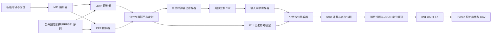

# 架构与扩展接口

本文的系统时钟FSM、同步采样和协议v1约定对应第一阶段，保持不变。第二阶段新增独立高速顶层，复用公共PRBS31、UART及复位模块；MMCM、ODDR、独立相位IOB采样和结果快照架构见[第二阶段工程说明](phase2.md)，实际验证范围见[第二阶段验证记录](phase2_validation.md)。高速路径不使用第一阶段两级同步器采集Q/QM。

## 数据路径

`swcell_fpga_top` 仅处理端口、复位同步和参数传递；`m11_test_top` 集成并编排测试。不同模块分别保存序列、功能模型、比较、记录、通信，便于复用。

## 时钟、复位与时序契约

所有可综合时序逻辑只在系统时钟上升沿工作。`M11_DFF_CLK` 是普通寄存器数据输出，不作为 FPGA 时钟；不创建相关 generated_clock。板级`swc_power_on_reset`利用FPGA配置INIT值启动计数器，默认保持100 ms，再经过两级寄存器同步释放；测试引擎使用同步高有效复位。没有外部复位端口，`swc_reset_sync`保留作未来有外部复位板卡的公共模块。

控制器提供 `step_valid` 和刺激向量；仅在 `step_valid && step_ready` 时接受事务、更新板外驱动和参考模型。随后定时器保持 `ceil(CLK_HZ × STEP_NS / 1e9)` 个周期，在末端产生 `step_done`，作为唯一检查边沿。控制器等待它再推进步骤，因此不会在同一边沿改变下一步骤并比较当前结果。

输入路径为 `SYNC_STAGES>=2` 级 `ASYNC_REG` 寄存器。每步必须满足：

- `STEP_NS>=500`，`SETTLE_NS>=200`。
- `STEP_CYCLES >= ceil(CLK_HZ×SETTLE_NS/1e9) + SYNC_STAGES + 2`。

稳定时间是每步内的最小物理传播预算，并非在 200 ns 处采样；实际比较总在步骤末端。例如本板50 MHz、500 ns、两级同步时每步25周期，在末端比较，前面留出传播及同步余量。指令/握手会进一步延长实际相邻刺激间隔。修改低速参数不会构建新时钟域。

上电先用两个不计数步骤同时初始化两条电路：`DL_EN=1,DL_D=0`；DFF 先 `CLK=0,D=0`，再 `CLK=1,D=0`。这样 FIRST_ERROR 的完整输出向量中也不会因未测试的存储节点而含未知值。每个子测试还独立执行自己的初始化，准备步骤不计入检查次数。

## 独立模型与比较

可综合参考模型只在事务接受时推进状态：Latch 在 EN=1 时更新；Master 在 CLK=0 时更新；Slave 在 CLK=1 时取得已存储的 Master。上升沿取得此前最后一个低相位的 D，而不是同一步骤中其他非阻塞赋值的旧/新混合状态。测试平台的独立外部模型没有系统时钟、序列索引或参考模型状态，只使用三个带传播延迟的电平敏感反馈元件。

输出向量 `{QM,Q,DL_Q}`，检查掩码 Latch=`001`、DFF=`110`。DFF 的每次检查同时覆盖 Q 和 QM；`total_checks` 计采样事件数，不是输出位数。仿真中的 X/Z 通过 case inequality 记错。

## 记录和消息接口

`swc_test_logger` 的 `clear` 开启一项测试；随后每个 `check_valid` 更新 64bit 计数。`error_checks` 每个失败检查只加一；Q 与 QM 各自累计，故两者可同时增长。首次错误快照锁住直至下次 clear，持续错误不会覆盖它。`cycle_number` 是从复位释放起运行的系统周期编号；`first_check` 是本测试内从 1 开始的检查编号。计数器为无符号 64bit 加法，溢出按模 2^64，第一阶段不接近该边界。

记录器 `INPUT_WIDTH`、`OUTPUT_WIDTH`、`Q_MASK`、`QM_MASK` 可参数化。`check_valid`、刺激、实际/预期、mask、mismatch、cycle_number 可作为未来 BRAM 采样缓存的旁路接口；当前不存波形。

`swc_json_reporter` 接受 `request_valid && request_ready` 后锁存全部消息字段，后续不依赖上游保持。字节输出的 `tx_valid/tx_ready` 支持任意 UART 停顿，末字节接受之前不接受新消息。上层等待消息发送完成后再清计数器。UART 完整发送末尾 LF 的 stop bit 后才置 `suite_done`。没有 `$display` 替代硬件 UART；RTL 的 `$fatal` 仅用于 synthesis translate_off 配置检查。

当前 JSON 编码器用固定长度常量串与十六进制字符映射，不综合除十运算，不需要 CPU、AXI 或 BRAM。`MODULE_NAME` 是三字符参数，`test_name` 是三字符输入。UART 默认取最接近目标波特率的整数分频器，构建脚本要求误差 <=2%。

## 添加 M12 / M13

1. 新建 `rtl/modules/m12/`，用独立控制器和参考模型描述该电路；不要复制 UART、PRBS 或记录器。
2. 控制器遵守相同事务接口：准备刺激、握手接受、等待 `step_done` 后推进；准备/初始化步骤明确置 `check_enable=0`。所有寄存器仍使用系统时钟。
3. 用 `swc_sequence_gen` 生成 0/1、0101、0011、00001111 或 PRBS31。`restart` 每测试重置序列，`advance` 每个数据样本推进一次，DFF 的三个检查阶段共用一个数据位。
4. 按新模块映射实际/预期/掩码，复用同步器、比较器和参数化 logger。FIRST_ERROR 当前协议输入 4bit、输出 3bit；更宽模块需要有版本说明地扩展快照字段和 reporter 宽度，不能截断状态。
5. 使用独立编排器实例化公共模块，或在将来增加总测试仲裁器；给 reporter 设置 `MODULE_NAME="M12"` 和三字符测试名。M11 专属 L/F 名称转换位于 M11 编排器中。
6. 在板级封装增加真实 IO；通过参数传递频率/步骤时间，补充实际 XDC 和 CDC 首级匹配。现有构建脚本的源码清单为 M11 显式收集，接入时增加新目录及顶层选择。
7. 新增无内部参考状态依赖的外部行为模型、刺激断言、精确检查次数和故障注入。为 PC 的模块/测试名称校验注册新模块，保留公共数值和保存逻辑。
8. JSONL 必须继续支持发送背压；每测试 START、可选 FIRST_ERROR、RESULT，整套 COMPLETE，避免每检查发送消息。

第一阶段仅比较稳定值；不会发现所有毛刺、亚稳态、主从穿透的短脉冲或真实 setup/hold 极限。功能 PASS 只证明本配置慢速激励下的稳定行为。

## 内部上电复位的边界

`swc_power_on_reset`的计数器初值为0，保持标志和释放流水线初值为1；这些声明初值由Vivado综合为触发器INIT属性，不是仅用于仿真的`#delay`。时钟启动后计满`POR_CYCLES`，两级流水线同步释放复位；默认50MHz下5,000,000+2周期，约100ms。首个时钟之前也保持复位，停止时钟不会提前释放。重新配置会重新装载INIT，运行中暂停时钟后恢复不会重新复位，也不检测电源欠压。

参考：[Vivado 2022.1 UG901，Flip-Flops and Registers Initialization / Initial Values](https://www.amd.com/content/dam/xilinx/support/documents/sw_manuals/xilinx2022_1/ug901-vivado-synthesis.pdf)，说明寄存器声明初值可映射INIT；[7系列UG474启动建议](https://docs.amd.com/r/en-US/ug474_7Series_CLB/Global-Controls-GSR-and-GTS)，说明配置完成时应控制用户时钟下的启动同步。

Phase 2B 继续使用静态 MMCM/ODDR + IOB 采样架构，新增独立双轴扫描、参考比特边界感知的窗口分析和可恢复的PC任务日志；详见 [Phase 2B](phase2b.md)。公共RTL模块继续可复用，主从级参考周期关系保留在M11专属目录。
