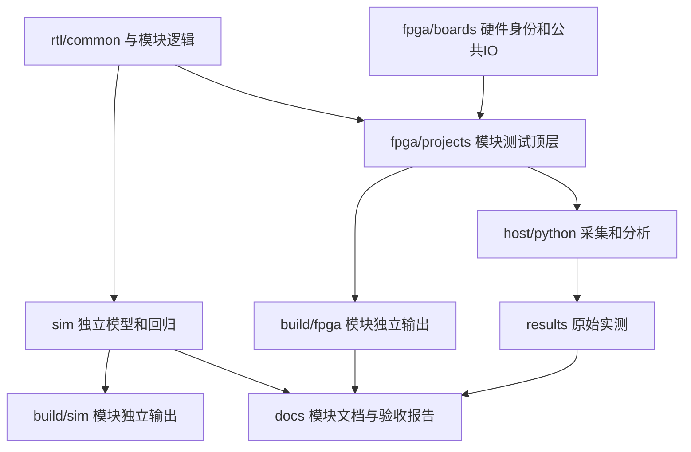

# SwCell总体架构

SwCell同时维护逻辑电路设计、功能参考、仿真、FPGA验证应用和原始实体测试证据。CPU、锁存器等逻辑模块不应绑定某块板卡引脚；同一板卡可运行多个互相独立的验证工程。

- **逻辑层**：公共UART/PRBS/CDC和各模块算法/参考，尽量独立于FPGA原语；M20各冻结版本保留原路径及ISA契约。
- **平台层**：板卡共享时钟/电源/LED/UART约束；模块私有连接留在各工程。M11七路不属于M20的默认引脚。
- **应用层**：M11基础、高速、板卡UART诊断分开；M20原型目录当前仅规划，无新顶层或bitstream。
- **验证层**：Python/XSIM、综合、实现、STA及硬件实测分别记状态；不能以catalog或目录完整性检查代替功能通过。
- **证据层**：Git纳管源代码、正式生成件、关键汇总/图和原始数据SHA。build/results原始数据保留原位置并单独备份；标签冻结当时源码树，不因目录重排移动标签或重写失败记录。

详细目录/模板与迁移政策见[目录规范](repository_layout.md)；[M11原架构](m11/architecture.md)说明UART测试链路，[M20索引](m20/README.md)说明CPU设计与数字验证。当前板卡参考见[板卡资源](../fpga/boards/swcell_k325t/README.md)。
