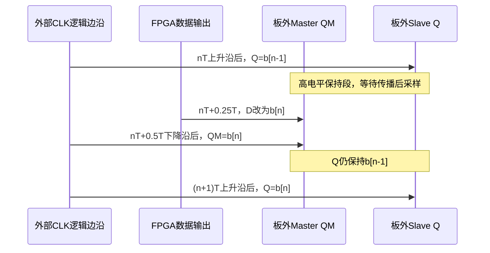
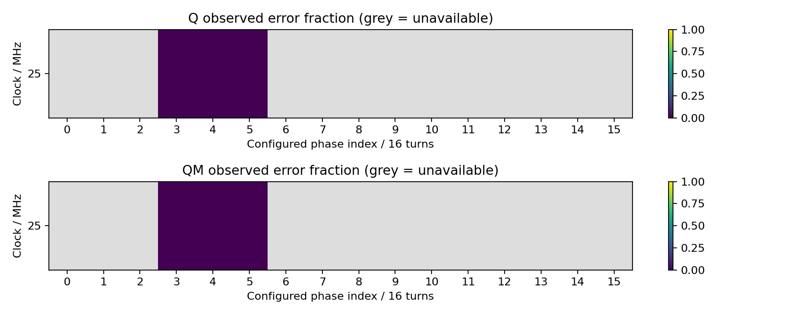
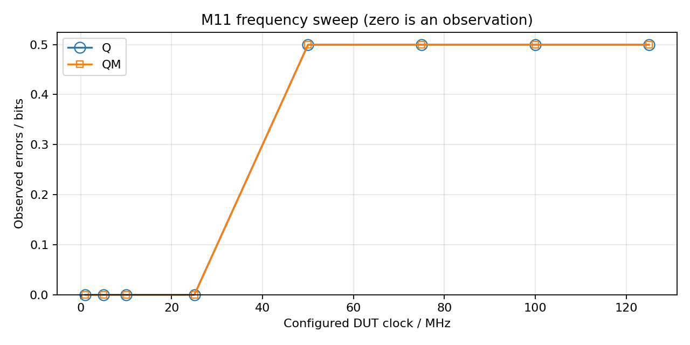
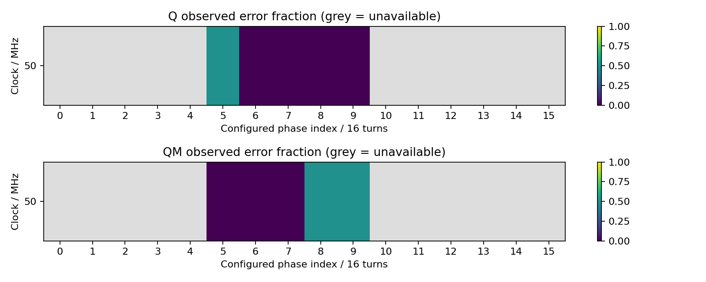

# M11 第二阶段开发与验证记录

记录日期：2026-10-16，Asia/Shanghai。本文记录增量实现、仿真、FPGA内部时序和实际板卡测试证据，**尚不是第二阶段正式验收报告**。第一阶段17项/4742次功能检查正式通过的结论保留，见[原报告](../reports/m11_phase1_20261016.md)。

## 测试内容与意义

第二阶段把“少量低速功能正确”推进到“在明确的频率与采样位置下，每个DFF周期持续检查数据，并可寻找可靠的数字采样窗口”。新增工程使用多bitstream固定配置扫频；每次切换通过JTAG重新配置、等待锁定并重新初始化，不进行运行中的不受控时钟切换。

| 内容 | 实现方式 | 判断依据 |
| --- | --- | --- |
| 长时间稳定性 | 参数设置10^6、10^7、10^8，最高允许10^9；64bit统计 | Q、QM各自累计N次，而不是将两路相加成2N个DFF周期 |
| 数据模式 | 全0、全1、0101、0011、PRBS31 | PRBS31为x^31+x^28+1，种子0x13579BDF，左移、输出旧bit30 |
| 频率扫描 | 1/5/10/25/50/75/100/125/150/200MHz静态时钟计划 | 先验证FPGA配置，负setup/hold不下载、不归为DUT错误 |
| 采样窗口 | Q/QM独立16位置；短扫描后分别选连续窗口中心 | 短测失败不直接认定DUT失效；无窗口报告NO_VALID_CAPTURE_WINDOW |
| 首错定位 | 本地64bit编号、预期/实际、PRBS状态和相位配置 | 结果冻结后通过握手送入50MHz系统域 |
| 数据归档 | 原始UART JSONL、相位/频率CSV、JSON摘要、PNG图 | 原始串口字节与主机产生的UNSUPPORTED/传输异常分开保存 |

通过长PRBS测试说明：在本次板卡、所配置频率、数据模式和采样位置下，观察到的N次数据检查没有错误；不能由此宣布理论BER为零、芯片Fmax已经找到，或未测温度/电压/负载下也具有同样性能。

## 时钟与采样条件

| 参数 | 设置或来源 |
| --- | --- |
| FPGA | XC7K325T-2FFG900C / Vivado part xc7k325tffg900-2 |
| 系统参考时钟 | D27，50MHz；板卡提供值，未独立仪器标定 |
| UART | W23输出，115200、8N1；/dev/ttyUSB1 |
| DUT供电 | 标称3.3V，用户提供；未记录独立电压实测值 |
| DUT时钟 | 1MHz采用50MHz同步时隙；其他采用静态MMCM+BUFG+ODDR |
| 输出电气设置 | 布线后`io.rpt`确认M11_DFF_D/CLK为bank18、LVCMOS33、12mA、SLOW；沿用原板级默认值，未做边沿/信号完整性优化 |
| D更新时间 | 高速为CLK逻辑上升沿之后0.25T；1MHz量化为0.26T |
| Q采样 | 每个周期的可配置位置；预期为此前稳定数据b[n−1] |
| QM采样 | 前半周期预期b[n−1]，后半周期预期新数据b[n] |
| 初始化 | D先强制0；等待锁定、域复位释放、32个D周期初始化及128个base周期预热 |
| 外部延迟 | PCB/157传播、偏斜、负载与输入建立保持预算尚未标定 |

25MHz示例：T=40ns，D逻辑更新在10ns。相位3/4/5分别为7.5/10/12.5ns；相位12为30ns。这些是FPGA逻辑配置时间，**不等同于板外引脚之间实测传播延迟**。Q/QM可选择不同相位；QM也可在高电平保持段检查，而不必一律在低电平透明段采样。



## 自动化验证证据

| 验证 | 证据与覆盖 |
| --- | --- |
| 第一阶段回归 | `build/phase2/phase1_regression_final.console.log`；4个正常/注错场景、替代参数、实际50MHz配置、115200 UART、POR、引脚诊断 |
| 第二阶段整机仿真 | `build/phase2/regression_final.console.log`；UNISIM MMCM/BUFG/ODDR、独立延迟主从模型、实际串行输出解析 |
| PRBS与周期对齐 | 独立位索引黄金模型逐次核对；含真正执行1,000,000次的25MHz仿真 |
| 采样错误与注错 | 正常相位Q/QM零错误；过早Q、过早QM产生错误；Q、QM及两者同时注错各64/64；首错编号/数据/标签检查 |
| 控制/CDC | `build/phase2/controls_final.console.log`；CE暂停、停止/恢复、256bit稳定结果握手、冻结和再次复位 |
| 相位网格 | 同一控制回归检查全部10种频率、各16个Q相位和16个QM相位；包括大分频专用互补输出 |
| 64bit边界 | `build/xsim_phase2/capture64.log`；预置到2^32附近后运行真实加法器跨界、完成冻结和清零；不是运行了40亿次 |
| Python | `build/phase2/python_tests_final.log`；36项检查，包括原串口伪终端集成、Ctrl+C、v1兼容、严格JSON、窗口、异常与CSV；主机编排使用临时目录与mock，验证选窗/长测参数、不支持不下载、退出码、无窗口频率汇总，以及缓存校验/构建中源码变化拒绝，不伪造硬件结果 |

故障注入和过早采样场景中出现CAPTURE_ERRORS是预期检查目标，整套回归的PASS表示这些错误被正确检测，不表示所有注错场景都被判为零错误。

高于25MHz的部分仿真使用0.1ns Master / 0.2ns Slave模型延迟，以验证时钟方案及数字周期对应；25MHz常规延迟模型为2ns/3ns。仿真通过不证明真实74LVC1G157在相应频率下通过。

## FPGA实现与时序检查

最终配置的逐频率setup/hold、DRC及支持情况见下表；完整报告、bitstream哈希与源码指纹保存在各构建目录及`runner_manifest.json`。每种相位和位数都会生成独立实现，表中代表配置不能替代其余配置的时序审查。

代表配置统一为Q索引4、QM索引12、PRBS31、N=1,000,000；单位均为ns。最终源码指纹为`9b5d55a7da483bb33c228ceb81d0fc7dc9cefc9e6cbe8aabdf3acd47e13aa767`。

| DUT配置 / MHz | WNS setup | WHS hold | WPWS pulse | DRC数 | 构建判定 |
| ---: | ---: | ---: | ---: | ---: | --- |
| 1 | 10.549 | 0.098 | 9.600 | 0 | SUPPORTED |
| 5 | 6.589 | 0.108 | 7.000 | 0 | SUPPORTED |
| 10 | 2.067 | 0.108 | 7.000 | 0 | SUPPORTED |
| 25 | 6.473 | 0.108 | 7.000 | 0 | SUPPORTED |
| 50 | 2.175 | 0.108 | 7.000 | 0 | SUPPORTED |
| 75 | 0.856 | 0.108 | 6.267 | 0 | SUPPORTED |
| 100 | 0.525 | 0.108 | 4.600 | 0 | SUPPORTED |
| 125 | 0.128 | 0.106 | 3.600 | 0 | SUPPORTED |
| 150 | -0.190 | 0.108 | 2.933 | 0 | UNSUPPORTED |
| 200 | -0.607 | 0.108 | 2.100 | 0 | UNSUPPORTED |

两组构建流程均完成，基础设施错误0。完整入口：`build/phase2/preflight_verified_low/`与`preflight_verified_high/`；逐镜像报告在`build/phase2/images/*_9b5d55a7da48/`。

150/200MHz的上述代表配置没有生成bitstream：最差路径分别是base域`warmup_reg[7]`到Q采样域的`issued_reg[10]/CE`和`start_state_reg[15]/CE`，只允许1/4周期（1.667ns、1.250ns）传播启动使能，产生−0.190ns、−0.607ns setup slack。**这是具体相位配置的FPGA路径限制，不能当作M11失效，也不能外推其他150/200MHz相位都不支持。** 完整扫描仍应尝试其他相位并分别实现检查。

已有镜像全部检查了hold和pulse裕量；代表配置的`no_clock`、`unconstrained_internal_endpoints`均为0。未提供的板外input/output delay仍在报告中明确可见；因此本表不表示板外STA已完成。

源码归档`build/phase2/source_9b5d55a7da48.tar.gz`经重新计算指纹核对一致，包含用于构建的21个文件。第一阶段已验收bitstream SHA256仍为`dd4e3d2e7cfc6367e7cd8823e733b50f18de5f60fe135c994e7a4c9a171e97b8`。

25MHz/Q4/QM4/亿次代表镜像使用4422个LUT（2.17%）、4734个寄存器（1.16%），没有为波形缓存使用BRAM；准确分类见该镜像`utilization.rpt`。不同静态参数可能使资源和布线略有变化。

MMCM的VCO计划与分频见[工程说明](phase2.md#2-频率产生方案)。初版5MHz直接设置270°曾触发AVAL-139；修正为专用CLKOUT2B/3B后再验证。半周期互补输出在展开时固定选择，没有新增Fabric时钟反相或动态MUX。

内部参考、采样后流水线及64bit比较/统计路径均由STA检查。只将两个待测输入pad→IOB捕获D的路径作为测量接口豁免，另将冻结结果总线约束到20ns最大数据延迟；没有使用全局false-path掩盖内部问题。报告状态为`INTERNAL_TIMING_PASS_EXTERNAL_DELAYS_UNCALIBRATED`，不是板外时序签核。输入采样FF布线后须实际放置在ILOGIC，否则构建失败。

`report_cdc`中的两条原始测量输入和冻结多bit结果总线需要结合结构审查：done先同步，生产端结果不变，再延迟捕获；不能逐位同步递增计数器。UART域固定50MHz，只有冻结结果进入发送模块。失锁/超时输出ABORTED并排除出性能结论。

## 实际板卡数据

### 25MHz：窗口子集与三种计数规模

最终版本先扫描相位3、4、5，Q/QM各4096次；这三个位置都零错误。算法选择Q4/QM4，随后完成100,000,000个有效DFF周期的连续PRBS31检查。这里仅实测3/16个相位，所得窗口是子集内的离散有效位置，不能称为完整眼图。

| 短测相位索引 Q/QM | 逻辑采样时刻 / ns | 每路检查数 | Q错误 | QM错误 |
| --- | ---: | ---: | ---: | ---: |
| 3/3 | 7.5 | 4,096 | 0 | 0 |
| 4/4 | 10 | 4,096 | 0 | 0 |
| 5/5 | 12.5 | 4,096 | 0 | 0 |

相邻逻辑位置间隔2.5ns；三个点首末相距5ns。这不是测得5ns或7.5ns的连续物理眼宽，也不代表PCB/IO延迟已经标定。



图中紫色为本次观测零错误，灰色为未测；数据源为上述主轮次`phase_sweep.csv`，横轴为逻辑相位索引。

| 长测规模（每路） | Q/QM索引 | Q错误 | QM错误 | 结果目录 |
| ---: | --- | ---: | ---: | --- |
| 1,000,000 | 4/12 | 0 | 0 | [`20261016_204704_404151+0800`](../../results/M11/20261016_204704_404151+0800) |
| 10,000,000 | 4/4 | 0 | 0 | [`20261016_204239_606501+0800`](../../results/M11/20261016_204239_606501+0800) |
| 100,000,000 | 4/4 | 0 | 0 | [`20261016_202044_643964+0800`](../../results/M11/20261016_202044_643964+0800) |

三种规模均真实执行，未用仿真或修改结果替代。分别重新配置并初始化，数据序列前缀会重复，不能把各轮N相加冒充一次更长的连续独立序列。百万次Q4/QM12还验证了两路使用不同采样相位。

主轮次：`results/M11/20261016_202044_643964+0800/`，12条完整UART JSONL、14,067原始字节，3条相位结果与1条长测结果；基础设施错误0、观测错误0。raw SHA256：`061b19ad29a4c835655d301191b2328370ef156c507124515b247fe6497ad080`。

主轮次最后使用的bitstream SHA256：`c80f81f5aa6923214b3694cf593d10c380627077367109be47cc56fc06746046`。原始数据离线重生成到`build/phase2/reanalysis_verified25/`，计数/状态/相位与采集版CSV逐项一致。

### 固定Q4/QM12的10频率代表点检查

本轮属于固定采样位置的诊断，不是每频率完整自动选窗。每个可用配置检查Q/QM各1,000,000次。Q4/QM12在高速配置分别为90°/270°；1MHz量化为93.6°/273.6°。

| CLK配置 / MHz | 每路实际检查数 | Q错误 | QM错误 | 状态 |
| ---: | ---: | ---: | ---: | --- |
| 1 | 1,000,000 | 0 | 0 | PASS |
| 5 | 1,000,000 | 0 | 0 | PASS |
| 10 | 1,000,000 | 0 | 0 | PASS |
| 25 | 1,000,000 | 0 | 0 | PASS |
| 50 | 1,000,000 | 499739 | 499739 | CAPTURE_ERRORS |
| 75 | 1,000,000 | 499739 | 499739 | CAPTURE_ERRORS |
| 100 | 1,000,000 | 499739 | 499739 | CAPTURE_ERRORS |
| 125 | 1,000,000 | 499739 | 499739 | CAPTURE_ERRORS |
| 150 | 0 | — | — | UNSUPPORTED |
| 200 | 0 | — | — | UNSUPPORTED |

50–125MHz的两路观测比例均为0.499739；与捕获到相邻周期值的可能性相符，但单凭错误比例不能证明根因。尤其不能据此宣布M11最大频率为25MHz，必须继续调整采样位置验证。150/200MHz没有执行DUT检查，表中的横线不表示零错误。



图仅表示固定配置的实际观测点，连线用于阅读，不是未测中间频率的测量数据，也不是最优采样相位下的性能包络。未支持点不画成零误码点。

完整数据：[`results/M11/20261016_204720_201452+0800/`](../../results/M11/20261016_204720_201452+0800)。8个实际配置完成、4个PASS、4个CAPTURE_ERRORS；raw共28条消息，另外2个主机UNSUPPORTED事件单独保存。基础设施错误0。该诊断流程退出码1，正确表示存在观测错误，而非脚本执行失败。

raw SHA256：`d86c46d51ad7d29d7c139c4255cef02b609273de08af184e13be6141e558717f`；host_events SHA256：`f2e8f0eee6b20e684d81848f0d97b5be04d94bb1abfeee386ace243ac8936708`。

这轮早期主机UNSUPPORTED事件的毫度字段使用0占位，未执行采样；拟测配置以索引4/12及构建参数为准。后续工具已改为填写正确的逻辑配置毫度值；保留原始事件，不回填或伪装为实测相位。

### 50MHz：调整独立采样相位后，亿次零错误

保持50MHz、D相位90°和相同PRBS31规则，仅扫描Q/QM相位5–9。结果如下；每个短测点均完成4096个DFF周期。

| 相位索引 Q/QM | 逻辑时刻 / ns | Q错误 / 4096 | QM错误 / 4096 |
| --- | ---: | ---: | ---: |
| 5/5 | 6.25 | 2066 | 0 |
| 6/6 | 7.5 | 0 | 0 |
| 7/7 | 8.75 | 0 | 0 |
| 8/8 | 10 | 0 | 2067 |
| 9/9 | 11.25 | 0 | 2067 |

**Q在已测位置6–9零错误，QM在已测位置5–7零错误。** 两路共同零错误的相位只有6、7，不足以得到3个共同位置；独立选窗分别得到4点与3点窗口，自动选择Q7、QM6。随后在该组合实际完成100,000,000次PRBS31检查，Q错误0、QM错误0。

| 所选参数 | 数值 |
| --- | --- |
| CLK配置频率 | 50MHz；T=20ns（逻辑推导） |
| D更新 | 每周期+5ns，90°，50Mbit/s；连续相同比特不会翻转 |
| Q采样 | +8.75ns，157.5°，索引7 |
| QM采样 | +7.5ns，135°，索引6，Master高电平保持段 |
| 每路有效检查数 | 100,000,000 |
| Q / QM观测错误 | 0 / 0 |
| 此长测镜像内部WNS / WHS / WPWS | 2.154 / 0.108 / 7.000 ns；DRC=0 |
| 有效检查区间时长 | 约2s，按N/f推导；不含初始化、JTAG、UART与构建耗时 |



图中灰色为未测位置，不能解读为错误或通过。QM在索引8/9进入下降沿后的新数据参考区，此时出错可与Master传播尚未完成相符；相对前半周期保持窗口是“越过右侧边界”，相对新数据却可能仍然采样过早，不能仅用相位索引大小判断物理早晚。

**本次成功的意义**：同一50MHz/D相位下，Q4/QM12比较失败，而Q7/QM6完成亿次零错误，说明固定相位失败不能直接认定外部DFF不能工作在50MHz；自动寻找两路各自窗口并做长测的路径得到实物验证。当前最高“已找到窗口子集且完成亿次零错误”的配置频率为50MHz。

**本次没有证明的内容**：未测完50MHz全部16位置；未完成75/100/125MHz的自动选窗长测，也未穷尽150/200MHz的其他FPGA可用相位。不能把50MHz写成芯片Fmax，或把更高频率的固定位置错误写成DUT固有上限。100,000,000位在50MHz只对应约2s有效数据，不能宣称完成数小时持续运行或温度/电压边界验证。

结果目录：[`results/M11/20261016_210340_077736+0800/`](../../results/M11/20261016_210340_077736+0800)，21条完整UART JSONL、24,710字节，5条短测结果、3条预期的错误快照与1条长测结果；基础设施错误0、长测错误0，自动流程退出码0。

raw SHA256：`63262c282bfc74a02209de42c1a3342dd99afdeb105b53add427bc74dd65e252`。所选长测bitstream SHA256：`0950327e0fc7cadad41c11225cb3e410119157f2a84ccd10fbacf6cbda989fa7`。离线重生成目录：`build/phase2/reanalysis_window50/`。

25MHz亿次测试对应约4s有效数据；50MHz亿次测试对应约2s，两者都属于大量周期的短时稳定性证据。摘要可提供约3/N的每路零错误95%上界，但只在额外的独立平稳Bernoulli误码假设下成立，不能作为理论BER=0或物理可靠性保证。

### 数据边界与历史记录

上述频率、相位均为FPGA逻辑配置值；未用外部仪器标定频偏、绝对延迟或输入输出波形。名义3.3V、电压实测null、温度null。原有SLOW输出边沿及外部负载也是本轮条件的一部分。

早期开发记录`results/M11/20261016_175649_193370+0800/`（25MHz百万次、源码49e6593c8b21）和`20261016_180721_719203+0800/`（25MHz三点+亿次、源码508aebe0c269）均保留；最终数据采用9b5d55a7da48。被中断的175825轮次及单独恢复镜像的重复轮次不混入主统计。历史版本源码归档保存在`build/phase2/`，不改写已有数据。

## 新增和修改的文件

| 组别 | 文件 |
| --- | --- |
| 公共高速资源 | `rtl/common/xilinx/swc_hs_clocks.sv`、`swc_hs_pattern_driver.sv` |
| 公共采样/记录/发送 | `rtl/common/swc_capture_lane.sv`、`swc_snapshot_bridge.sv`、`swc_json_packet_tx.sv` |
| M11参考与控制 | `rtl/modules/m11/phase2/m11_hs_reference.sv`、`m11_hs_engine.sv` |
| 板级与构建 | `fpga/projects/m11/performance/rtl/swcell_m11_hs_top.sv`、`build_hs.tcl` |
| 仿真 | `sim/phase2/tb_m11_hs.sv`、`tb_capture_lane.sv`、`tb_hs_controls.sv`、`tb_hs_clock_grid.sv` |
| 自动回归脚本 | `sim/scripts/run_phase2.sh`、`run_phase2_controls.sh`、`run_all_regressions.sh` |
| Python | 新增`host/python/swcell_sweep.py`、`swcell_hs.py`、`tests/test_hs.py`、`tests/test_sweep.py`、`requirements-analysis.txt`；扩展`swcell_capture.py`兼容v2 |
| 文档 | `docs/m11/phase2.md`、本文；扩展UART协议、README及架构/验证入口 |

第一阶段的控制器、参考模型、UART v1、顶层、引脚XDC和已验收bitstream保持原有用途。高速模块可供M12/M13复用，M11特有的主从逻辑参考保留在模块目录。

## 上板操作与后续边界

```bash
# 在工程根目录；板卡已上电、M11子卡已连接，串口无人占用。
source ~/Software/Xilinx/Vivado/2022.1/settings64.sh
.venv/bin/python -m pip install -r host/python/requirements-analysis.txt
sim/scripts/run_all_regressions.sh

# 先用25MHz执行全16相位，再在选定窗口做1亿次PRBS及其他数据模式。
.venv/bin/python host/python/swcell_sweep.py --port /dev/ttyUSB1 \
  --frequencies 25000000 --important-frequencies 25000000 \
  --important-bits 100000000 --patterns 0,1,2,3,5

# 全目标频率自动扫描；不支持配置明确保存，不下载。
.venv/bin/python host/python/swcell_sweep.py --port /dev/ttyUSB1

# 离线重新生成数据与图表：将本次目录替换为实际路径。
.venv/bin/python host/python/swcell_hs.py results/M11/本次目录/raw.jsonl \
  --output build/phase2/offline_analysis
```

上述命令只经JTAG下载易失FPGA配置，不擦写Flash。完整扫描包含160个短测bitstream及窗口长测，可能需数小时；已有匹配源码指纹/参数的构建缓存可复用。一次子集联调不代表完整扫描已经执行。

本次最终已通过JTAG恢复25MHz/Q4/QM4/100,000,000次镜像，复验仍为Q/QM零错误，记录在`results/M11/20261016_211214_363059+0800/`。该重复恢复轮次不重复计入主统计；测试结束后RTL自动将CLK/D置低并保持完成状态。Flash未擦写，断电后仍需按JTAG流程重新加载。

下一步的硬件工作是补齐实际全相位/全频率矩阵，复验重要点和其他数据模式，并结合采样窗口判读频率范围；真实电压/温度、PCB时序和负载测量留待有来源的标定数据。当前未实施完整setup/hold扫描、温度/电压扫描、以太网、GUI或连续高速波形上传。正式验收确认后，再按报告模板生成第二阶段正式中文图文报告。

## 后续 Phase 2B

75/100/125MHz 的独立双轴全相位扫描及分级可靠性验证继续在 [Phase 2B验证记录](phase2b_validation.md) 中保存，操作见 [Phase 2B说明](phase2b.md)。本页中的历史测量和旧源码指纹保持不变。
