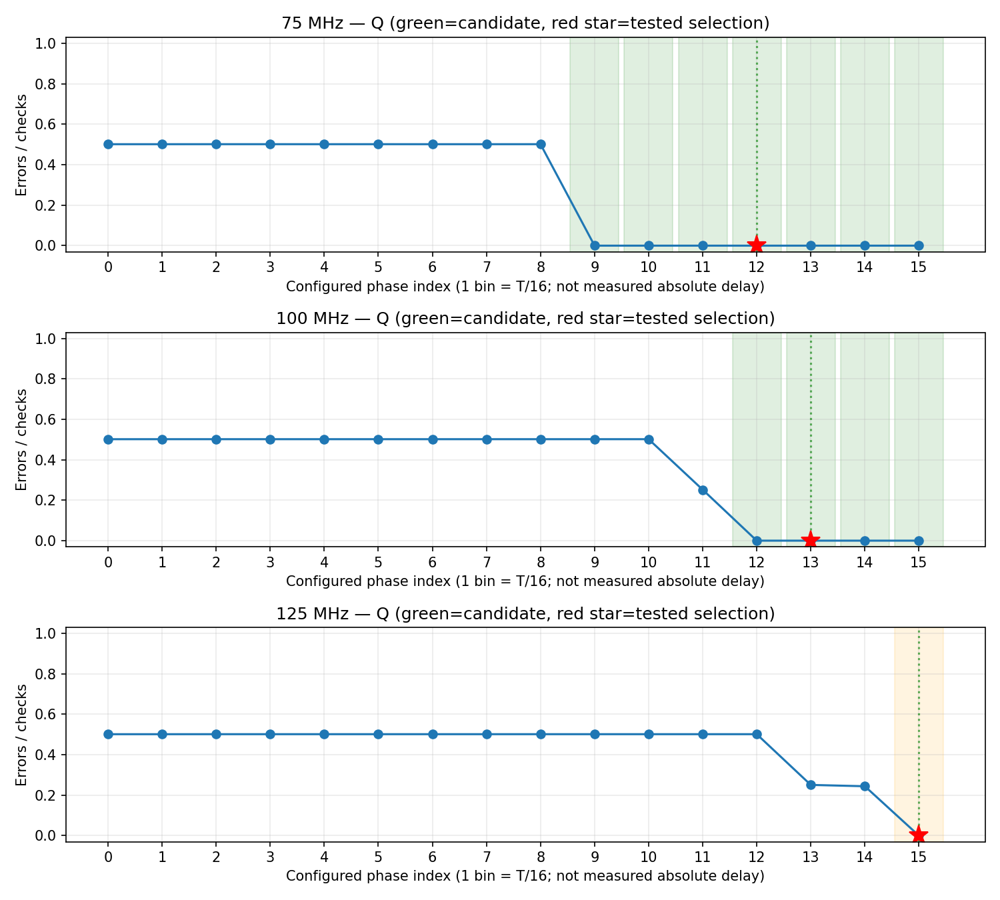
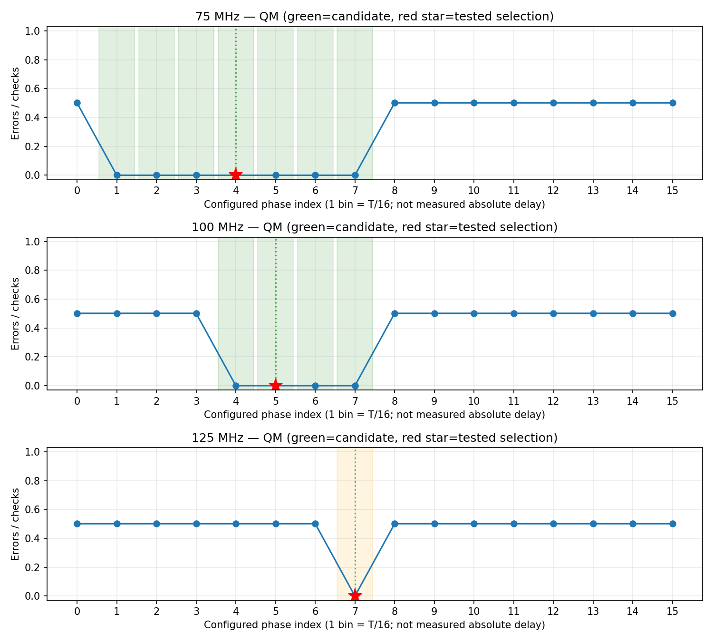
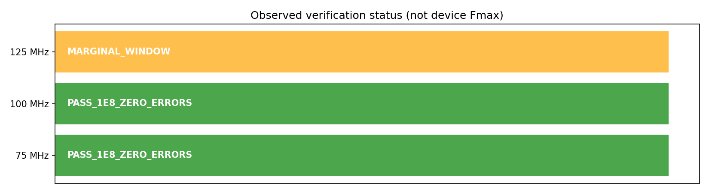

# M11 Phase 2B 实物扫描与验证总结

> 开发和实物测试已完成，等待用户正式验收。本文件为验证记录；不代替用户确认后的正式阶段报告。更新：2026-10-17 06:35:03 +0800。

本轮完成75、100、125MHz的Q/QM独立16点扫描，随后分别完成0101、0011、PRBS百万次和门控亿次检查。**75MHz与100MHz具有连续零错窗口；125MHz虽取得两路各0/100000000，但两路各只有一个零错点，结论保留为MARGINAL_WINDOW。**

按本轮至少3个连续零错网格点的判据，最高已验证亿次零错误频率为**100MHz**；最高观测亿次零错误频率为**125MHz**。两者都不是器件保证Fmax，也不能写成理论BER为零。

## 1. 实测范围与环境

|参数|本轮配置 / 证据性质|
|---|---|
|时间（Asia/Shanghai）|2026-10-16T22:14:35.847444+08:00 至 2026-10-17T02:22:00.486885+08:00；含构建、受控中断和闪退恢复|
|FPGA / 工具|XC7K325T-2FFG900C；part `xc7k325tffg900-2`；Vivado2022.1 / XSIM|
|DUT|M11：U236高电平透明Latch；U237 Master低透明、U238 Slave高透明；本轮性能扫描针对Master/Slave DFF|
|系统时钟|D27，配置50MHz；用于控制、POR及UART，与DUT测试时钟区分|
|接口 / IO|UART `/dev/ttyUSB1`，115200、8N1，TX W23 / RX V20；LVCMOS33、DRIVE12、SLEW SLOW|
|电压 / 温度|名义3.3V；实际电压、温度未测，JSON为null；PCB/157绝对延迟未标定|
|编程方式|静态多bitstream，经JTAG配置；未操作Flash|
|PRBS31|x³¹+x²⁸+1，左移，反馈bit30 XOR bit27，输出旧bit30，seed `0x13579bdf`；有效计数前经过确定性初始化及预热|
|扫描规模|3频率×2轴×16点=96个轴测点，每路每点10000次；每轴独立判断，另一轴有错也继续|
|长测规模|每频率0101/0011各10000、PRBS1e6及1e8；同一组相位，全部两路零错误|

本轮共108个有效采集job、105个独立实现镜像（每频率两轴锚点交集共用一个镜像），保留111条尝试历史。每频率累计每路101340000次检查，其中包括用于定位窗口的有错扫描；**不能将这些检查合计写成全部零错样本**。亿次测试每频率每路单独计数100000000；Q/QM是两路观察，不相加冒称单路两亿比特。

## 2. 时钟生成与周期对应

|DUT时钟配置|MMCM M / D / O|VCO MHz|周期ns|D更新T/4 ns|相位步进T/16 ns|所选Q / QM相位ns|
|---:|---|---:|---:|---:|---:|---|
|75MHz|24 / 1 / 16|1200|13.333333|3.333333|0.833333|10.000000 / 3.333333|
|100MHz|16 / 1 / 8|800|10.000000|2.500000|0.625000|8.125000 / 3.125000|
|125MHz|20 / 1 / 8|1000|8.000000|2.000000|0.500000|7.500000 / 3.500000|

以上频率、相位和数据时长来自RTL/MMCM配置推导，并经仿真检查相对边沿；没有用板外仪器标定绝对时间。MMCM+BUFG生成base、90°数据和两路独立采样时钟；ODDR输出CLK和D，IOB寄存器直接采样Q/QM。没有Fabric组合时钟、运行中不受控MUX、DRP或IDELAY。

D在nT+T/4更新为b[n]，每个有效DUT周期发射一个序列比特，数据更新速率分别为75/100/125Mbit/s；实际引脚翻转率依序列而变。Q全周期期望b[n−1]；QM相位0..7期望b[n−1]，8..15期望b[n]。Q15→0跨参考比特边界不合窗；QM7→8不合窗、15→下一周期0可合窗。采样结果和相同边沿寄存的期望/PRBS标签在下一采样边沿比较，有效标志隔离初始化、流水线和停钟阶段。没有任意延迟参考一拍来制造通过。

高速有效计数期间每个周期检查一次，无第一阶段FSM逐步骤握手开销；POR、锁定、初始化、预热、JTAG下载和UART消息不计入N。主机墙钟耗时与N/f分开列出。

## 3. 实测窗口与分级结果

|DUT频率|Q零错索引 / 点数|QM零错索引 / 点数|所选Q / QM|最终分类|
|---:|---|---|---|---|
|75MHz|9,10,11,12,13,14,15 / 7点|1,2,3,4,5,6,7 / 7点|12 / 4|`PASS_1E8_ZERO_ERRORS`|
|100MHz|12,13,14,15 / 4点|4,5,6,7 / 4点|13 / 5|`PASS_1E8_ZERO_ERRORS`|
|125MHz|15 / 1点|7 / 1点|15 / 7|`MARGINAL_WINDOW`|

窗口包含的**网格点数**并非精确物理窗口宽度；这些窗口均接触参考周期切换边界，`boundary_censored=true`，不能认为两侧物理失效边界都已测到。75MHz/100MHz可选择内部点；125MHz没有可观察的双侧相邻零错裕量，因此亿次记录PASS不覆盖频率层面的MARGINAL分类。

|频率MHz|模式|Q / QM索引|每路有效检查|Q错误|QM错误|有效数据时长s（N/f）|主机耗时s（JTAG/UART）|
|---:|---|---|---:|---:|---:|---:|---:|
|75|0101|12 / 4|10,000|0|0|0.000133|16.508|
|75|0011|12 / 4|10,000|0|0|0.000133|14.936|
|75|PRBS31|12 / 4|1,000,000|0|0|0.013333|22.081|
|75|PRBS31|12 / 4|100,000,000|0|0|1.333333|17.325|
|100|0101|13 / 5|10,000|0|0|0.000100|15.145|
|100|0011|13 / 5|10,000|0|0|0.000100|15.112|
|100|PRBS31|13 / 5|1,000,000|0|0|0.010000|15.081|
|100|PRBS31|13 / 5|100,000,000|0|0|1.000000|15.857|
|125|0101|15 / 7|10,000|0|0|0.000080|15.112|
|125|0011|15 / 7|10,000|0|0|0.000080|15.240|
|125|PRBS31|15 / 7|1,000,000|0|0|0.008000|15.193|
|125|PRBS31|15 / 7|100,000,000|0|0|0.800000|15.600|

所有模式/百万次通过后才执行同组相位的亿次。125MHz的0/1e8只覆盖该相位、该板卡和当前环境的约0.8s有效数据，不能等同长期环境可靠性。

## 4. 图表

下图数据来自本轮 `phase_scan.csv`。纵轴为实测数字错误比例Errors/checks；横轴为配置相位索引，每格T/16，绝非实测传播延迟。绿色为连续零错候选区域、橙色为窄窗口、虚线为候选中心、红星为后续通过长测的选点。网格点间连线只帮助阅读，不代表中间相位已测量。







100MHz Q11、125MHz Q13/Q14的错误比例介于0与约0.5之间，进一步说明应扫描窗口而非用一个固定相位判器件失败。相邻PRBS翻转数量吻合仅作候选诊断，未用它修改期望模型或确定物理失效原因。完整96行逐点计数、首错和SHA见CSV与[任务详情](../tasks/m11-phase2b-20261016.md)。

## 5. 综合、布局布线与STA

全部105个镜像分别综合、place、route，保存routed DCP和报告，内部时序满足后才生成及下载bitstream；本次重新实现结果与旧固定Q4/QM12预检分开。

|频率MHz|独立镜像数|全部镜像最小WNS ns|最小WHS ns|最小WPWS ns|亿次镜像WNS / WHS / WPWS ns|
|---:|---:|---:|---:|---:|---|
|75|35|+1.682|+0.078|+6.267|+1.752 / +0.108 / +6.267|
|100|35|+1.002|+0.047|+4.600|+1.554 / +0.093 / +4.600|
|125|35|+0.407|+0.064|+3.600|+1.538 / +0.092 / +3.600|

- 全部镜像：DRC违例0，`no_clock=0`、`unconstrained_internal_endpoints=0`；Q采样LOC为`ILOGIC_X0Y334`，QM为`ILOGIC_X0Y317`。Clock Interaction未见Unsafe/Unknown/Unexpandable项；关联时钟的数据和参考路径继续STA。
- `no_input_delay=2`、`no_output_delay=6`显式保留。Q/QM外部pad→IOB D是数字窗口测量口，缺少PCB/157 min/max延迟，使用局部例外；UART/LED/D/CLK外部输出延迟尚未标定。**内部STA通过不等于外部IO接口完整时序已关闭。**
- CDC每镜像仍有2项CDC-1（原始Q/QM→IOB）、3项CDC-10（复位组合条件→两级异步置位/同步释放的reset同步器）、512项CDC-15（两路冻结256bit快照），另有4或5项CDC-3 Info随相位关系变化。未隐藏或宣称CDC零告警。
- 结构审查：复位只对`engine/r[b,d,q,m]/reset_pipe_reg[0,1]/PRE`作局部例外；同步器级间Q→D、下游复位与所有数据路径保持计时。done经两级同步，快照再等待额外系统时钟才锁存，源payload保持至重配；总线20ns datapath约束，不逐位同步递增计数器。XSIM含快照/复位/停钟检查，数字仿真不能证明模拟亚稳态MTBF。

逐job时序清单：`build/phase2b/final_timing_audit.csv`；汇总核验：[evidence_audit.json](../assets/m11_phase2b_20261017/evidence_audit.json)。每镜像的timing、clock_interaction、cdc、io、drc、utilization及source_manifest在其build目录，CSV可定位。

## 6. 自动验证结果

|验证层次|命令/方法|结果|证据|
|---|---|---|---|
|SV语法 / elaboration|回归脚本中的xvlog/xelab|PASS|各XSIM编译日志|
|Phase1及原Phase2仿真|`sim/scripts/run_all_regressions.sh`|PASS|`build/phase2b/regressions.console.log`最终`SWCELL_ALL_REGRESSIONS_PASS`|
|新Phase2B独立外部延迟模型|`sim/scripts/run_phase2b.sh`|PASS|三频率×32轴点、实际采样边沿、物理引脚历史参考、早相位/正常相位、整周期错位注入|
|64bit / 控制 / CDC / UART|原Phase2 TB及真实UART串行解码|PASS|含跨2^32进位、CE暂停/冻结、复位、失锁ABORTED、快照与完整JSONL|
|Python最新全部测试|`.venv/bin/python -m unittest discover -s host/python/tests -v`|PASS，52项|`build/phase2b/python_tests_final.log`；本次收尾重新执行|
|旧协议兼容|真实Phase1及旧50MHz JSONL逐行解析|PASS|`build/phase2b/legacy_real_parse.log`|
|本轮离线重新分析|`swcell_phase2b.py --analyze`|PASS|`build/phase2b/final_offline_analysis.log`；96行phase、12行long、3图、summary|
|综合 / P&R / STA / DRC|105个镜像独立实现及最终只读核验|PASS|各镜像报告、`final_evidence_audit.log`|
|实物采集完整性|108个有效job，raw/bit/source SHA、消息首尾、计数与聚合字节偏移复核|PASS|398条完整JSON，531730字节；与数据文件一致|
|频率功能/裕量结论|独立双轴扫描及同相位分级长测|75/100MHz PASS；125MHz MARGINAL|本文件第3节；不合并为三个频率全面PASS|

## 7. 证据与复现

原始目录：`results/M11/phase2b_20261016_reset_sync/`，包含 `raw.jsonl`、`attempts/`、`checkpoint.json`、`phase_scan.csv`、`long_run.csv`、`summary.json`、三张PNG及自动 `report.md`。详见[架构、文件清单、上板命令](phase2b.md)。

可上传的[证据包](../../results/M11/m11_phase2b_20261017_evidence.tar.gz)约5.4MiB，包含本轮全部原始数据、功能源码、105个镜像的文本报告/来源、三份亿次镜像、仿真及Python测试日志。包内`PACKAGE_SHA256.json`记录逐文件校验值，已逐成员读回复核；包外[SHA256文件](../../results/M11/m11_phase2b_20261017_evidence.tar.gz.sha256)用于传输校验。不包含大型routed DCP/波形缓存，也不替代整个工程的异机备份。解包后可离线重新分析，checkpoint中的原机器绝对build路径仅作来源记录。

|证据|SHA256|
|---|---|
|当前FPGA完整源码指纹|`b0209deae54271113fb461148b4a794d467ba2612ed6996ff19f13c1d16fb79b`|
|FPGA21文件归档 `build/phase2b/source_b0209deae542.tar.gz`|`ff5a3c3410c94a313fbbd33c9338d33eca04130e2a1358cf7796e0629a13e35c`|
|本轮 `raw.jsonl`|`bcbcc762a6b4eaed474da83274722a0414112dd39d908ae42b2b14c4e25b4a56`|
|`checkpoint.json`|`2816eb0f2ef4a7705104e7feb12f4f15d88421c311085cd1bb0b20d77853cb10`|
|`phase_scan.csv`|`152c97fda83f38e4bc5f3c7622329505539289ad52f616a72459d5f0eb2fa261`|
|`long_run.csv`|`6f7986c96c03926414ca904b211fe5cabd83063e36a54678d742516d7368b714`|
|`summary.json`|`ff07622e58aa5384af615469110aac4331ffe40804acf0726f713681d62cc947`|

### 各亿次记录与实际镜像

- **75MHz**：`attempts/0039_hundred_million_75000000_12_4_100000000_5_0.jsonl`；raw SHA256 `3674c20cccc3692800daeabe71ef53d74d4bd1d7483209237c944f4dfc95e038`；bit SHA256 `78178b4b2dc2cc9b46730143d0f2f4fa5ef3089b3a2213eb5a89ba08b06f2d7d`；构建目录 `build/phase2/images/f75000000_q12_m4_n100000000_p5_s0_b0209deae542/`。
- **100MHz**：`attempts/0075_hundred_million_100000000_13_5_100000000_5_0.jsonl`；raw SHA256 `abfab15ba0c3840500b44e528105aaf247c67bfee3f625c359509d4f31e3403d`；bit SHA256 `913681e30166ca21049bf9cb12bb6e42a57328be8839ea32d220560a6a6d565e`；构建目录 `build/phase2/images/f100000000_q13_m5_n100000000_p5_s0_b0209deae542/`。
- **125MHz**：`attempts/0111_hundred_million_125000000_15_7_100000000_5_0.jsonl`；raw SHA256 `544f018bab34b36a81fffc24bafd1078df6790b65b7cd42900c0310aa9f5f56c`；bit SHA256 `33981a55fdaa489a3fdbf1d0e8ed4ecf67123f9278bdb99fb3cafe0c247e547f`；构建目录 `build/phase2/images/f125000000_q15_m7_n100000000_p5_s0_b0209deae542/`。

离线复核（不会下载硬件）：

```bash
MPLCONFIGDIR=/tmp/swcell-mpl .venv/bin/python host/python/swcell_phase2b.py \
  --analyze results/M11/phase2b_20261016_reset_sync
.venv/bin/python build/phase2b/final_audit.py
```

需要重测时使用新目录，避免覆写本轮证据；不要对已完成轮次反复下载。完整上板流程见[操作说明](phase2b.md)，只通过JTAG，不写Flash。

## 8. 异常保留与验证意义

本轮111条尝试中108条MEASURED、2条INTERRUPTED及1条闪退遗留STARTED。后三条有对应后续成功尝试，按job_id选最新记录后没有未完成job；不是仍有测试在运行。另有一个0字节孤立attempt文件保留，未计入有效数据。历史状态不为凑齐PASS而删除或改写。

调试经历过复位PRE约束遗漏、受控SIGINT恢复及VS Code闪退；全部保留旧日志。内核曾记录全局OOM杀Chrome，但没有证据确定VS Code闪退的直接原因；并行构建从4降至2，并限制只预构建当前频率，之后完成扫描。最终控制器于02:22正常结束，收尾已核实没有遗留扫描/JTAG构建进程。

本轮证明：现有M11在指定IO、相位和环境条件下，75/100MHz可找到多点数字采样窗口并完成分级零错误检查；125MHz有可重复记录的有限零错选点，但不能证明足够裕量。此前固定相位出现约50%错误不能作为75MHz以上不可工作的结论。工程链路已能自动区分采样位置问题、FPGA时序问题及未完成数据，并保留恢复和分析证据。

后续仍需外部仪器核对CLK/D实际频率、占空比、相位、抖动、边沿质量，测量Q/QM稳定时刻、PCB往返延迟与实际供电/负载。125MHz可在后续授权范围内增加相位分辨率、边界邻点重复和多次重新配置检查。本轮未做绝对tpd标定、完整setup/hold扫描、温压扫描或保证Fmax；也没有覆盖PRBS31完整2^31−1周期。正式阶段报告在用户确认验收后按模板另存，第一阶段已验收报告保持不变。

## 9. 开发诊断历史（不混入本轮结论）

### 复位同步器约束修正（开发诊断轮次保留）

初始 `88e05720f237` 的75MHz/Q1/QM6镜像被STA正确拒绝，WNS −0.586ns。违例为 `stop_reg_inv/C → engine/rq/reset_pipe_reg[0]/PRE` 的 recovery 检查，非比较数据路径。`swc_reset_sync` 已是带 ASYNC_REG 的两级异步置位/同步释放结构，原Tcl遗漏其原始异步复位输入的局部例外。

核对本机 Vivado 2022.1 的 `data/ip/xpm/xpm_cdc/tcl/xpm_cdc_async_rst.tcl`：XPM 同样对进入异步复位同步器的原始复位设置局部例外。本工程只豁免四个 `engine/r[b,d,q,m]/reset_pipe_reg[0,1]/PRE` 端点；同步器Q→D和下游复位/数据路径继续计时。没有对所有寄存器复位端、数据端或时钟组作全局豁免。

旧轮次已中断保留：`results/M11/phase2b_20261016/`，有Q0、Q2、Q3实采记录以及被拒绝的Q1；未作为完整扫描。修正后重新创建独立轮次：`results/M11/phase2b_20261016_reset_sync/`，源码SHA256为 `b0209deae54271113fb461148b4a794d467ba2612ed6996ff19f13c1d16fb79b`。旧源码21个文件已归档，不与新轮次合并统计。

关于结构语义参见 [AMD 异步复位同步器说明](https://docs.amd.com/r/en-US/ug906-vivado-design-analysis/Asynchronous-Reset-Synchronizer)；约束实现以本机2022.1 XPM源码和本工程实际同步器端点为依据。

### 实际中断恢复验证

修正轮次在Q0采集完成后发送SIGINT，保存中断任务并等待已启动构建收尾，再用同目录 `--resume --jobs 4` 恢复。控制台证据在 `build/phase2b/resume_exercise.log` 和 `hardware_reset_sync.resume.console.log`。恢复后检查：Q0仍仅1次尝试且原raw校验值未变；Q1保留INTERRUPTED旧尝试，新建MEASURED尝试并收齐5352字节日志。已完成测点没有重复下载，未完成测点正确重测。构建、串口和JTAG没有同时被两个控制进程占用。
