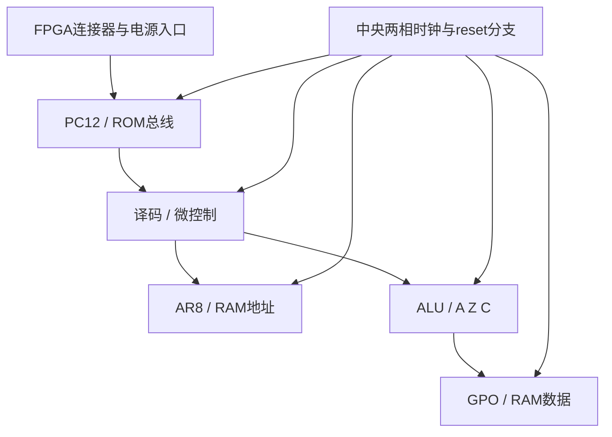

# M20：PCB初步分区与放行条件

2026-11-02，ESTIMATED初步规格；没有制作PCB、封装、网表封装映射或引脚约束。

## 面积与层叠

GW/P6X为六脚小封装，具体外形以原厂SOT363-2/CASE419B-02核对；不把相同pin功能等同于焊盘兼容。按约2.0×1.25mm名义本体，543颗约1358mm²，仅是本体下限；无法据此做一块37mm见方CPU。

工程规划按每157含焊盘、去耦和局部走线占5×5mm单元，543颗约13575mm²；再考虑30%–100%跨区走线/测试/电源空间，约176–272cm²。可研究160×180mm级独立CPU板，连接FPGA背板；不是正式外形或可布通承诺。封装、布局密度和测点可能显著改变尺寸。

|层数|评估|
|---|---|
|2层|大量交叉/回流割裂，风险高，不推荐首块完整CPU|
|4层|信号/地/电源/信号是可研究起点；需保持参考平面，不能让时钟跨分割|
|6层|更多信号通道与参考面，便于543颗/去耦/宽总线分区；优先评审，费用与制造能力另定|

## 分区

共享节点按实际消费者位置布局，而非机械按生成器group分界。PC→ROM→译码环与RAM数据→ALU应尽量短；每位Master/Slave和反馈紧邻。时钟根靠近几何中心，按支路平衡负载和回流；跨片时延差不能只靠线长补偿。

布线优先级：反馈小回路/时钟两相和地回流→reset→PC-ROM环→RAM数据及控制→其它数据/监视。每支clock/关键反馈/QM至少预留高阻低电容探测位置，避免长测试stub。

## 辅助BOM初稿

[core_bom.csv](physical_resources/core_bom.csv)：476功能组合+1trap观察+66存储=543；暂列2个时钟缓冲封装、1个reset缓冲和1个电源监视器（最终数量/料号TBD），543个本地去耦，分区bulk另计。FPGA ROM/RAM/OLED不计入157，但FPGA板及连接器是系统BOM。

投板前必须完成P1/P2/P3测量、缓冲器及负载/skew闭合、真实DFF时序、存储器服务时限、全部3.3V HR银行和供电次序确认、SI/PI与热评审。当前规格可指导原理图和实验分区讨论，不能作为完整PCB制造放行。
