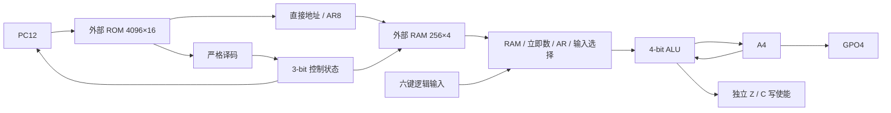

# M20-300 V1 CPU 功能 RTL 设计

更新：2026-10-29（Asia/Shanghai）。冻结 ISA：[`M20-300-ISA-0.1`](M20_300_ISA_FROZEN.md)；本实现的周期 profile：`M20-300-V1-TIMING-0.1`。本文描述实际 `rtl/m20/` 源码，不是 FPGA 布局布线、外部存储器或 157 电路的时序证明。

**ISA 冻结不等于微架构冻结。** 本轮选择候选八状态及普通 2/RAM 5 周期，便于与 V0 逐指令对照。后续允许优化内部执行周期、PC/AR 电路、控制结构；ISA 行为须不变，周期变化须更新 profile、Python 性能参考、差分配置和预算。当前 328 颗仍是未审计的预算，不作为 RTL 优化的验收捷径。

## 1. 模块分工与执行路径

|文件|功能|顺序状态位|
|---|---|---:|
|`m20_pkg.sv`|内部操作/状态常量；不是新的 ISA 编码|0|
|`m20_decoder.sv`|严格检查全部保留字段，产生操作类别、寻址和读写控制|0|
|`m20_alu.sv`|4-bit ALU，独立 A/Z/C 写使能|0|
|`m20_pc.sv`|PC 保持/提交、12-bit word 地址|12|
|`m20_ar.sv`|AR 保持/提交、8-bit nibble RAM 地址|8|
|`m20_control.sv`|当前八状态控制器；只含 3-bit 状态寄存器|3|
|`m20_cpu_core.sv`|连接数据通路、存储总线和组合 retire 观察口；A4/Z1/C1/GPO4|10|
|**合计**|程序可见 30 bit，加内部控制 3 bit|**33**|

数据通路未加入 B/T/IR/LR、硬件栈、CALL/RET、游戏加速器、RAM 数据临时寄存器或硬件周期计数器。PC/AR 的组合增量器分别计算地址，不构成新增的 8-bit 数据 ALU。ALU 的 5-bit 扩展组合线只用于四位进位/借位判定，不保存状态。

这是**行为等价的功能 RTL**：使用 case、加减比较和逻辑运算，由 `always_ff` 描述原生 FF。未来 MUX 结构版本应以本实现及独立 Python 模型为对照；本文件不把 FPGA LUT 数量当作 157 数量。

## 2. 33 位状态及复位

|实际层级|宽度|复位值|更新条件|
|---|---:|---|---|
|`u_pc.value`|12|000|合法指令退役一次；顺序加一按模 4096，或绝对跳转|
|`u_ar.value`|8|00|合法 AR 写指令退役；INCAR 按模 256|
|`a_reg`|4|0|退役且 ALU `a_we=1`|
|`z_reg`|1|1|退役且 ALU `z_we=1`|
|`c_reg`|1|0|退役且 ALU `c_we=1`|
|`gpo_reg`|4|8|OUT 退役|
|`u_control.state_reg`|3|RESET|每个系统时钟更新所选微状态|

`rst` 为同步、高有效；有效边沿恢复全部 33 位状态。总线 `ram_ce/oe/we` 还在组合层被 `rst` 屏蔽，避免等待复位边沿时继续发出新的写请求。复位不连接 RAM 清零。离开复位后先执行一拍 RESET→FETCH_WAIT，单独作为 profile 的 reset1，不混入每条指令。

Testbench 可以在每个场景启动时以层级赋值装入 PC/A/AR/Z/C/GPO 夹具；这仅是验证资源，不是新增 CPU 功能端口。正常 boot 场景从标准复位入口运行，连续执行不得由宿主修正 CPU 或游戏 RAM。

## 3. 状态、时钟边沿与实际周期

下表以“边沿前当前状态→该边沿执行的效果”定义；状态编码为本实现内部约定，不属于冻结 ISA。

|状态/编码|边沿动作|下一状态|PC/数据状态|RAM 控制|
|---|---|---|---|---|
|RESET/000|无指令提交|FETCH_WAIT|保持复位状态|CE/OE/WE=0|
|FETCH_WAIT/001|给当前 ROM 地址一个稳定周期|EXEC|PC/A/AR/Z/C/GPO 保持|CE/OE/WE=0|
|EXEC/010，普通合法|提交一次；分支/IO/AR/ALU/HALT 效果在此完成|FETCH_WAIT，HALT 指令则 HALT|退役后 PC/目标寄存器更新|CE/OE/WE=0|
|EXEC/010，RAM 合法|开始进入 RAM 事务|MEM_SETUP|所有数据状态及 PC 保持|尚无有效 RAM 访问|
|EXEC/010，非法|进入 TRAP，无正常退役|TRAP|PC/A/AR/Z/C/GPO 保持|CE/OE/WE=0|
|MEM_SETUP/011|地址及 ST 数据建立；读操作开始 OE|MEM_ACCESS|PC/A/AR/Z/C/GPO 保持|CE=1；读 OE=1；WE=0|
|MEM_ACCESS/100|ST 在此边沿产生唯一一次写；读适配器可先取数据|MEM_RELEASE|PC/A/AR/Z/C/GPO 仍保持|ST WE=1/OE=0；读 WE=0/OE=1|
|MEM_RELEASE/101|读数据参与 ALU/LD，或完成 ST；此边沿统一退役|FETCH_WAIT|PC 和相关 A/Z/C 更新，AR 保持|WE=0；读 OE 持续到此边沿|
|HALT/110|无动作|HALT|全部功能状态保持|CE/OE/WE=0|
|TRAP/111|无动作|TRAP|全部功能状态保持|CE/OE/WE=0|

普通合法指令从 FETCH_WAIT 到 EXEC 提交需 2 个边沿；RAM 指令依次经过 FETCH_WAIT、EXEC、MEM_SETUP、MEM_ACCESS、MEM_RELEASE，需 5 个边沿。非法指令在 EXEC 进入 TRAP，需 2 个执行周期且不增加退役数。HALT 正常退役一次，PC 先递增，随后停止。

本轮特意将 **RAM 读结果写回安排在 MEM_RELEASE**，而不是先在 MEM_ACCESS 保存中间结果。这样 A/AR 在整个事务中保持，不需要额外的 RAM 数据/结果寄存器；不改变 ISA 或 V0 的 5 周期 profile。ST 写发生于 MEM_ACCESS 边沿，地址/数据还保持完整 MEM_RELEASE 周期后才随退役改变。

## 4. 无 IR 的 ROM 稳定契约

`rom_addr` 直接连接 PC；`rom_data` 直接参与组合译码，核心从不锁存整条指令。PC 仅在 `retire_valid` 的提交边沿改变，RAM setup/access/release 期间不会提前加一。未退役的非法字保持 PC，且译码的 `legal=0` 禁止任何 RAM 总线请求。

后端必须保证当前 PC 的 ROM 字在 EXEC 判断及整个 RAM 事务期间稳定。PC 改变后的 FETCH_WAIT 提供基准等待；本实现没有 ready/WAIT 输入。若实际 NOR 或 BRAM 适配无法满足，应修改后端/时序 profile 并重新验证，不能靠理想零延迟仿真宣称已满足物理 tACC。

CPU 只接收 16-bit ROM 字，没有“地址已加载”输入或 FAULT 状态。仿真填充 FFFF 后，核心看到该编码会 TRAP。有限镜像长度的 UNMAPPED_ROM 仅属于 Python/仿真元数据诊断；不能将核心的实际 TRAP 更名为硬件 FAULT。

## 5. RAM 逻辑接口和后端边界

|信号|意义|
|---|---|
|`ram_addr[7:0]`|直接取指令低 8 位；间接取 AR；有效事务内保持|
|`ram_wdata[3:0]`|当前 A；ST 事务内保持|
|`ram_rdata[3:0]`|后端提供的 nibble，读指令在 MEM_RELEASE 提交边沿使用|
|`ram_ce`|合法 RAM 指令且处于三个 MEM 状态，复位时为 0|
|`ram_oe`|有效读事务，覆盖 SETUP/ACCESS/RELEASE|
|`ram_we`|有效 ST 且只处于 ACCESS；只有一个写边沿|

读写控制互斥；读不产生写，ST 不要求读取 previous-value。OE 持续三个状态仍属于同一条指令的一次逻辑读事务；同步适配器在多个边沿重采样同一地址不增加 ISA 读事务数。仿真监视器为了诊断可观察写前 RAM 内容，但不得计作 CPU RAM 读。

基准异步模型可在地址/OE 后延迟返回数据；同步 RAM 适配可在 SETUP/ACCESS 边沿先读取并保持至 RELEASE。是否支持某个延迟必须由真实仿真说明；这里没有可变 WAIT，超出稳定窗口的延迟属于不满足当前后端契约。真实 x8 SRAM 的高四位及三态方向、NOR 模式、物理 CE/OE/WE 极性、脉宽、建立保持和总线换向仍需专门适配/验证，逻辑接口未绑定板级引脚。

复位只能禁止尚未发出的逻辑写；若复位发生在 ST 的 MEM_ACCESS 写边沿之后、MEM_RELEASE 退役之前，RAM 已完成的写入不会回滚，该条中断指令不会正常退役。V1 不承诺跨复位的事务原子回滚；若外部物理 SRAM 已接受此前的写脉冲，不能通过复位撤销。本轮没有验证真实 SRAM 最短写脉宽或电气行为。

## 6. 独立 A/Z/C 写使能

|指令类别|A_we|Z_we|C_we|
|---|---:|---:|---:|
|LDI/LD、AND/XOR/OR/NOT|1|1|0|
|ADD/ADC/SUB/SBC（含立即数）|1|1|1|
|CMP|0|1|1|
|SHL/SHR|1|1|1|
|MOVA ARL/ARH、IN0/IN1|1|0|0|
|ST、AR 写、跳转、OUT、NOP/HALT|0|0|0|

ALU 用 5-bit 扩展线计算 `A+operand+carry`，进位取 bit4；减法先构造 5-bit `operand+borrow`，C 用未截断比较 `A>=operand+borrow`，结果取低四位。SBC 的 borrow 为 `1-old_C`，不是 old_C。CMP 仅写标志；IN/MOVA 仅写 A。移位 C 取旧 A 的移出位，Z 取四位结果是否为零。

## 7. 组合 retire/debug 接口

`retire_valid` 在普通 EXEC 或 RAM MEM_RELEASE **提交边沿之前**有效，且仅用于合法指令。`retire_pc` 和 `retire_instruction` 此时仍是旧 PC/ROM；`retire_next_pc` 和 A/AR/Z/C/GPO 是该边沿的提交后值。Testbench 在 posedge active 区保存这些组合值，待 NBA 更新后再验证 debug 状态，不会把下一条 ROM 字当成当前退休指令。

`retire_ram_valid/write/addr/wdata/rdata` 描述对应的一次逻辑事务；ST 的实际写边沿早于退役一个周期，但仍属于同一保持中的指令。`retire_instruction_cycles` 给出所选 profile 的 2 或 5，监视器还必须独立计数真实微周期检查，不能只相信这个声明常量。

这些接口全部是导线/组合逻辑，不添加核心 FF。硬件累计计数器、退役指令捕获、CSV/WDB、有效范围、超时和断言都在验证层。`halted/trapped` 由当前控制状态组合导出，不额外锁存。TRAP 没有正常 `retire_valid`；验证层需单独观察异常进入边沿。

## 8. 资源口径和 328 预算风险

仅 33 个功能状态位目前可从源文件逐项精确核对。若未来每普通 DFF 暂按 2 颗 157，基础 storage 为 **66 颗**；这不包括 CE/保持、复位、组合选择、地址增量和译码。

|原候选模块|原 storage MUX|原其它 MUX预算|原合计|V1 已确认/未确认|
|---|---:|---:|---:|---|
|PC12、递增、绝对跳转、保持|24|58|82|12 位状态确认；组合/保持未结构化|
|AR8、递增、写源、保持|16|46|62|8 位状态确认；组合/保持未结构化|
|A4 写源及保持|8|12|20|4 位状态确认；选择/CE未计数|
|Z/C2|4|2|6|2 位状态确认；独立更新控制须审计|
|GPO4|8|4|12|4 位状态确认；保持/输出负载未审计|
|uSTATE3|6|0|6|3 位状态确认；下一状态另列|
|ALU/立即数RAM选择|0|40|40|行为 RTL，未证实40|
|RAM地址选择|0|8|8|组合选择，未结构计数|
|输入银行选择|0|10|10|仅六位逻辑输入；实际同步器另列|
|初始化/复位覆盖|0|12|12|行为复位，未证实12|
|控制器译码/下一状态|0|70|70|最大不确定项之一，未证实70|
|**合计**|**66**|**262**|**328**|**只有状态位数量已精确核对**|

资源分类：A 类为上述核心功能硬件；B 类为 FPGA/仿真 ROM/RAM后端、按键同步、波形/trace、计数器、断言与监视；C 类为物理外部存储器、三态驱动、时钟/复位/电源和 PCB 其它器件。B/C 不得隐藏成“CPU免费能力”，完整硬件 BOM 仍须单列。

六键两级同步若由157实现另计12bit/24颗，复位两级同步另计2bit/4颗；实际器件还需要时钟扇出/复位、SRAM方向、PCB驱动等，不可据此宣布整板328或356颗。V1不做综合/实现，不输出LUT计数，也不把功能RTL当完成的MUX网表。

## 9. 验证入口和未完成物理事项

实际仿真项目/结果见 `M20_300_V1_VERIFICATION.md` 与 `M20_300_V1_TEST_REPORT.md`（由本轮集成生成）。先验证冻结规则，再跑译码/ALU、总线/复位、Python/RTL差分，最后原Pong/Snake ROM。设计文档不自行把尚未运行的用例标PASS。

后续仍需：存储器物理时序及WAIT策略、FPGA上板约束/时序收敛、OLED/SPI与消抖程序、MUX结构化/共享/准确计数、157反馈DFF的真实时序及扇出验证。当前功能实现可作为后续优化版本的逐指令对照，不能代替这些验收。
