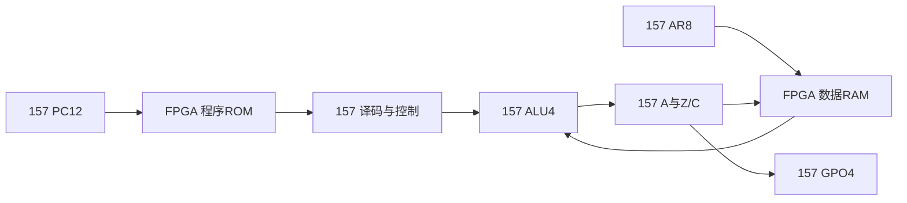

# M20 V2.1：543颗结构正式化

2026-11-02。状态 **VERIFIED：数字功能及结构计数**；真实157电路、STA和硬件尚未验证。用户已接受500+规模，不再以300作为硬限制。ISA为M20-300-ISA-0.1，profile为M20-300-V1-TIMING-0.1。

## 架构与来源

保留V1行为RTL和V2-603结构，新增`rtl/m20/v21/`。`host/python/m20/v21_build.py`源自经过评审的候选生成器，已修正非法EXEC状态低位的多余!trap；按译码、控制、ALU、结果、标志、PC、AR、寄存器D、总线组织显式MUX。未改变游戏ROM、编码/标志/访存语义或2/5周期。



CPU状态33位：PC12、AR8、A4、Z/C2、GPO4、微状态3；无IR/B/T/LR。结构RTL时序绑定原生FF，FF-D无条件更新，保持和同步复位都在MUX网络中。真实映射见physical_resources/dff_bindings.csv；不得把FPGA FF参数当作双MUX DFF规格。

## 接口及计数

正式模块`m20v21_cpu_core`，统一小写端口原语`swc_mux157(s,i0,i1,y)`。原V2使用大写同名原语，两个实现分别编译，不能把不兼容原语定义混入同一库。

|口径|组合|状态折算|总计|
|---|---:|---:|---:|
|完整退役/异常验证接口|477|66|543|
|纯CPU功能锥|476|66|542|

1个额外MUX仅产生trap_event；其它退役端口为实际Q/D、总线或既有节点别名，没有额外功能状态。33个reset选择已含组合列。退役payload仅retire_valid有效时定义，这与既有V2契约一致；halted/trapped及debug状态始终可观察。

保持原ROM/RAM/keys接口和完整retire字段；新增trap_event、debug_legal、debug_next_state供异常测试。调试器读取状态不能参与CPU执行。FPGA只承担存储器/外设/时钟和监视，PC/AR/ALU/译码/FSM均保留在157核心。

## 可重复生成

```bash
PYTHONDONTWRITEBYTECODE=1 PYTHONPATH=host/python \
build/venvs/python312/bin/python -B -m m20.v21_build --output build/m20_300/v21/reproduce
```

将两份生成SV/JSON与rtl/m20/v21/generated逐字节比较。主生成文件应随源码纳管，build中的临时副本不是唯一源码。生成器和审计器独立，审计器不导入生成器；603版保持只读。

后续物理规格入口：[可实现性总览](M20_PHYSICAL_FEASIBILITY.md)。
