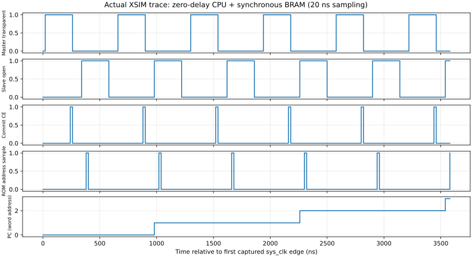
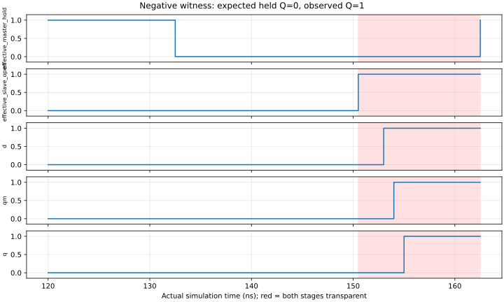

# M20 V2.3 双相时钟与同步FPGA存储联合验证报告

2026-11-03，工程主机b760m。本报告记录实际XSIM数字验证；不代替用户阶段验收，也不是实体157时序签核。正式结果以本目录[v23_resources/verification.json](v23_resources/verification.json)、[逐配置CSV](v23_resources/regression_summary.csv)及SHA索引为证据。

## 本轮证明的内容

保留V2.1的477个组合MUX和33位原D函数，把CPU状态切换为**66个真实反馈MUX**构成的Master/Slave模型，执行原ISA和原Pong/Snake机器码。与V1行为、V2.1原生FF、V2.3原生FF分支及独立Python模型比较。CPU没有增加IR、等待状态或额外状态位，完整接口仍543颗（纯功能542）。

FPGA侧仅服务4096×16同步ROM、256×4同步RAM、keys/GPO与两相调度，没有替CPU进行计算/译码。每核独立存储数组/输出/事务，不能通过共享CPU结果伪造一致。

## 实际配置

|参数|零延迟功能配置|带延迟基准|来源|
|---|---|---|---|
|sys_clk|50MHz|50MHz|仿真`always #10`，非板外实测|
|M/D1/S/D2|240/80/240/80ns|1280/160/1280/160ns|注册调度tick×20ns|
|CPU微周期|640ns，1.5625MHz|2880ns，约347.222kHz|四阶段总长|
|普通/RAM指令|2/5微周期|2/5微周期|冻结V1性能契约|
|ROM/RAM响应|地址采样后2个sys边沿|同左|同步适配器；另叠加各场景IO延迟|
|组合MUX数据延迟|0|0.2/0.8ns交替|数字压力参数，非器件标定|
|组合MUX选择延迟|0|0.3/1ns交替|同上|
|锁存MUX数据/选择|0/0|0.4/0.5ns|同上|
|分支偏移/偏斜|0|Master1、Slave0.5、每分组0.3ns|同上|
|UART/板级时钟/STA|未运行|未运行|本轮纯联合仿真|

基准之外还执行reduced、max_delay、master_late、slave_early，详见[验证矩阵](M20_300_V2_3_VERIFICATION.md)。这些较低仿真频率用于证明时序调度，不是CPU实测Fmax。

## 测试结果与口径

|测试|结果|检查口径与证据|
|---|---|---|
|原V2.1独立基线回归|PASS|本轮重新运行原`run_m20_v21.sh`，87/57331及50521非法终态/恢复|
|V2.3零延迟联合回归|PASS|49指令/22223事件；38游戏/35108事件|
|V2.3带延迟联合回归|PASS|同样87/57331，全状态/微周期/总线/完整RAM相同|
|连续Pong64tick|PASS|4252事件、13223执行微周期，读924/写649；两种配置均匹配|
|连续Snake64tick|PASS|18778事件、65225执行微周期，读5266/写3957；两种配置均匹配|
|全部非法编码实际终态|PASS|15015合法/50521非法；50521次真实TRAP保持、50521次复位后执行NOP|
|存储/复位专项|PASS|零/带延迟分别7组；pending写取消、已写保留、读/OUT/HALT、重复写、TRAP/FFFF/恢复|
|调度器|PASS|5次单步，4阶段分别发起停钟，不对称死区3/5 tick|
|CPU单步|PASS|12微步；2/5profile、ST仅1次、停钟33位不变、HALT继续步进无副作用|
|指定短路径压力|PASS|5场景×6配置=30场景/72事件；含原历史SUBI3001的A3→C向量|
|实际重叠穿透见证|PASS（负测有效）|原应保持Q=0，重叠后观察Q=1；有效相位互斥fatal另一次触发|
|错误ROM/RAM窗口|PASS（负测有效）|ROM300ns触发Master开窗变化fatal；RAM200ns触发响应setup fatal|
|独立结构审计/重生成|PASS|477/33/66/543；逐pin/D/Q/QM一致，临时生成与正式文件字节相同|
|全Python单测|PASS|123项（原113+V2.3新增10）|
|综合/布局布线/STA/硬件|NOT_RUN|本轮没有新板级工程或实物测试|

57331=57314次退役+17次异常，不因四份RTL或两轮配置而宣称单一运行翻倍。全非法专项另计。原87场景的有效执行微周期为166844；TB的`microcycles`观察计数还包含147个指令套件终态保持周期，不能混作软件执行周期。原场景的历史memory_mode字段只保留来源标签，本轮**全部使用同步适配器**。

## 实际波形

数据来源：最终XSIM `zero/instructions/timing_trace.csv`，20ns采样；显示Master透明与Slave更新隔开、PC在提交阶段改变、同步ROM在关闭Master期间取新指令。图不是示意手绘。

数据来源：实际事件`penetration.csv`，时间单位ns。150.5–162.5ns为模型有效双透明区；D在原始提交之后改变，QM/Q仍被改变，说明模型确实能表现穿透。开启检查时150.501ns报告`V23_PHASE_OVERLAP`，原始日志保留。

## 验证意义与边界

本轮将“477组合+33理想FF的数字正确性”推进到“477组合+66透明反馈MUX和同步FPGA存储窗口”的完整执行验证。原游戏机器码不改，2/5微周期不改；没有发现需要插入CPU等待状态的功能冲突。接口服务顺序、主从安全交接、停钟/初始化和单写契约可作为下一步原理图时序设计输入。

这不是物理NC7SZ157/LVC157的setup/hold、亚稳态或Fmax证明。未计入真实负载、PCB、供电/温度、缓冲器与布线的污染/传播分布；不是模拟SPICE或板外测试。本轮不增加器件选型、PCB和外设开发。

## 证据、恢复及已修复问题

最终原始目录：`build/m20_300/v23/regression_r6/`。旧基线复跑：`build/m20_300/v23/v21_baseline_20261103/`。新摘要/波形在`v23_resources/`；原始日志、CSV、WDB保留原位置，通过[evidence_sha256.csv](v23_resources/evidence_sha256.csv)校验。源码快照在[source_sha256.json](v23_resources/source_sha256.json)，补充交付清单见`delivery_manifest.json`。

开发失败证据保留：dev_r1为漏连调度器reset而elaboration失败；dev_r2为夹具强制父级Q后释放产生X。分别修复连接、改为在停钟时驱动D并按真实透明/关闭序列加载初态。r4/r5为中间已通过版本；最终结果不借用它们为后加修改背书。重叠/存储负测中的fatal是预期错误，不是正向回归失败。

独立审计与原284文件SHA核对保证旧V1/V21/ISA/汇编/历史证据不被覆盖；文档入口/任务进度更新单独列明。没有远程操作，没有移动旧tags。本轮源码及小型证据走本地Git暂存/审阅流程，未擅自创建新commit。

后续接口设计必须遵守[两相时钟与FPGA存储器接口时序契约](M20_300_V2_3_FPGA_MEMORY_TIMING.md)。真实时钟分发、往返延迟与DFF建立保持仍需硬件标定；本任务到此停止。
