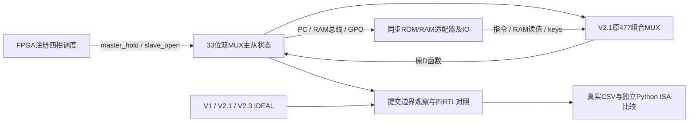

# M20 V2.3：双相锁存器联合仿真架构

2026-11-03。目标是证明冻结的CPU逻辑能在真实透明/保持模型及同步FPGA存储服务下运行。当前验收结果见[测试报告](M20_300_V2_3_TEST_REPORT.md)；本文的仿真时基和延迟不是板外测量。

## 核心保持不变

V2.1的ISA、477个组合MUX节点及逐pin连接、33位D输入函数保持。`v23_build.py`只将状态绑定独立变换到新目录，`v23_audit.py`不导入生成器，独立比较全部组合网络、D/Q/QM映射，拒绝隐藏FF/额外逻辑和伪造计数。正式旧文件不覆盖。

|实现|状态实现|核心完整口径|用途|
|---|---|---:|---|
|V1|原生FPGA FF|非结构计数|冻结行为参考|
|V2.1|33个原生FF，477组合MUX|543等价|冻结结构参考|
|V2.3 `IDEAL_FF`|33个原生FF，原D函数|543等价|验证状态层切换|
|V2.3 `TWO_PHASE_LATCH`|33×2显式反馈MUX，核心无原生FF|543实体MUX模型|实际透明/保持联合仿真|

543=477+66；剔除一个trap_event观察MUX为542。检查器计数器、调度器、FPGA存储器和IO属于验证/服务层，不加入CPU预算，也不帮助CPU译码或执行。没有IR/B/T或额外CPU状态。

## 每位主从电路

`Master.QM = master_hold ? QM : D`；`Slave.Q = slave_open ? QM : Q`。两级分别用`swc_mux157_v23`实例实现，不用FF或always_latch替代。反馈可保持未知上电值；只能由确定的透明/关闭序列初始化。延迟模型分别作用于MUX数据输入、选择输入和相位分支，能够表达两级同时透明时的数据穿透；不表达模拟亚稳态、内部晶体管和可信的器件污染延迟。

33位低到高依次PC12、AR8、A4、Z、C、GPO4、FSM3。所有位只有原D网络驱动，Master/Slave模型的检查使能只控制观察断言，不改变数据路径。

## 四阶段与提交

|阶段|master_hold|slave_open|允许行为|
|---|---:|---:|---|
|M|0|0|Master透明，组合结果建立；CPU可见Q保持|
|D1|1|0|Master已关，双方保持|
|S|1|1|Slave更新CPU可见Q；Master保持|
|D2|1|0|双方保持；结束后进入下一M或安全停钟|

输出由同一sys_clk的寄存器产生，不以组合译码直接驱动物理相位。`commit_ce`为M关闭系统边沿的预边沿使能；`commit_clk`仅供参考CPU的仿真观察时钟，不能据此在板级复制Fabric时钟域。真实核心状态在S阶段更新，比较在S阶段指定观察点执行。断言在各位**延迟后有效选择输入**检查互斥；Q改变时检查Slave确实打开。

`stop_request`或撤销run完成当前完整四阶段后停在双方关闭状态；`step_request`从停钟执行**一个微周期**，普通指令需要2步，访存5步。停钟不暂停在透明窗口。复位调度器时只保证相位关闭，不保证未知锁存器自动清零。

## 确定性启动

1. 外部rst置1，调度器从双方关闭状态开启M→D1→S→D2；本平台执行两个完整复位周期，确认33位全部已知且与参考复位值一致。
2. 保持ROM正确初始化；rst释放，执行原有RESET→FETCH_WAIT的独立入口微周期。
3. 双方关闭时prime同步ROM，等待返回；开始正式计数。CPU复位不清外部RAM。
4. 运行中rst立即屏蔽总线；同步状态更新仍通过完整主从序列。已完成的RAM写不回滚，待提交写取消。

原87场景包含非零初态夹具：只有停钟时通过各位D及透明/保持序列加载Master/Slave，并对参考寄存器加载同值。夹具不直接强制Q，不参与执行。Pong/Snake冷启动与连续64tick走实际复位，完全不使用非零状态夹具。

## 时基及参数

sys_clk仿真周期20ns，即50MHz；不代表已建立板级工程。零延迟M/D1/S/D2为12/4/12/4 tick，微周期640ns；带延迟基准64/8/64/8 tick，微周期2880ns。普通/访存仍2/5微周期，墙钟时间随相位配置改变。ROM/RAM延迟、IO服务均在微周期内部消化，没有插入CPU等待状态。

所有时序参数和边沿对应关系见[存储接口契约](M20_300_V2_3_FPGA_MEMORY_TIMING.md)。不修改原`M20-300-V1-TIMING-0.1`的指令微周期口径；CPU微周期频率不是sys_clk频率，也不是指令吞吐率。
