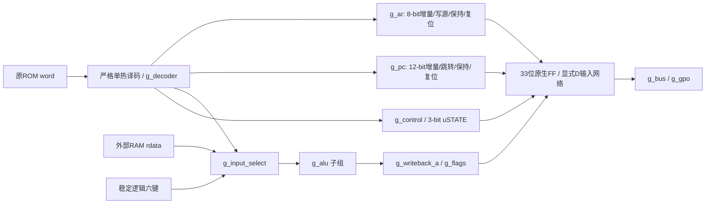

# M20-300 V2：可计数157结构实现

日期：2026-10-29（Asia/Shanghai）。冻结ISA保持`M20-300-ISA-0.1`，周期保持`M20-300-V1-TIMING-0.1`。V1全部功能源码和原始证据作为只读基线，V2在新目录增量实现；不创建板级工程、引脚、bitstream或外设连接。

## 1. 设计与产物

|文件/目录|用途|
|---|---|
|`rtl/m20/v2/swc_mux157.sv`|唯一单通道157计数原语|
|`host/python/m20/v2_muxlib.py`|显式MUX有向无环图，基本逻辑/加法/递增的结构构造|
|`host/python/m20/v2_alu.py`|四位加减/逻辑/移位及独立写使能构造|
|`host/python/m20/v2_build.py`|严格译码、各状态数据通路、总线/控制构造及确定性SV/JSON生成|
|`rtl/m20/v2/generated/baseline/`|未启用全局CSE的结构基线：CPU、单元ALU、单元decoder，各SV+连接JSON|
|`rtl/m20/v2/generated/shared/`|完全相同构造启用全局MUX节点共享后的结构网表|
|`host/python/m20/v2_audit.py`|独立解析SV/JSON、状态/连接审计、逐模块CSV/MD和拓扑统计|

生成器中的Python算术仅在构造时计算索引/常量，不在运行时替CPU做运算。生成SV中的组合逻辑只有`swc_mux157`实例、常量和接线；时序部分只有无条件`always_ff @(posedge clk) Q <= D`。没有行为`+/-`、关系比较、case译码、隐藏LUT/ROM或专用游戏运算器。



各功能由独立Python构造函数与语义group维护，生成SV保留`g_decoder/g_pc/g_ar/g_alu_*`等generate层级。采用同一CPU内的静态组合图，是为了跨组公共节点只实例化一次；实例清单仍保留唯一层级、pins、归属和复用请求。ALU/decoder另生成独立模块做穷举单测，**不会把这些测试副本再加到CPU top计数**。

## 2. 原语及基本逻辑的实际成本

设`M(S,I0,I1)=S?I1:I0`，每个显式实例就是一颗SN74LVC1G157等价。物理脚号/电气参数本阶段不绑定。

|功能|MUX构造|没有可共享节点时的成本|
|---|---|---:|
|接线、tie0/tie1|直接连接|0颗；真实电源/接线另属PCB|
|NOT a|`M(a,1,0)`|1|
|a AND b|`M(a,0,b)`|1|
|a OR b|`M(a,b,1)`|1|
|a XOR b|`M(a,b,NOT b)`|2；已有同一NOT可复用|
|按位选择|每bit一个`M`|等于所选位宽|
|固定一位移位|位接线＋补0|移位线本身0；选择其结果/更新标志仍计数|
|与常数相等|需要的反相信号＋literal AND链|全部由上述MUX构造，保留位检查不免费|
|四位零检测|OR归约后NOT|全计入实际实例；允许复用已有节点|

单bit全加器使用`p=a XOR b`、`sum=p XOR carry_in`、`carry_out=M(p,a,carry_in)`，连接四级产生四位结果和进位。SUB/CMP选择反相operand、初始carry=1；SBC初始carry=旧C；ADC初始carry=旧C。由此得到`A + ~B + C = A - B - (1-C)`，C符合冻结ISA的无借位定义。没有8-bit数据ALU或额外中间寄存器。

两版均只进行三种基本构造简化：selector是常量、两分支相同、`M(S,0,1)`直接成为S接线。每次简化留有原因清单，实际不再发射MUX实例；**`M(S,1,0)`仍是NOT，不免费**。shared再对完全相同`(S,I0,I1)`做hash-cons，重复请求引用同一节点；不利用FPGA免费输入反相，也不按扇出重复计节点。

## 3. 数据通路与33位状态

|功能组|state bit|结构安排|实际组合MUX baseline→shared|
|---|---:|---|---:|
|ALU|0|单个四位加减通路、逻辑/结果选择、独立A/Z/C写使能|134→107|
|A写回|4|写使能＋保持＋同步复位|9→9|
|Z/C写回|2|两个独立使能，不随A无条件更新|6→6|
|PC|12|显式12位递增、绝对跳转、保持/复位|74→74|
|AR|8|显式8位递增、立即数/ A写源、保持/复位|79→79|
|GPO|4|OUT时选择A，其余保持/复位|9→9|
|译码|0|全部保留字段严格检查，生成有效单热操作|264→169|
|微状态|3|原八状态转移，不增加状态/周期|60→47|
|输入选择|0|立即数、RAM、AR半字及两键银行|20→20|
|RAM地址/控制|0|直接/AR地址、CE/OE/WE和reset屏蔽|17→17|
|**合计**|**33**|**保持30＋reset33已包含在组合列内**|**672→537**|

30个软件数据状态位具有显式保持选择；uSTATE三位每拍更新到next-state，HALT/TRAP由next-state固定点保持，因此没有再造3个冗余CE选择。33位均有显式复位选择。原生FF不含隐式CE/reset；按本任务规则，真正CPU storage另折`33×2=66`颗157。

core直接把严格译码的单热信号交给ALU，避免先编码内部op6又重译码。单独ALU/decoder模块保留V1的op6接口做测试。单热和加减通路复用是两版共同的初始实现方案，不计为后续CSE收益；baseline不是刻意把所有表达式复制到最差规模的网表。

## 4. 控制、总线和退役契约

保留V1八状态：RESET、FETCH_WAIT、EXEC、MEM_SETUP、MEM_ACCESS、MEM_RELEASE、HALT、TRAP。普通指令EXEC边沿提交；RAM指令在MEM_RELEASE提交，ST实际写只在MEM_ACCESS边沿一次。无IR，PC/ROM及A/AR/flags在RAM事务期间保持。复位不清外部RAM。

retire/debug为接线观察，不另加功能门或状态。投影使用实际FF-D输入，在`retire_valid=1`时与V1完全相同；无效时的retire payload/ram-valid等sideband不承诺同V1的无意义电平。TB只在握手有效时比较它们，仍在每周期比较真实架构状态和总线；Python原预期未改。

核心功能根是FF-D和物理ROM/RAM总线输出。生成器及独立审计都确认所有被计数节点可由这些根到达，观察口不偷偷增加逻辑；正常状态/debug线路直接使用原生FF的Q。没有硬件FAULT状态：实际ROM未加载区FFFF仍是TRAP，范围元数据只在测试层。

## 5. 优化范围与物理边界

本轮只实施O1：全局相同MUX节点/反相复用。组合672→537，等价总数738→603；状态仍33、实际周期仍2/5，拓扑最大MUX层数仍50。未更改PC/AR时分复用、微状态或ISA，不把未实施方案写成节省。

当前生成的组合逻辑均可展开为本原语，不存在无法计数的行为运算。**但真实双MUX反馈DFF尚未实现**；原生FF仍用于FPGA。DFF按2颗的折算不是物理setup/hold、主从交接、时钟负载、复位脉宽或电气驱动证明。最大功能pin负载34来自rst，内部MUX输出最高负载21（两版均如此）；共享改变局部负载分布，真实板卡可能需要额外缓冲。

RAM/ROM本体、六键/复位同步、外部总线方向/三态、时钟/驱动/供电去耦及FPGA调试资源均另列，不混入603颗核心逻辑数。详见[精确预算](M20_300_V2_MUX_BUDGET.md)。

## 6. 生成与重新核对

```bash
PYTHONDONTWRITEBYTECODE=1 PYTHONPATH=host/python \
build/venvs/python312/bin/python -B -m m20.v2_build \
  --output build/m20_300/v2/reproduced
```

本轮12份SV/JSON隔离重生成与版本目录逐字节相同，证据`build/m20_300/v2/regeneration_check.json`。维护时先改构造源码、生成到独立目录检查diff，再明确更新结构网表并重跑审计和三方回归；不手改生成SV、不改V1来迎合V2。
