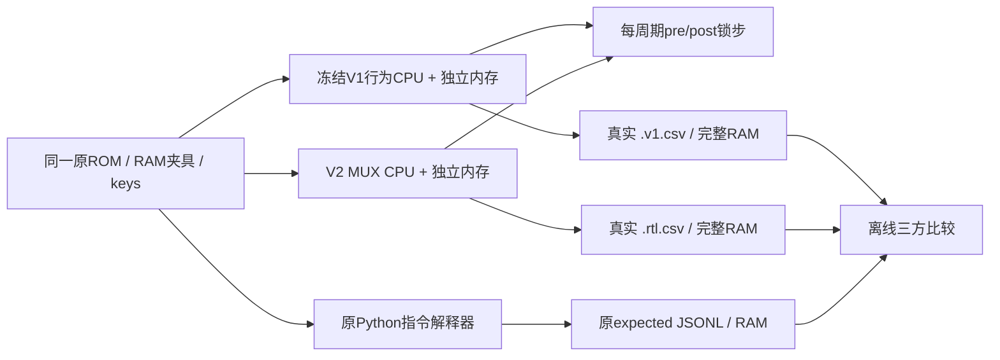

# M20-300 V2：三方功能等价与资源审计方法

更新：2026-10-29（Asia/Shanghai）。[结果报告](M20_300_V2_TEST_REPORT.md)记录实际运行，不以Python图自检或生成器计数替代XSIM/独立审计。

## 1. 基线保护

V2开始前读取原V1的`verification.json`及32份源指纹，随后将原源码、冻结规则、游戏、全部原V1证据和旧工程文件共1191项建立SHA保护，存于`build/m20_300/v2/baseline.json`。原`build/m20_300/v1/`的848份证据不覆盖、不删除。小型`v1_source_baseline.tar.gz`只存源码快照，不冒充完整证据备份。

实际复跑原入口：

```bash
M20_OUTPUT_DIR=/home/boksop/swcell/build/m20_300/v2/v1_recheck \
sim/scripts/run_m20.sh
```

此时实际86项Python/87CPU场景通过；所有新结果落入新目录。V1的RTL、Python解释器/汇编器、Pong/Snake ASM、旧测试/Tcl/规则和原验证数据均保持。

## 2. 独立V2回归入口

```bash
M20V2_OUTPUT_DIR=/home/boksop/swcell/build/m20_300/v2/v2_recheck \
sim/scripts/run_m20_v2.sh
```

使用现有Python3.12与Vivado Simulator2026.1.1。`M20_VIVADO_BIN`、`SWCELL_PYTHON`可显式配置；脚本不综合/实现、不建板级工程。`M20V2_OUTPUT_DIR`与原V1的`M20_OUTPUT_DIR`不同，误设旧V1目录及其子目录会在写入前被拒绝。

先运行baseline所有单元/CPU/游戏，再编译和运行shared，分别在自己的xsim目录使用同名V2模块。每步检查工具退出码和显式PASS标记；XSIM的“fatal但退出0”不会伪装通过。最终必须`M20_V2_REGRESSION_PASS`且返回0。

默认目录是`build/m20_300/v2/regression`；本轮该目录保留首轮elaboration失败，因此复跑应使用新目录。已通过的权威结果在`build/m20_300/v2/regression_r2/`，不要覆盖它来隐藏失败。

## 3. 三方对照，不改预期



`v2_verify.py`调用原V1的prepare/compare，不修改它们。原49指令/38游戏场景、22223/35108事件保持不变。每版保存ROM4096word、RAM256nibble、逐事件keys、预期JSONL及预期RAM；开始/结束时对全部输入和预期做哈希检查。

V1与V2在同一TB中真正执行，各有独立ROM/RAM。运行期没有Python推进游戏状态，没有TB回写游戏RAM或CPU寄存器；CPU夹具只在reset启动边界装入，正常boot从标准复位值和脏RAM开始。

`*.rtl.csv`与`*.v1.csv`均由SV `$fwrite`实际采集。Python先将V2与独立指令模型比较，再将真实V1/V2逐事件及全部最终RAM比较，不制造RTL输出。两份CSV独立保留，便于追查共同条件错误。

## 4. 全部检查层次

|层级|检查内容|实际范围|
|---|---|---|
|原语|`Y=S?I1:I0`真值|每版8向量|
|译码|V1/V2与独立bit规则|每版65536 word，15015合法/50521非法|
|ALU|V1/V2与独立整数数学oracle，独立A/Z/C写使能|每版32768向量；全部64内部op及四位A/operand/C|
|存储/reset|active-WE复位屏蔽、已写不回滚、RAM保持、HALT/TRAP恢复、延迟/同步读|每版7组|
|CPU指令|架构状态、ROM、总线/事务、PC/AR边界、实际单条/累计周期、终态|每版49场景/22223事件|
|游戏|原ROM boot、全部定向边界、各连续64tick、63食物探测/64封顶/重启和内存模式|每版38场景/35108事件|
|完整RAM|V1=V2=Python，含scratch与未访问地址|每场景256nibble|
|图构造单测|基本逻辑/4-bit加法/4/8/12-bit递增全空间、两版ALU数学oracle|7项Python测试，辅助而非XSIM证据|
|资源审计负测|改pins/虚报数量/假共享/隐藏逻辑/额外FF/组合环/错误原语均拒绝|5项Python测试|

65536穷举是译码单元，不能写成逐个时序执行了50521个非法指令；CPU差分中有16种代表非法字加未加载FFFF，共17次TRAP。32768也只属于组合ALU单元，不表示全CPU全部可能状态已形式证明。

TB保存旧PC/指令及提交投影，posedge后核实实际提交；retire无效时的payload不属于有效事务，不以其无意义电平差别判失败。真正架构状态、RAM地址/数据/控制和reset屏蔽仍逐周期比较；有效retire所有字段精确比较。

独立计数的实际执行周期与原2/5profile一致：指令套件51193、游戏115651微周期。锁步计数还包含指令套件49场景各3个终态静止检查周期，因此51340；游戏均在观察边界停止，锁步为115651。不能把多出的147个终态观察周期写成指令变慢。

## 5. 资源审计另设独立证据链

`v2_audit.py`不导入构造器或其stats。它解析实际SV每个MUX实例及S/I0/I1/Y，核对连接JSON、唯一原语、端口/输出、原生FF和功能根。拒绝未计数行为逻辑/其它原语/组合环/额外状态，核对每bit显式CE保持与复位，确保debug不增加功能成本。

```bash
PYTHONDONTWRITEBYTECODE=1 PYTHONPATH=host/python \
build/venvs/python312/bin/python -B -m m20.v2_audit \
  --output docs/m20/v2_resources \
  --markdown docs/m20/M20_300_V2_MUX_BUDGET.md
```

输出`module_budget.csv`、逐实例`gate_instances.csv`、`audit.json`和预算Markdown。报告写明组合与DFF折算分开、CE/reset是组合子集、共享归属一次、单元副本不重复计入top。拓扑深度/内部负载为数字网络指标，不是物理ns或可用频率。

12份结构SV/JSON还在隔离目录重生成逐字节比较，`regeneration_check.json`关联具体内容。Python全量现98项通过，但资源结论来自独立SV解析，功能结论来自真实XSIM，两者不能互相代替。

## 6. 失败、证据与边界

首轮真实xelab失败原因为实例/net同名，修复实例名`u_m...`后重生成，逻辑及计数不变；首轮日志留存，第二轮另目录通过。发生字段差异会保存expected/actual、PC、指令序号、事务/周期及输入；所有运行保留日志和WDB，不自动删除。

成功目录中有两版各5个WDB（原语/ISA/内存/指令/游戏），以及源码/输入指纹、两份真实CSV和最终RAM、three_way_comparison.json和v2_verification.json。原V1目录保护的CLI负向测试也有单独JSON，不冒充CPU仿真。

本轮原语没有器件传播延迟，nativeFF不是物理反馈DFF；测试时钟10ns、ROM1.5ns/RAM2ns和注册读适配仅验证数字契约。没有STA、布线、扇出电气、同步ROM/最终BRAM IP、外部存储器电气或真实157性能证明；没有新增WAIT。未做全状态形式等价，结论限定全部指定回归和已穷举单元范围。
