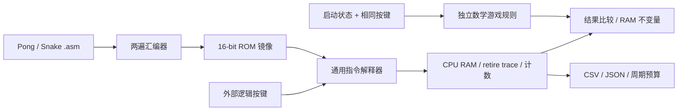

# M20-300 V0：ISA、游戏机器程序与执行预算验证

日期：2026-10-28（Asia/Shanghai）。**V0 软件原型验证完成；不是 FPGA/157 实物验收报告。** 本文使用用户指定的 [M20_300_architecture_v0_1.md](M20_300_architecture_v0_1.md)，其原文保留。旧 M20-747 的 8-bit 指令、IR/B/T/LR、63 微状态和周期预算不用于本轮。

## 1. 本轮实际完成什么

|交付|位置|已验证内容|
|---|---|---|
|16-bit 编码/解码|`host/python/m20/isa.py`、[ISA 文档](M20_300_isa_v0_1.md)|全部 65,536 个 word 的合法性与保留字段；15,015 合法、50,521 非法|
|汇编器|`host/python/m20/assembler.py`|两遍符号解析、安全整数表达式、标签、`.equ/.org/.word`、范围/重叠检查、小端 bin/memh/listing|
|指令解释器|`host/python/m20/machine.py`、`__main__.py`|A/AR/PC/Z/C/GPO、直接/间接 RAM、按键、跳转、HALT/TRAP/FAULT、逐指令 trace|
|Pong/Snake 机器程序|[程序入口](../../software/m20_300/README.md)|核心游戏算法、单层软件返回、动态身体和位图；没有宿主游戏快捷指令|
|独立数学参考与预算器|`game_reference.py`、`benchmarks.py`|启动夹具、运行后 RAM 比较、不变量、写地址白名单、连续运行、真实动态计数和证据导出|
|新增单元测试|`host/python/tests/test_m20_300.py`、`test_m20_games.py`|15 项 ISA/工具测试及 10 项游戏/输出链路测试|

软件 ISA 标识为 `M20-300-ISA-0.1-software`。本轮只将候选未明确的子编码和标志规则定义为软件契约，不代表 RTL 或资源预算已经冻结。

## 2. 数据流和可信边界

数学规则不修改正在运行的 CPU RAM；解释器不导入游戏规则。场景测试的 RAM 在启动前预置，以覆盖碰撞、进位等边界。另用脏 RAM 启动和两游戏各 512 tick 的连续机器程序执行，确认实际 boot/循环可工作；连续执行只提供外部按键，不让宿主推进身体、球或食物。

## 3. ROM 和 RAM

|项目|Pong|Snake|
|---|---:|---:|
|发射的 16-bit 指令字|168|368|
|ROM 地址跨度（含空洞）|168，空洞 0|368，空洞 0|
|有效镜像字节|336|736|
|占 4096-word ROM|4.10%|8.98%|
|剩余指令字|3928|3728|
|返回编号单元|RAM F0；编号 1/2|RAM F0；编号 1..4|

ROM 容量是 4096×16=8192 字节；不是旧方案的 4KiB。`.memh` 的文本文件字节数不能当有效程序容量。镜像按 word 编址，`.bin` 每 word 低字节在前。两游戏目前各自独立链接/装载；两者字数之和虽小于容量，仍未实现合并镜像、启动菜单或 RAM/ABI 共存。

RAM 容量为 256×4=1024 bit，物理存储由 FPGA 或外部芯片提供，不由 157 构造。Pong 使用 00..0C、20、F0；Snake 使用 00..21 工作区、40..BF 的 64 个双 nibble 身体槽、C0..DF 的 128 格占用位图及 F0 返回 ID。详细规则和地址分别见 [Pong](../../software/m20_300/pong_program.md)、[Snake](../../software/m20_300/snake_program.md)。

## 4. 实际动态指令及模型周期

解释器从实际机器字逐条执行，记录动态指令和 RAM 事务，再使用候选微架构成本：普通指令 **2**、RAM 指令 **5** 微周期；taken/not-taken 分支均为 2。正常轨迹满足：

`执行周期 = 2×退役指令数 + 3×(RAM读次数 + RAM写次数)`

这里 RAM 指令已在所有指令的基础 2 周期中计入一次，故只再加 3。逻辑取指次数等于退役指令数，不是物理异步 ROM 的电平采样次数。复位单列 **1** 模型周期，不混入每 tick。`tick` 到 `tick_done` 观察点尚未执行末尾 `NOP; JMP tick`，持续循环再计 **2 条指令、4 周期**。

以下数据来自本轮 `case_metrics.csv` 与 `summary.json`，不是人工估算指令条数：

|程序/场景|动态指令|RAM 读|RAM 写|执行微周期|说明|
|---|---:|---:|---:|---:|---|
|Pong boot|19|0|15|83|从非零 RAM 到首次 tick 入口|
|Pong 普通移动|65|15|9|202|球运动、读取六键、两次共享函数调用|
|Pong 墙和球拍同时反弹|74|16|12|232|纵向反弹后使用新 y 判断球拍|
|Pong 右方得分/分数回绕|83|18|15|265|8-bit 分数由两个 nibble 实际推进|
|Pong 本组最大：墙反弹、双方球拍移动及得分进位|94|21|19|308|`score_wall_two_paddles`|
|Snake boot 清 RAM 和初始化|1862|0|269|4531|256 个单元均由 CPU 写入；包括随后初始化写|
|Snake 普通移动|256|82|56|926|环索引、旧尾释放和新头位图更新|
|Snake 增长/分数 FF→00|291|92|64|1050|一次食物候选查询|
|Snake 合法进入旧尾|274|86|57|977|非增长先清尾占用再设新头|
|Snake 自撞死亡|133|40|30|476|身体/位图保持，更新状态和事件|
|Snake 长到 64 节封顶|225|73|51|822|完成增长后封顶，不继续生成食物|
|Snake 死亡后按键重启|1869|0|271|4551|含按键和完整软件 boot|
|Snake 本组最大：增长并探测 63 个候选|4152|1021|684|13419|`food_search_63`，长度 62→63|

以上“最大”是**已保存测试场景的最大观测值，不是全状态穷举证明的最坏上界**。Pong 1077 个场景，Snake 1081 个场景；其中各 1000 个固定种子随机场景、各 64 种完整按键掩码及定向边界。Snake 随机身体同时使用长密集蛇形路径及随机自避连通路径，不能宣称穷举所有身体形状。

63 次探测夹具是真实可连通身体：16×8 逐行蛇形路径 `path`；旧身体为 `reversed(path[2:64])`，头朝左、食物 (1,0)、得分 FF。增长后占用线性位置 1..63，CPU 从候选 2 开始，直到 64=(0,4) 才找到空格。全部 4152 条指令的 PC、机器字、寄存器、RAM 事务和累计周期已保存。

单层共享调用的开销也被计入：写返回 ID 加 JMP 为 9 周期；Pong 返回分派 ID1/2 分别 9/18 周期，Snake ID1..4 分别 9/13/17/21 周期。参数准备、函数主体另计，未给软件返回或食物搜索“免费执行”。

## 5. 在假设 CPU 微周期时钟下的时间预算

下表使用**持续循环**成本（Pong 最大 312、Snake 最大 13423 周期）。频率只是候选换算值，未测得或证明这些 157 CPU 时钟可用；板卡 50MHz 输入、CPU 微周期时钟和游戏 tick 速率是不同概念。

|假设 CPU 微周期时钟|Pong 普通 206 周期|Pong 本组最大 312 周期|Snake 普通 930 周期|Snake 本组最大 13423 周期|
|---|---:|---:|---:|---:|
|100kHz|2.060ms|3.120ms|9.300ms|134.230ms|
|1MHz|0.206ms|0.312ms|0.930ms|13.423ms|
|2MHz|0.103ms|0.156ms|0.465ms|6.7115ms|
|5MHz|0.0412ms|0.0624ms|0.186ms|2.6846ms|

换算公式为 `时间=微周期数/CPU微周期频率`，不是运行 Python 的墙钟耗时。本轮 `OUT` 次数为 0，**没有 OLED/SPI、按键软件消抖、帧等待或存储器额外 WAIT**；因此这些时间仅说明核心算法的预算，不能当成完整游戏 FPS。加入外设程序后须重新实跑统计，不沿用旧 747 方案的帧预算。

连续运行证据：Pong 512 tick 执行 35190 条指令/109452 周期；Snake 512 tick 执行 134022 条指令/481014 周期。两个区间均不含 boot/reset：Pong 从首次 tick 入口开始，首轮不含前置循环返回；Snake 从 boot 的 tick_done 开始，每轮包含前置 NOP/JMP。Snake 使用固定矩形按键路径持续存活；这条回放验证持续执行，不覆盖所有增长分支。

## 6. ISA 是否缺必要能力

**对于已实现的两套核心算法，没有发现必须新增的运算、分支或寻址指令。** 这不替代 OLED 集成和最终结构资源审计。

|需求/候选缺项|本轮实际做法或可用替代|结论与代价|
|---|---|---|
|8-bit 分数、索引及位图地址|4-bit ADD/ADC、SUB/SBC；LD/ST 保留 C|实际进位/借位及回绕已测，不需要 B 寄存器|
|动态数组及位图|AR 两个 nibble 动态装入，LD/ST/逻辑 `[AR]`；SHL/SHR 计算掩码/索引|身体表和食物循环已实际执行，无隐藏数组硬件|
|相等/无符号大小比较|SUBI/CMP 更新 Z/C，C=无借位；JZ/JC/JMP|碰撞、限位、循环与分派已用到|
|没有 CMP immediate|允许破坏 A 时用 SUBI；要保留 A 可先将常数置 RAM，再用已有 CMP|LD 恢复 A 会更新 Z，不能把 ST/SUBI/LD 当精确等价 CMP；核心程序不需要增指令|
|没有 JNZ/JNC|JZ/JC 跳过后续 JMP，或调整控制流|可表达，可能多 1 条分支；不是免费伪指令|
|没有 ORI|使用 RAM OR；或 `NOT; ANDI (15^n); NOT`|核心程序已能完成事件/位图操作；合成序列 3 条|
|没有 DECAR|现程序更新 RAM 索引后重装 AR；也可 MOVA/SUBI/SBCI/MOVAR 合成|合成会改变 Z/C，不能冒充“保留标志”的单条 DECAR|
|没有硬件 CALL/RET、LR/栈|F0 存 4-bit 返回编号，JMP 共享函数，再由普通指令分派|ROM 足够；仅单层调用，嵌套/递归不在 ABI 承诺内|
|没有硬件随机数|食物用有界确定性线性探测|功能可验证，不是随机分布或最终游戏体验证明|
|输入后条件判断|IN 和 MOVA AR 保持 Z/C；需要判断时显式 ANDI/LD/SUBI|避免误用旧标志；已纳入编码及单测契约|
|OLED、消抖、等待和中断|本轮未实现；OUT/六键银行仅由指令测试验证|不能从核心通过断言最终固件都不需要 ISA 或时序调整|

LD/LDI/AND/XOR/OR/NOT 更新 Z、保留 C；AR_CTRL/IO 全部保持 Z/C；减法 C=无借位，是本轮明确选定的软件契约。后续 RTL 必须逐指令匹配；如评审改变语义，应版本化修改，而非默默迁回旧 ISA。

## 7. 测试与证据

|验证层级|命令/方法|结果|证据|
|---|---|---|---|
|Python 全量回归|README 中 unittest discover 命令|PASS：77 项，含原 52+新增 25|`build/m20_300/software_v0_1/python_tests.log`|
|编码/指令/汇编/CLI|15 项独立 ISA 测试；全编码判定、全非法 TRAP、4-bit 算术数学 oracle、256 RAM 地址、64 输入、回绕/异常|PASS|`host/python/tests/test_m20_300.py`、同一测试日志|
|游戏及输出链路|10 项测试，含边界、随机、脏 RAM、连续循环、损坏位图有界诊断、故意改错 IN 指令、镜像/计数/trace 一致性|PASS|`host/python/tests/test_m20_games.py`、同一测试日志|
|正式 V0 benchmark|1077 Pong +1081 Snake 场景、各 512 tick 连续运行|PASS|`summary.json`、`case_metrics.csv`、`fixtures.jsonl`、`benchmark.log`|
|预算/镜像导出|镜像字节与汇编一致、源文件 SHA、最大轨迹计数/事务/周期和 CSV 一致、时间换算一致|PASS|输出链路单测、`clock_budget.csv`、各 `max_case_trace.jsonl`|
|RTL/elaboration、XSIM|本轮无 CPU RTL|NOT_RUN|后续 V1/V2|
|综合、实现、STA|本轮未创建 M20 工程|NOT_RUN|后续结构审计/板级阶段|
|FPGA/157 实物游戏|本轮不运行硬件|NOT_RUN|不得用 M11 的时钟/实采结果替代|

原始软件证据目录：`build/m20_300/software_v0_1/`（Git 忽略，可由命令重新生成）。每个最大场景的完整输入与轨迹在相应游戏子目录；`summary.json` 还记录汇编器、解释器、参考规则、预算器、测试和用户架构源文件的 SHA256。

|对象|SHA256|
|---|---|
|用户架构源文件（保持不变）|`65e7ca419dd37183880116d7b4ab191a53b38eee2c9d7aa8601e8d71f265a16a`|
|Pong `.asm`|`1b43020e4cdebac150041796e3898aeaac489efaf911496b39fc0dc5fe66933c`|
|Pong 小端 `.bin`|`e1029928d763ab5b0d21fe347687f52b326f545e9072f4c04365597439eead8c`|
|Snake `.asm`|`9d905bd0b8d567ae8d6f54250e220f85bdb72734324ba6025b3259e07b08dd13`|
|Snake 小端 `.bin`|`466cb149c8e5d6914d0b78dc8a3ec5074c77020edf880cedbd520b41b3376b98`|

复现：见 [软件 README](../../software/m20_300/README.md) 的 benchmark 与完整回归命令。固定种子 `0x2030028`，每游戏随机场景默认 1000；最大 10000。生成证据不写既有 M11 数据。当前 Git `main` 尚无首个 commit，本轮未暂存/commit/push，不虚构关联提交。

## 8. 对下一阶段的意义和入口

V0 证明了当前软件 ISA 可以在 4096-word/256-nibble 限制内表达两套核心算法；软件返回、间接数组、位图和有界食物搜索有了真实机器轨迹和可核对的动态成本。它降低“先做硬件后才发现指令不够用”的风险，并提供后续 RTL retire 对照模型。

下一步仍按候选 V1/V2：先实现 CPU/总线 RTL 与独立 XSIM，对齐 PC/A/AR/Z/C/GPO 和 RAM 事务；验证无 IR 时整个 RAM 事务 PC/ROM 稳定、写脉冲/互斥与延迟契约。Python 的原子指令执行不能验证这些边沿。WAIT、FPGA BRAM 读延迟和外部 SRAM/NOR 延迟必须显式建模，增加的周期及资源应重新统计。

随后补 OLED/SPI/消抖程序，再测完整游戏吞吐。328 颗核心、356 颗含部分同步辅助的数量仍只是用户候选的预算点估；编码可实现性、Python 通过和 ROM 余量均不证明 ALU40/控制70 已经逐 MUX 落地。必须另做结构级 157 计数和物理时序验证。本轮没有修改既有 RTL/XDC/Tcl/M11 Python 源码、历史结果或用户架构源文件，也没有运行 Vivado。
