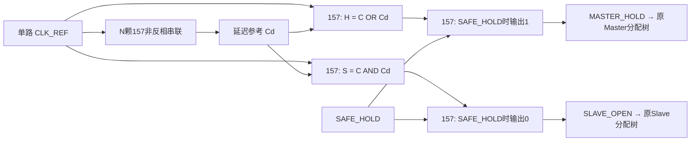

# M20重新设计：小规模157前馈两相时钟核

2026-11-03。**方案提案，未验证、未定版。116颗Johnson候选停止开发，原代码和证据保留。** 本轮从时钟本身重新设计，不沿用计数器、发生器DFF、非法状态检测或同步控制网络。

## 1. 推荐的新电路

单路参考C经过N颗非反相157，得到延迟副本Cd；再以两颗157生成：

```
MASTER_HOLD = C OR Cd
SLAVE_OPEN  = C AND Cd
```



所有逻辑使用同一型号NC7SZ157，不引入其他时序IC。该电路是**前馈网络，无内部存储、无异步反馈环**；不存在“发生器自身的DFF先需要可靠两相才能产生可靠两相”的自举依赖。

### 每颗157的连接

157定义Y=S?I1:I0，常量1接逻辑电源，0接地。以下是逻辑网络，不是板级引脚/XDC或PCB方案。

|单元|S|I0|I1|Y|颗数|
|---|---|---|---|---|---:|
|延迟级i|0|前一级输出（首级C）|0|下一延迟节点|N|
|Master译码|C|Cd|1|H_RAW|1|
|Slave译码|C|0|Cd|S_RAW|1|
|Master保持钳位|SAFE_HOLD|H_RAW|1|MASTER_HOLD|1|
|Slave保持钳位|SAFE_HOLD|S_RAW|0|SLAVE_OPEN|1|

两译码器都让原始C驱动SELECT，延迟链通过DATA进入：参考上升时优先经H选择弧关闭Master，Slave等待Cd上升；参考下降时优先经S选择弧关闭Slave，Master等待Cd下降。

连接模板：[结构SV](../../rtl/m20/clock_proposals/swc157_phase_feedforward.sv)；[N=8逐器件连接CSV](compact_clock/connections_n8.csv)。**SV只表示连线，不含真实传播延迟**；零延迟仿真会使Cd等于C，因此不能靠它证明死区，当前也没有运行仿真。

## 2. 理想时间顺序

|C|Cd|H|S|阶段|
|---:|---:|---:|---:|---|
|0|0|0|0|Master透明，Slave保持|
|1|0|1|0|上升后D1，双方保持|
|1|1|1|1|Master保持，Slave透明|
|0|1|1|0|下降后D2，双方保持|

设链延迟为τ，正向脉宽足够时，理想周期近似：

```
C上升 → Master关 → 等τ → Slave开
C下降 → Slave关  → 等τ → Master开
```

低透明窗约Tlow−τfall，高透明窗约Thigh−τrise；两个死区分别接近链的上升/下降延迟，实际还须加减独立译码、钳位、分配及锁存选择路径。τrise和τfall不能假定相同。

## 3. 真实数量与功能分工

|延迟级数N|连续时钟核N+2|含两路安全保持N+4|
|---:|---:|---:|
|1|3|5|
|4|6|8|
|8|10|12|
|12|14|16|
|16|18|20|

建议以**8～12颗的结构候选**（N=4或8、含保持）展开时序研究；这只是资源目标，不是已证明四/八级足够。级数不能凭数量目标或典型延迟强行冻结。若取N=8，CPU543+发生器12=555颗，仍不包含原有时钟Buffer树。

本轮有意只定义时钟核及安全保持：

- 两个周期相位由157生成，FPGA不直接输出它们。
- FPGA可负责参考时钟频率、CPU reset、SAFE_HOLD与运行/单步管理；这些外围职责符合现有CPU+FPGA分工。
- 此数量不包含“所有RUN/STEP/CDC/故障恢复也必须由157自主完成”。若仍要求该功能，必须另立控制方案并单独计数，不能把它暗含在12颗内。
- RESET与PARK若需两个独立引脚并在157内部合并，再加一颗OR-MUX；可由FPGA合并为单SAFE_HOLD则不增加157。

116颗版本包含13位状态及完整控制网络；新时钟核没有这些状态，结构不依赖该版本。

## 4. 必须先承认的时序条件

### 数字节点不重叠不等于锁存器内部不重叠

对任意Master叶端i和Slave叶端j，以上升边为例：

```
D1_min = chain_rise_min + Slave译码DATA开启_min
       + Slave钳位/分配_min + Slave有效开启_min
       − Master译码SELECT关闭_max
       − Master钳位/分配_max − Master有效关闭_max
```

下降边交换Master/Slave与相应边沿。链延迟须从同一参考点计入输入走线；C到关闭译码SELECT的快速支路最大延迟也必须扣除，不能把两条板上支路视为零延迟或完全匹配。两个全局下界都必须大于所需guard；不能只看同一bit、同一门典型值或发生器输出节点。

已核对[onsemi NC7SZ157 Rev7原厂手册](https://www.onsemi.com/download/data-sheet/pdf/nc7sz157-d.pdf)第5页：3.3V相关AC表给typ/max，min栏未给保证值。因此**无法从现有手册诚实证明某个固定N具有保证的最小死区**；本提案也不声称这一难点凭延迟线自动消失。它的收益是消除状态/反馈竞态，把待测条件集中到容易观测、调整的前馈延迟与叶端差异。

链末级约驱动两译码输入，中间级通常只驱动下一级；负载与手册15/50pF测试点不同，不能把3.2ns典型值直接乘N当真实链延迟。CPU的setup/hold和有效闭合时间也不是手册单独MUX的S→Y传播时间。

此外，Thigh/Tlow必须大于链最大延迟及最小透明窗需求。加长链会缩短可用透明窗口，不能无限加级。参考必须干净、无窄脉冲；未经分析不能把任意短输入脉冲视为被可靠滤除。

不采用“RC慢沿直接接普通157输入”作为默认替代：同手册第3页有输入转换速率限制；本轮没有确认Schmitt规格，也不新增其他器件。

## 5. 上电、保持及单步边界

SAFE_HOLD=1时输出H=1/S=0，输入必须有确定的上电安全默认值。等待延迟链稳定后再按时序释放；CPU复位仍须覆盖完整Master/Slave初始化循环。单纯输出保持不会初始化33位CPU状态。

无状态网络无法自动判断输入停振，也不能自行实现严格完整单步：C停低会最终M透明，停高会最终S透明，安全停钟需要外部SAFE_HOLD。

一种可评审的FPGA协同运行方式：在已稳定的Slave窗口（C=Cd=1、Q已完成更新）断言SAFE_HOLD，仅关闭Slave；确认钳位生效后才允许参考暂停。恢复应与参考阶段对齐，必要时走CPU复位。不能把任意异步PARK释放当作完整首周期，也不能在没有新Master捕获时把恢复阶段的Slave开放重复计作新提交。外部持续晶振的相位合格控制还需单独定义，不在当前12颗内。

## 6. FPGA存储服务必须重新预算

新电路**f_CPU微周期=f_REF**，不再是Johnson的f_REF/8。例：若输入100kHz，CPU微周期也是100kHz，理想半周期约5µs再扣死区；这只是设定示例，不是已实测频率。

旧V24“等待同一REF两个服务边沿”的BRAM适配器不能直接沿用。可用既有50MHz FPGA快时基完成服务：FPGA生成分频REF时按相关时钟处理；独立外部晶振则需明确CDC及最坏识别延迟，不能一律称异步或零延迟。

必须重新安排RAM快照、读响应、写持久点及ROM更新窗口，特别是短D1/D2未必可由50MHz逐段捕获。不需要增加CPU指令或改477网表，但不能假装旧事件协议可以直接替换。这轮只交时钟核方案，不实现新内存控制器或重新跑CPU。

## 7. 当前结论与下一步

这是本轮从零推荐的简约结构。相比继续自举计数器，它没有发生器自身存储竞态，具备明确的逐颗连线和N+4计数；**它仍是需要时序条件/实测下界的候选，不是可靠性已经签核的替代品**。

按此前用户“发现理论问题先提出、不先耗时验证”的要求，本轮到此停在方案评审：未运行XSIM/CPU回归、未改116版本、未修改ISA/CPU/M0–M19、无commit/tag/远程。下一步若继续，先对独立数据/选择/分配/锁存弧建立小型模型和正/负角，不先跑87场景；如果必须要求不依赖任何最小延迟数据就保证固定死区，需要先调整约束，不能承诺这几个MUX已经满足。
