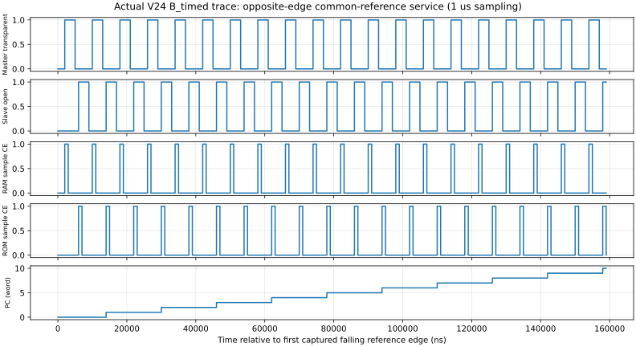

# M20 V2.4 自主两相与同源存储：设计审核稿

2026-11-03。**状态：NEEDS_ARCHITECTURE_REVIEW；候选已实现，预设参数联合仿真PASS，新增独立混合延迟弧缺口待解决。不是V24验收通过。** 按用户“发现理论缺陷先提出并中断”要求，停止新RTL修改和新增时序/长回归，等待决定。

## 1. 已完成的V2.3定版

原48暂存文件和delivery_manifest逐项SHA一致；2802原始文件哈希、477/33/66独立审计、隔离重生成字节一致。

|本地版本|标识|范围|
|---|---|---|
|V2.3源码及原48文件|aecf570c2e33563179e95e1615fd005cc19817f5|仅模式A数字仿真|
|V2.3正式报告/索引|5e601a9（完整SHA见本地Git）|三份报告入口文件，不含V24审查或RTL|
|annotated tag|m20-v2.3-two-phase-sim-verified → aecf570|FPGA直接两相+内部服务，不含Johnson/外部服务/实体时序|

没有任何remote/push/pull/fetch。旧V2.1/V2.2标签和603版本不变。V2.4未提交、未创建验收tag。V23[正式报告](../reports/m20_phaseV2.3_20261103.md)与旧regression_r6原证据保留。

## 2. 候选架构与范围

先形成[架构契约](M20_V24_ARCHITECTURE.md)，再实施。CPU继续使用冻结V23 543网络，V1/V21/V23-IDEAL和Python保持独立对照。发生器与CPU组合/ISA无关，FPGA不替CPU计算。

模式A：原V23调度器配置3/1/3/1参考周期作为相位参考；模式B：FPGA单路参考；模式C：独立晶振等效占空比/周期扰动。B/C实例化**完全相同的纯MUX发生器**。静态编译选择唯一源，相位成对选择，不实现热切换或并联推挽输出。

公共CLK_REF同时送发生器和FPGA；发生器在上升沿后经本机相位更新，FPGA在下降边沿采公开4位相位码、CPU地址/控制，**不是一概按异步CDC处理**。公共源并不自动消除PCB、clock-to-Q和输入建立约束。

## 3. 独立服务协议及预算

|公开相位|FPGA服务|相对首M时间|
|---|---|---:|
|0000|RAM地址/数据/控制快照，启动同步读/准备写|0.5T|
|0111|pending写单次持久化|3.5T（D1）|
|1111|ROM新PC快照，启动同步读|4.5T|
|其余|推进读计数/保持输出|不重新解释CPU|

同步RAM在2.5T返回，Master约3T关闭；ROM6.5T返回，下一M约8T打开。没有复制Johnson递推的私有计数器。ROM在Master关闭期间更新；请求相位与ROM地址稳定时间有观察断言，RAM检查新鲜响应和稳定时间。

V24写持久点为D1下降沿，与V23内部M-close CE **明确不同**；两者均先于CPU Slave提交。软件2/5微周期未变；7项复位专项按真实写提交点区分“取消pending”与“已写不回滚”，未篡改Python期望。不要把V24接口当V23物理提交时刻的直接替换。

仿真B参考1MHz/50%（CPU微周期125kHz）；C各半周按固定公式扰动，原始CSV可复查，不能写成固定实测125kHz。窗口预算[JSON](v24_resources/timing_budget.json)包含设计目标：相位建立100ns、PCB返回20ns、FPGA setup/guard20ns；RAM IO10+PCB10+CPU组合200+guard20ns。在T=1000ns、duty最低45%的示例下，目标余量相位310ns、RAM260ns、ROM1460ns。**全部是目标/假设，不是测量或签核；局部互锁最小死区仍无保证值。**

## 4. 发生器功能及真实资源

[逐模块CSV](v24_resources/mux_budget.csv)，独立SV实例/连线审计与临时重生成一致：

|类别|数量|
|---|---:|
|组合MUX（含反相、复位、保持、译码、同步及控制选择）|88|
|Johnson4位存储|8|
|RUN/STEP同步4位存储|8|
|token/ack2位存储|4|
|active/step_mode/sticky_fault3位存储|6|
|本地互锁反馈MUX|2|
|发生器总计|**116**|
|冻结CPU，独立计数|543|
|未含Buffer的系统合计|659|

发生器13位状态使用26个真实反馈MUX，不用FPGA原生FF代替；状态和器件均不混入CPU核心。原17颗候选只支持连续运行，完整功能不可仍称17颗。

RUN/STEP输入两级发生器状态同步；单步是toggle/ack协议，一次仅一项未确认请求。RUN优先，连续运行时STEP待处理，停止后执行；在1000安全状态启动/停车，一个单步覆盖八参考周期并返回1000。参考始终运行，不组合门控。

非法状态/非活动但不在1000时先置sticky_fault、冻结相位并钳位输出；下一参考边沿修复1000，不自动恢复CPU。故障需重置CPU及服务再启动。任意停振不自动检测；外部rst可无参考边沿关闭输出，但状态同步初始化仍需参考恢复。不能把紧急钳位当无损完成事务。

## 5. 已执行结果：限定于当前模型

原始目录`build/m20_300/v24/regression_r1/`，[机器结果](v24_resources/verification.json)、[分配置CSV](v24_resources/regression_summary.csv)、[逐文件SHA](v24_resources/evidence_sha256.csv)。

|测试|实际结果|范围|
|---|---|---|
|A/B/C零延迟|各87/57331 PASS|原49指令/22223，38游戏/35108|
|A/B/C预设延迟|各87/57331 PASS|含Pong/Snake连续64tick及完整独立RAM|
|内存/复位|每组7，共42项 PASS|pending取消、已写不回滚、读写/HALT/TRAP/恢复|
|全部非法编码|50521终态及50521复位恢复 PASS|B_timed CPU真实执行，不只是译码|
|慢CPU压力|5场景/12事件 PASS|组合2–5.2ns选择模型，主频不据此签核|
|其余指定短路径|各配置5场景 PASS|PC0→PC1、AR0→AR1、A0/A3→C、FSM|
|发生器三组整体延迟配置|各6单步、正常循环/STOP/停振rst、8非法修复 PASS|均为Master/Slave选择弧绑定同值的配置|
|故意20ns本机Master分支延迟|重叠fatal正确检测|预期负测，不代表全部混合弧已覆盖|
|Python|127项 PASS|含8192状态×8输入=65536次独立控制模型比较|
|独立Master/Slave快慢混合弧|**NOT_RUN，发现理论缺口后暂停**|不能以以上PASS代替|
|布局布线/STA/实物|NOT_RUN|未做PCB/新选型/M0–M19|

图来自B_timed真实CSV，每1µs服务下降沿采样，横轴ns；不是相位边沿的亚ns波形。当前参考单位和资源只表示数字模型结果。生成器证据包含WDB，但未以“波形看起来正确”作为PASS标准。

## 6. 新发现的理论/模型缺口（阻塞）

H_local=CLK_REF OR S_local，S_local=CLK_REF AND H_local，确实给发生器**输出节点**的理想因果顺序。但13位存储调用`swc_ms_bit_v23`时，Master与Slave两颗MUX的SELECT_NS共用一个参数：

- `rtl/m20/v23/swc_ms_bit_v23.sv`的master/slave均使用`.SELECT_NS(SELECT_NS)`。
- 当前nominal/fast/slow只是整体参数变化；同一存储bit的两条选择弧没有独立交叉。
- 增大分支skew的负测不等价于Master/Slave器件自身独立快慢。

因此当前测试不能证明“输出节点先关Master”就等于“实际所有Master都先于任何Slave关闭完成”。以H_local输出上升为t=0，一个**纯数字理论反例**为：

|路径|模型延迟假设|有效事件|
|---|---:|---:|
|H→Master分支|0.1ns|Master选择输入到达0.1ns|
|Master有效选择弧|5.2ns|5.3ns才关闭|
|H→S本地反馈数据弧|1ns|S输出在1ns打开（假设其参考选择已到达）|
|S→Slave分支|0.1ns|Slave选择输入到达1.1ns|
|Slave有效选择弧|1ns|2.1ns即打开|

于是模型允许2.1–5.3ns同时透明，**3.2ns重叠**。参考周期仍可为1µs；单纯降频不消除同边沿问题。该表尚未运行新XSIM，不伪装成故障波形；5.2ns在此是示例有效选择弧，不把原厂S→Y最大传播时间等同于实体锁存关闭时间。

本工程冻结参数`config/m20/157_timing_models.json`对NC7SZ157的数据/选择最小延迟、污染延迟、setup/hold均为null。不能用整体同值参数的数字PASS填补缺口，也不能仅追加若干157延时链就宣称具有保证死区。

这是V24发生器的新增模型/架构审核问题。V23模式A已接受完整参考tick死区、限定参数的数字仿真，并未承诺实体时序，**不因此反向判V23失败**。

## 7. 建议的下一步（待用户决定）

1. 先将本机模型拆分为H/S反馈门及各Master/Slave独立的数据/选择弧，覆盖正常脉宽下的混合快慢与分支偏斜；先做小型负测，不能直接重跑87场景掩盖问题。
2. 再评审本机锁存互锁/握手结构，或明确可接受的最小延迟与选择偏差约束及其将来的标定办法。不能将“再加两个门”当作已证明修复。
3. 只有局部时序条件和适用范围明确后，更新116颗预算、版本化模型，再启动完整联合回归。

当前不继续RTL或时序验证；保留全部已有PASS/负测/开发失败证据，供用户审查。无V24验收tag。
