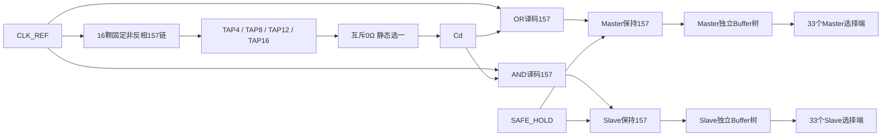

# M20 V2.4：固定16级多抽头前馈时钟架构

2026-11-04。已完成固定结构和小型时序验证；整体状态为**STOP_BEFORE_C_AND_D**。结构为VERIFIED，预设延迟窗口仅CONDITIONAL，未排除的快速链敏感性使四抽头均FAILED；物理与完整CPU联合为NOT_VERIFIED。实际结果以[M20_V24_TEST_REPORT.md](M20_V24_TEST_REPORT.md)和其证据为准。用户确定本方案为V2.4主线；17颗及116颗Johnson候选保留为历史，不继续作为主设计。

## 1. 版本与资源边界

冻结CPU为477个组合MUX、33位状态对应66个存储MUX，完整接口共543颗NC7SZ157等价。ISA、CPU网表、Pong/Snake ROM不修改。V2.3模式A基线提交aecf570、报告提交5e601a9和tag `m20-v2.3-two-phase-sim-verified`保持；新的时钟和服务结果不能覆盖或反向改变其PASS结论。

|本发生器部分|固定实体数量|
|---|---:|
|非反相延迟链|16|
|OR译码|1|
|AND译码|1|
|Master SAFE_HOLD钳位|1|
|Slave SAFE_HOLD钳位|1|
|发生器总计|**20**|
|CPU加发生器|**563**，不含分配Buffer|

`TAP_STAGES=4/8/12/16`只模拟一个0Ω装配连接，所有配置始终存在16级实体链。不增加选择MUX，不将未选中的后续链删掉，也不以FPGA LUT数代替外部器件数。发生器不含状态寄存器、计数器、DFF或反馈环。

## 2. 单路参考到两相

定义C为CLK_REF，Cd为选定抽头。每级延迟MUX均为S=0、I0=上一级、I1=0；译码为：

```
H_RAW = MUX(S=C, I0=Cd, I1=1) = C OR Cd
S_RAW = MUX(S=C, I0=0, I1=Cd) = C AND Cd
MASTER_HOLD = SAFE_HOLD ? 1 : H_RAW
SLAVE_OPEN  = SAFE_HOLD ? 0 : S_RAW
```



|C|Cd|H_RAW|S_RAW|理想阶段|
|---:|---:|---:|---:|---|
|0|0|0|0|Master透明|
|1|0|1|0|上升后D1|
|1|1|1|1|Slave透明|
|0|1|1|0|下降后D2|

两译码器都用原始C作SELECT，关闭当前透明级优先走选择路径，另一相等待Cd到达。该真值表只证明逻辑连接；独立传播弧不同可能改变边沿先后，必须继续计算真实叶端有效边界。

## 3. 三种来源的静态映射

|来源|两相来源|服务关系|
|---|---|---|
|A|FPGA直接输出两相|保留V2.3参考；本次新测试独立记录|
|B|FPGA只输出单路CLK_REF，经过同一20颗发生器|可依据与FPGA快服务时钟的同源关系约束|
|C|外部3.3V CMOS时钟，经过与B相同的20颗发生器|CLK_REF同时提供FPGA；服务域关系按实际方案分析|

参考源只能在断电装配时选择一个；Master/Slave必须成对选择同一来源。两推挽输出不能通过多个同时装配的0Ω并接。抽头同样只装一个。结构参数代表装配，不是运行中的逻辑MUX或热切换控制。

五类既定Buffer候选均留在系统预算中：NC7SZ157P6X、74LVC244APW,118、74AVC1T1004DPJ、74AVC1T1022DPJ、CDCLVC1106PWR。本轮参数化其数据传播/分支差异；没有把某个假设延迟当成这些型号的保证值，也不重新选型或确定其原理图引脚。

## 4. 时基和功能分工

本设计`f_CPU_microcycle=f_CLK_REF`，不是Johnson的除8。透明窗近似为参考高/低半周期减去相应边沿链延迟，还要扣除译码、钳位、分配和有效开关差异。链长增加会同时增加死区并缩短透明窗口。

20颗只实现时钟转换及SAFE_HOLD；FPGA可提供参考/分频、SAFE_HOLD、CPU reset、STOP/STEP协调和ROM/RAM服务。FPGA控制器不能改变或替代20颗内部的时钟生成逻辑，不能替CPU译码/运算。未来脱离FPGA的自治控制需另立预算，不暗含在20颗内。

## 5. 分层执行门槛

1. 静态审计20实例、固定16级、装配互斥和无组合环。
2. 独立时序模型及小型双MUX DFF：全部抽头、独立快慢、全球33×33叶端D1/D2、负测穿透和SAFE_HOLD竞争。
3. 仅在步骤2建立可信的**假设参数窗口**后，设计快FPGA存储服务并做最小CPU/事务测试。
4. 通过后才启动完整CPU差分。若所有抽头在所选合理假设角落均无有效窗口，保留失败并停止，不强行进入87场景。

零延迟只用于结构功能核对，不能作为非重叠结论。本文本身不构成实物NC7SZ157或Buffer树的setup/hold、功耗或Fmax签核。

## 6. 本轮已执行的A/B结果与停止条件

实际运行目录`build/m20_300/v24_ff16/small_r4/`（2026-11-04）：固定20实例和24个零延迟HDL真值/抽头检查已执行；独立延迟模型自测证明DATA/SELECT上下降、惯性短脉冲语义以及两个方向的真实双MUX穿透可观测。四抽头共14场景×4=56项，32项CONDITIONAL、24项FAILED，不以单一PASS概括。

名义场景全局叶端D1/D2分别为TAP4=8/8、TAP8=16/16、TAP12=24/24、TAP16=32/32ns。这些是模型实测，不是NC7SZ157板外结果。11个normal_assumed场景中，仅TAP16全部满足本轮assumed 4ns guard，其最小D1/D2取两方向最坏为6ns。

但`fast_chain_sensitivity`采用每级0.5ns的未定最小延迟敏感性，四抽头D1/D2分别−7/−7、−6/−6、−4/−4、−2/−2ns。每个抽头均有跨位流水错误4次；同位重叠计数均为0，证明同位观察不足。该假设没有被datasheet保证值排除，不能只保留11个normal场景而宣布抽头合格。

因此本轮不推荐实体抽头，不启动FPGA服务适配C或87场景CPU联合D。结构没有因时序失败而改变；CPU543、ISA、ROM、V2.3代码/报告/数据/tag继续保持。汇总见[小型验证JSON](ff16_resources/small_verification.json)、[56项CSV](ff16_resources/timing_results.csv)；原始参数和逐事件记录仍在独立build目录。
