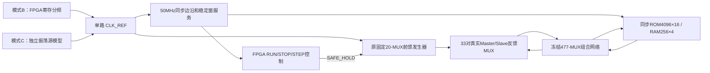
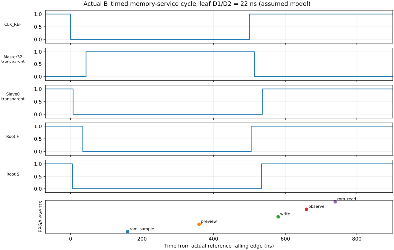

# M20 V2.4-C/D：前馈时钟、FPGA 存储器与 543-MUX CPU 数字联合验证

2026-11-04：用户已正式批准有条件数字验收，按本地定版流程建立 `m20-v2.4-digital-verified`。见[正式阶段报告](../reports/m20_phaseV2.4_20261104.md)及[本地定版报告](M20_V24_LOCAL_GIT_REPORT.md)。以下原始开发验收记录及其 SHA 保留；文中提交前状态以当时记录解释，当前以本地标签和定版报告为准。

**结论：C/D 的数字系统功能已完成并通过。在明确的 TAP16 延迟假设下，A/B/C 的架构状态、微周期、退役与 RAM 结果一致。实体 NC7SZ157 和 PCB 的时序可靠性仍独立开放，不构成本轮数字回归的阻塞条件。**

## 1. 验收口径

|层次|状态|证据及结论边界|
|---|---|---|
|结构、冻结兼容性、理想数据功能|VERIFIED|477 组合主体未改；CPU 33 位由 66 反馈 MUX 存储；固定 20 颗发生器；全部数字回归通过|
|有界传播延迟下的系统功能|CONDITIONAL|TAP16、指定独立叶端与数据延迟，实测仿真 D1/D2 最低各 22ns；全部带延迟系统回归通过|
|故障检出能力|VERIFIED|服务迟到断言、原 56 场景和 632 次局部短路径负测重放，原失败分类保留|
|问题配置本身|FAILED|快速链、晚释放、跨寄存器穿透等反例仍失败，未因正常配置通过而重新分类|
|综合、布局布线、STA、实体测试|NOT_VERIFIED|本轮没有板级工程、实际引脚分配、bitstream 或实机测试|
|实体最小延迟、Buffer/PCB 与真实锁存边界|NOT_VERIFIED / OPEN|另见[实体事项](M20_V24_PHYSICAL_TIMING_OPEN_ISSUES.md)，不宣称芯片时序签核|

`logic` 指 CPU 组合及存储 DATA 路径零延迟，**时钟链和有效开闭事件仍保留正延迟**。不能把零延迟组合 RTL 的 delta-cycle 顺序解释为实体非重叠。原 B 的 `STOP_BEFORE_C_AND_D` 是当时的评审结论，用户本次明确授权后，采用“规定数字包络”和“实体可靠性”分别验收。

## 2. 实际结构和时钟



模式 A 独立运行冻结 V2.3 调度器、双锁存 CPU 和存储适配器。B/C 直接实例化同一个既有 `swc_ff16_phase_timing`，其 20 个逐芯片模型与固定实体结构一一对应，H/S 实际输出驱动 66 个反馈 MUX；没有另一个理想调度器替代 CPU 时钟。PREVIEW 只更新验证参考和快照，不连接 CPU 状态的时钟端。

|参数|实际设定/推导|来源|
|---|---|---|
|FPGA 存储/控制时钟|50MHz，20ns|RTL 仿真时基|
|B：CLK_REF|1MHz，500ns 高/低，25 个服务 tick/半周期|寄存分频输出|
|C：CLK_REF|独立初相 17ns；高 500/505/510ns、低 500/507ns；周期 1000～1017ns，平均 1008.5ns|可复现独立源模型，约 0.9916MHz；非实测晶振|
|A：直接两相微周期|logic 640ns；timed 2880ns|原 V23 的两套调度参数；跨模式比较按提交序号，不按绝对时间|
|有效 CPU 微周期|连续 RUN 时每个 REF 周期一次；普通指令 2、RAM 指令 5|保持 `M20-300-V1-TIMING-0.1`|
|TAP16 链|16 级，每级 rise/fall DATA=2ns|assumed；实体始终保留全部 16 级|
|译码|OR SELECT rise=4ns，AND SELECT fall=4ns，其他非链 DATA/SELECT=1ns|assumed 独立弧|
|叶端 i=0…32|Buffer=1+3i/32ns；独立有效开/闭边界=1+4i/32ns|assumed，最坏 3ns 分配差＋4ns 边界差|
|CPU 数据 timed|组合 DATA 0.2/0.8ns、SELECT 0.3/1.0ns 按节点交替；存储 DATA=0.1ns|assumed，非 datasheet min|
|资源|477＋66＋20＝**563**|[独立资源审计](ffcd_resources/resource_audit.json)；不含 Buffer、FPGA 存储/控制/调试|

根部 D1/D2=29ns；全 33×33 最坏有效叶端 D1/D2=**22/22ns**。不是只比较 H/S 电平或同一 bit 的主从。在 B/C 各四套程序套件及全非法专项中均实际计时检查，原全局互斥与 4ns guard 断言保持。

停车、启动和复位占墙钟时间，不计为软件隐藏微周期。SAFE_HOLD 下参考仍运行，但 CPU 不推进；恢复高窗可能重新打开 Slave 传递原 QM，不计作新微周期，下一完整 Master 低窗口才启动有效服务。

## 3. 存储服务实际发生在哪里

CLK_REF 经两级 `ASYNC_REG` 和历史边沿检测，服务事件由实际参考的同步电平及 age 产生，B/C 不使用 V23 内部计数器或 Johnson 状态。同步 ROM/RAM 地址先寄存，读取两次 50MHz 服务边沿后返回并保持。实体 CDC/亚稳态与 IO/PCB 延迟另列，不假装为零。

下表由实际 VCD 的 REF 边沿与 pre-NBA 服务事件 CSV 联合计算，每个事件每模式采集 76 点，单位 ns。

|事件|参考边沿|B_timed 实际偏移|C_timed 实际偏移|行为|
|---|---|---:|---:|---|
|RAM_SAMPLE|下降沿|160|140～159|锁存 RAM 地址/控制/写数据，启动同步读|
|PREVIEW|下降沿|360|340～359|快照旧状态和退役；仅供参考模型比较|
|WRITE_COMMIT|上升沿|80|60～79|将 pending 写持久化一次|
|OBSERVE|上升沿|160|140～159|检查实际 Slave 更新后的状态，完成一次微周期|
|ROM_READ|上升沿|240|220～239|采样新 PC，2 服务周期后返回指令并保持|



图源：`full_r1/B_timed/xsim/memory_service.vcd`；横轴相对实际 REF 下降沿，ns。图为原始事件提取，不是人工时序示意。另有 [PNG](ffcd_resources/memory_service_timing_complete.png)、[服务延迟 CSV](ffcd_resources/service_latency.csv)、[波形摘录 CSV](ffcd_resources/memory_wave_excerpt.csv)。

B 的 ROM 约在上升后 280ns（再加用例设定的 1.5ns 输出延迟）有效，早于下一下降后约 36ns 的最早 Master 开放；RAM 约在下降后 200ns（再加 2ns 输出延迟）返回，早于 360ns PREVIEW 和下一上升附近的 Master 关闭。预算来自较长高/低窗口，**不要求在 22ns 死区内完成 BRAM 访问**。

RAM 写持久点是上升后 WRITE_COMMIT，早于 OBSERVE；ISA 的 ST 退役仍在原 MEM_RELEASE。RESET 在持久点前取消 pending，之后不回滚；CPU 复位不清 RAM。具体接口见[适配设计](M20_V24_MEMORY_ADAPTER_DESIGN.md)和[CDC/后续约束](M20_V24_CLOCK_CDC_CONSTRAINTS.md)。

## 4. 自动回归实绩

执行环境：Ubuntu 24.04、XSIM 2026.1.1、工程独立 Python 3.12 环境。原始输出 `build/m20_300/v24_ffcd/full_r1/`；全部入口返回码 0。

|配置|指令场景 / 事件|游戏场景 / 事件|原定合计|结果|
|---|---:|---:|---:|---|
|A_logic|49 / 22,223|38 / 35,108|87 / 57,331|PASS / VERIFIED|
|A_timed|49 / 22,223|38 / 35,108|87 / 57,331|PASS / CONDITIONAL|
|B_logic|49 / 22,223|38 / 35,108|87 / 57,331|PASS / VERIFIED 数字数据功能|
|B_timed|49 / 22,223|38 / 35,108|87 / 57,331|PASS / CONDITIONAL|
|C_logic|49 / 22,223|38 / 35,108|87 / 57,331|PASS / VERIFIED 数字数据功能|
|C_timed|49 / 22,223|38 / 35,108|87 / 57,331|PASS / CONDITIONAL|

每套额外执行 5 条短路径压力场景 /12 事件及 2 条最小联合程序 /9 事件，合计 94 场景 /57,352 事件。没有拿额外用例替换原 87 项。

|专项|结果|证据|
|---|---|---|
|编译、elaboration、全部主回归|PASS|`full_r1/{profile}/xsim/compile.log`、`*.elaborate.log`、套件日志|
|Python 与 V1、V21 IDEAL_FF、V23 IDEAL_FF 同时对照|PASS|每场景 `*.rtl/v1/ideal/switch.csv`、`all_comparison.json`|
|独立 V23 模式 A 与 B/C 全微周期状态对照|PASS|[microstate_comparison.csv](ffcd_resources/microstate_comparison.csv)，每配置原套件 166,991 行；含额外项 167,066 行|
|PC/AR/A/Z/C/GPO/FSM/HALT/TRAP、退役和最终 RAM|PASS|六配置按事件/微周期序号完全一致；不是只看最终画面|
|同步服务单元|PASS：6 项|`B_timed/xsim/service.log`：地址保持、2 周期读、取消待写、写一次、观察计数等|
|内存/复位专项|PASS：7 项×6 配置|各配置 `xsim/memory.log`；B/C_timed 门禁先于全部程序回归|
|运行控制|PASS：7 项×B/C|各 `control.log`，每模式显式确认 26 个单步微周期|
|全编码及非法终态/恢复|PASS：B/C 各 65,536 编码分类、50,521 实际 TRAP、50,521 复位恢复|各 `illegal.log`，合法 15,015；无错误 RAM 写副作用|
|Python 全部单元测试|PASS：151 项|`full_r1/python_tests.log`；用时 12.576s|
|RAM 返回迟到负测|预期断言检出|额外延迟 500ns，`bad_ram.log`：`V23_RAM_RESPONSE_SETUP`|
|ROM 返回迟到负测|预期断言检出|额外延迟 300ns，`bad_rom.log`：`V23_ROM_CHANGED_MASTER_OPEN`|

负测断言沿用了 V23 名称，但执行的是新的 C/D 测试，不代表冻结 V23 失败。原断言未放宽；新的服务故障确实导致 Fatal，脚本检查预期标记后才视为“检出能力通过”。

### 游戏和事务的可核验含义

|程序场景|ROM 字数|动态事件|CPU 微周期|结论|
|---|---:|---:|---:|---|
|Pong 冷启动|168|19|83|原 ROM 启动正确|
|Pong 连续 64 tick|168|4,252|13,223|连续状态与参考一致|
|Snake 冷启动|368|1,862|4,531|原 ROM 启动正确|
|Snake 连续 64 tick|368|18,778|65,225|连续状态与参考一致|

四个启动/连续场景实际执行 RESET 有效的完整 Master/Slave 序列并核对 33 位，没有用变量初始化代替 CPU 复位。其余带种子的定向场景保留既有 fixture 的受控预置方式，不能将每个定向 fixture 都解释为独立实体上电实验。

Pong 原始二进制 `.bin` SHA256：`e1029928d763ab5b0d21fe347687f52b326f545e9072f4c04365597439eead8c`。

Snake 原始二进制 `.bin` SHA256：`466cb149c8e5d6914d0b78dc8a3ec5074c77020edf880cedbd520b41b3376b98`。

对应文本 memh 的 SHA256 分别为 `bc99bc01f95e2d1160328e4e0c5460134400c73612b888b56b30bf9121193b4d` 和 `2acc4c44fd561d805a3f9a1e260cb7a6521718c76868727ffce14644a6a96f96`；仿真 ROM 补齐到 4096 字，文件哈希与短 memh 不同，程序字逐项一致。

每配置原 49 指令场景逻辑 RAM 读/写为 1,275 /974，38 游戏场景为 8,433 /6,712。每场景实际持久写次数都与 Python 相同，最终 256×4 RAM 完全比较。详见 [transactions.csv](ffcd_resources/transactions.csv)。

**读事务的口径：**冻结 CPU 的 CE/OE 可跨 SETUP/ACCESS/RELEASE 三个微状态连续有效，FPGA 可重复采样同一读请求；这些 BRAM 内部采样不是三条 ISA 访存。CSV 的 logical_reads 来自退役事务，persistent_writes 来自实际适配器计数。本轮没有把物理 BRAM 重采样数伪装成“一次读”，也没有为压缩读数修改 CPU 或微周期。

## 5. 停钟、单步和复位

FPGA 新控制器有 IDLE/ARM/ACTIVE/CLOSING 状态，属于 FPGA 服务资源，不在外部 20 颗预算内。SAFE_HOLD 在同步高窗 age12 操作；写和 ROM 已完成后钳位，再等 4 个服务 tick 确认 parked。参考时钟持续运行，parked 后架构状态和 BRAM 输出保持。

STEP 使用 `step_ready`＋请求上升沿；只接受 ready 时的一个脉冲，忙时不排队。一次 `step_ack` 对应恰好一个完整 CPU 微周期，含 RAM 指令各微状态。STOP 优先；RESET 期间忽略 STEP；RUN 可用于实际相位复位初始化。已经覆盖空闲/运行中 STOP+STEP、重复 STEP、连续两次 ST 后 LD、STEP 转 RUN、RUN 转 STOP 与恢复，以及 HALT/TRAP 后 STEP。

HALT/TRAP 阻止 CPU 新退役和 RAM 请求，**不自动停止参考振荡或 FPGA 周期性 ROM 刷新**；如需全服务保持，另请求 STOP。紧急调度器 reset 与正常 STOP 的事务语义不同；实体掉电/停振检测不在本轮范围。

## 6. 原失败证据没有消失

|重放|配置结果|证据位置|
|---|---|---|
|原小型时序 56 组|32 CONDITIONAL、24 FAILED，原机制一致|`build/m20_300/v24_ff16/full_r1_ffcd_negative_small/`|
|79 实际短路径×8 条件|632 次，131 次观察到错误；0.125ns/级 79 条、0.25ns/级 52 条；0.5/1ns 正向合计 316 次无错|`build/m20_300/v24_ff16/full_r1_ffcd_negative_cones/`|
|快速链四抽头|叶端 D1/D2 仍 −7/−6/−4/−2ns|原 CSV、参数及失败波形保留|

[negative_replay.json](ffcd_resources/negative_replay.json) 保存本轮路径和结果 SHA。原 `small_r1…r4`、`deep_review_r1…r4` 和 `ff16_resources/ff16_review_resources` 不覆盖。旧负测脚本打印的 `STOP_BEFORE_C_AND_D` 仍是原探索分类，不再作为用户已授权数字系统开发的门禁。

开发中另外保留两次已定位的测试平台失败：`dev_r1` 的 STOP 未清导致等待 ready 超时；`dev_r2` 的 4e9 看门狗字面量溢出。修正测试驱动/恢复合法看门狗后，`dev_r3` 门禁通过再启动 `full_r1`；没有修改 CPU 预期结果或放宽断言。

## 7. 交付、复现和保存

|文件/目录|职责|
|---|---|
|`rtl/m20/v24_ffcd/swc_ffcd_service.sv`|50MHz 事件服务及 B 参考分频|
|`rtl/m20/v24_ffcd/swc_ffcd_run_control.sv`|SAFE_HOLD、完整周期 STOP/STEP 协调|
|`rtl/m20/v24_ffcd/generated/`|从冻结 V23 主体生成的新存储绑定和 manifest|
|`sim/m20_ffcd/`|真实反馈 MUX、内存/控制/故障平台、断言及生成的六配置 harness|
|`host/python/m20/ffcd_build.py`、`ffcd_audit.py`、`ffcd_verify.py`|生成、独立逐连接审计、Python/多 RTL 对照|
|`host/python/tests/test_m20_ffcd.py`|5 项生成确定性、结构、篡改拒绝和冻结恢复检查|
|`tools/m20/ffcd_checkpoint.py`、`ffcd_evidence.py`|只读保护快照、统计/波形/哈希/归档|
|`docs/m20/ffcd_resources/`|小型 JSON/CSV、图、SHA 和来源；不把大量缓存纳入源码|

在工程根目录使用新的输出路径，一条命令完成 C 门禁、完整联合、原负测重放、全部 Python 和归档：

```bash
M20_FFCD_OUTPUT_DIR="$PWD/build/m20_300/v24_ffcd/system_$(date +%Y%m%d_%H%M%S)" \
  bash sim/scripts/run_m20_v24_system.sh
```

可用 `M20_VIVADO_BIN` 和 `SWCELL_PYTHON` 覆盖本机工具路径。仅运行系统 C/D 用 `bash sim/scripts/run_m20_ffcd.sh`；设置 `M20_FFCD_STAGE=dev` 仅跑 C 门禁和最小程序。脚本拒绝覆盖已有正式输出；不要向 `full_r1` 重跑。`M20_FFCD_RESUME_FINISH=1` 仅用于 C/D 已有 `verification.json`、但还未生成负测目录/归档的中断收尾，不能在已完成归档上反复执行。

本次实际执行先 core full，再恢复 finisher，两个退出码均 0；日志分别为 `full_r1.console.log` 和 `full_r1.finish.log`。新版一键入口还增加了每次独立 baseline 捕获，其 shell 语法、快照及归档参数路径另作轻量检查；没有为文档/绘图变更重复耗时系统回归。

原始索引：[evidence_sha256.csv](ffcd_resources/evidence_sha256.csv)，8,089 文件、211,505,057 字节；源/输入/测试指纹见 [validation.json](ffcd_resources/validation.json)、[source_sha256.json](ffcd_resources/source_sha256.json)、[input_sha256.json](ffcd_resources/input_sha256.json)。本轮所有新增交付文件另见 [delivery_sources.json](ffcd_resources/delivery_sources.json)，不含清单自身 SHA。

本地原始系统归档：`build/m20_300/v24_ffcd/full_r1_evidence.tar.gz`，25,187,797 字节，SHA256 `c1ceb0f32f305aa1ee567620f4d014799c8e27638c4d4bc70618bed2aa21c0f3`，未上传。它包含系统原始数据/服务 VCD/摘要；两套负测原始波形位于表中独立目录，应连同原 A/B 数据另备份，不能只备份这个 tar。

Git HEAD 仍 `5e601a9`，V23 tag 仍指 `aecf570`；任务前 147 个受保护文件 SHA 和原 90 个暂存文件的索引 blob 均保持。本轮不暂存、不 commit、不 tag、不远程操作。[最终检查](ffcd_resources/final_checks.json)与[恢复入口](../tasks/m20-v24-ffcd-20261104.md)记录交付状态。

## 8. 十二个工程问题的结论

1. **服务事件来源：**实际单路 REF 经 50MHz 两级同步及稳定窗 age 产生，不依赖旧内部调度器。
2. **B/C 实际时钟：**同一个 20-MUX 逐芯片前馈模型的真实 H/S 输出驱动 CPU 反馈存储。
3. **周期对应：**连续有效 RUN 为 1 REF＝1 CPU 微周期；park/启动为显式控制开销，不隐藏改变 2/5 profile。
4. **存储窗口：**当前 1MHz 级数字包络内通过，利用长高/低窗口，不挤死区；迟到负测可检出错误。
5. **完整周期控制：**已验证 FPGA 协调 SAFE_HOLD/RUN/STOP/STEP，受 ready/ack 和规定高窗约束；20 颗本身无自主控制器。
6. **跨模式一致：**全微状态、退役、逻辑事务、持久写和最终 RAM 一致；不比较不同绝对时刻。
7. **完整原回归：**六配置各 87 场景 /57,331 事件全部通过，不以几个示例替代。
8. **游戏：**原 ROM 不改，Pong/Snake 冷启动及各连续 64 tick 对照通过。
9. **有效裕量：**选定假设下 ROOT 29/29ns、全局 LEAF 实测仿真最低 22/22ns。
10. **快速链反例：**已重放，负裕量与局部穿透仍存在；原失败没有改成 PASS。
11. **数字验收：**达到本轮数字功能及指定条件时序的交付条件，供用户审核；未自动正式定版或进入 V3。
12. **实体后续：**链 min/max、独立开闭/CQ、跨相 Buffer/负载/PCB、供电/默认安全、CDC/IO/STA 及批次温度需要真实工程证据；数字通过不替代这些事项。


## 9. 用户批准后的版本恢复补充

定版审核发现旧632实验入口依赖ignored历史build。新增 `sim/scripts/run_m20_ff16_cones_replay.sh`，直接读取纳管的原79见证JSON；相同网表、时序模型、旧判据不改，逐项对比所有错误path ID。实际632重放与旧结果完全一致，131错误/316正向无错。原 `run_m20_ff16_review.sh` 继续用于持有历史原始数据时的深度证据审计。

一键system入口改为调用独立重放。原full_r1模拟主体、源指纹及全部8089原始文件不变；新恢复入口按定版报告另外验证，不改写原 `delivery_sources.json/final_checks.json` 等历史检查点以匹配新HEAD。当前版本的技术源指纹与纳管清单另见 `M20_V24_SOURCE_MANIFEST.json` 和 `M20_V24_GIT_FILES.csv`。
