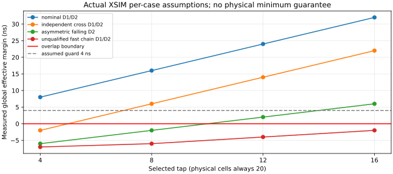
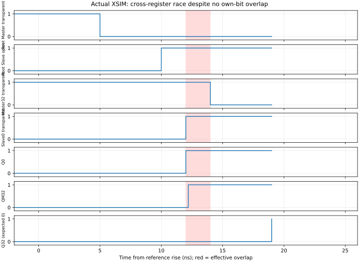
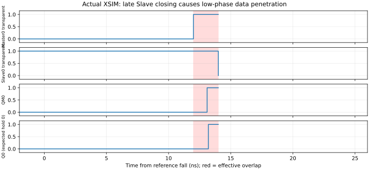

# M20 V2.4：四抽头独立时序验证与反例

2026-11-04，实际运行 `build/m20_300/v24_ff16/small_r4/`。**A结构VERIFIED；模型故障检出VERIFIED；56项时序结果为32项CONDITIONAL、24项FAILED。门禁：STOP_BEFORE_C_AND_D。** 尚无实体合格抽头，不启动完整CPU回归。

## 验证的对象

每种tap始终保留20颗独立传播模型，参数逐颗配置DATA上/下降、SELECT上/下降。两相各33条独立叶端路径，分支传播和锁存器有效开/关延迟分开；Master关闭与Slave打开不共用同一参数。

每个状态位由两个真实透明/保持的反馈MUX组成，使用独立数据传播参数。位32的数据来自位0的Q，经0.1ns组合路径，用于检出跨寄存器穿透；其余输入使用可预测翻转。初始执行两个完整、拉长的初始化周期并确认Q/QM已知，再统计4个基础参考周期；safe_hold_normal另有两次上升检查及park/resume过程。没有使用CPU参考变量生成实际Q。

原语自测检查DATA/SELECT上下降、惯性短脉冲取消，并故意在两个交接方向制造有效透明重叠，均实际观察到Q错误。该模型的逐输入惯性语义、重汇合和局限见[时序模型](M20_V24_TIMING_MODEL.md)。

## 判定口径

对每次完整交接，直接记录所有有效叶端的时间戳：

```
D1 = 最早Slave打开 − 最晚Master关闭
D2 = 最早Master打开 − 最晚Slave关闭
```

最坏位可来自不同寄存器；同时记录自身位重叠和全局跨位重叠。CONDITIONAL要求D1、D2均至少4ns、无数据/流水错误、无缺失窗口且Master窗口达到本小型测试的100ns要求。4ns与100ns均是**assumed测试条件**，不是NC7SZ157保证的setup/hold或CPU建立时间。

窄脉冲导致无法配对时D1/D2为null，不能算作0ns或通过。重叠计数为实际透明重叠区间数，不是同一重叠内多次信号事件数。多毛刺/窄脉冲的每个瞬态未全部折算成一个“最坏死区”，缺失/短窗口单独判失败。

基准为1MHz参考，正常高/低各500ns；占空/抖动场景为300/700ns加确定性±20ns扰动。发生器不除频，若未来接CPU则微周期频率等于参考频率；本轮不是CPU最高频率测试，也没有UART实物采集。

## 实际全局有效裕量

单位ns，均来自XSIM事件记录。表内正数仍须满足4ns guard。

|场景|TAP4 D1/D2|TAP8 D1/D2|TAP12 D1/D2|TAP16 D1/D2|
|---|---:|---:|---:|---:|
|nominal，链每级2/2ns|8 / 8|16 / 16|24 / 24|32 / 32|
|independent_cross，独立叶端快慢|−2 / −2|6 / 6|14 / 14|22 / 22|
|master_late|−2 / 8|6 / 16|14 / 24|22 / 32|
|slave_late|8 / −2|16 / 6|24 / 14|32 / 22|
|mixed_stage，局部混合快慢|−2 / −3.5|6 / 3|14 / 9.5|22 / 16|
|edge_asymmetric，链2/1ns|−2 / −6|6 / −2|14 / 2|22 / 6|
|decode_hold_mismatch|−8.2 / −8.2|−0.2 / −0.2|7.8 / 7.8|15.8 / 15.8|
|buffer_skew|−4 / −4|4 / 4|12 / 12|20 / 20|
|duty_jitter|8 / 8|16 / 16|24 / 24|32 / 32|
|probe_load，所选级附加1/2ns|−1 / 0|7 / 8|15 / 16|23 / 24|
|safe_hold_normal|8 / 8|16 / 16|24 / 24|32 / 32|
|safe_hold_late_release|8 / 8，缺窗/错误|16 / 16，缺窗/错误|24 / 24，缺窗/错误|32 / 32，缺窗/错误|
|runt_high，3ns高脉冲|null，缺窗/错误|null，缺窗/错误|null，缺窗/错误|null，缺窗/错误|
|fast_chain_sensitivity，链每级0.5ns|**−7 / −7**|**−6 / −6**|**−4 / −4**|**−2 / −2**|



|结果分组|CONDITIONAL|FAILED|说明|
|---|---:|---:|---|
|11个normal_assumed×4tap|32|12|TAP4/8/12/16分别3/8/10/11项满足|
|晚释放、窄脉冲负测×4tap|0|8|故意违反控制/输入契约，故障检出有效|
|未限定最小值敏感性×4tap|0|4|不能未经证据排除后宣称抽头合格|
|合计|**32**|**24**|不是56项时序全部通过|

每个tap快速链场景均有8个全局重叠区间、0个自身重叠区间、4个流水错误。仅在11个normal_assumed范围内，TAP16最小裕量6ns，对4ns guard剩2ns；**该受限集合不覆盖全部可能延迟组合。**

## 数据穿透的可复现小反例

`independent_cross / TAP4`的发生器根部D1=D2均为+5ns，且每位自身两级均无重叠。但不同叶端造成：

|相对参考上升沿|实际事件|
|---:|---|
|7ns|Master0有效关闭|
|12ns|Slave0有效打开|
|14ns|Master32才有效关闭|
|19ns|Slave32有效打开|

在12～14ns期间，Slave0与Master32同时透明。源D0在上升前已稳定为1，源/目的旧Q均为0。实际CSV中Q0于12ns变1，经过0.1ns组合和Master数据传播，QM32于12.2ns变1；随后Q32于19ns获取1，**本应保持旧Q0=0的流水级提前了一周期。** 本模型预先延迟DATA输入端，已稳定的数据在有效SELECT切换时可立即被选通，不能再机械叠加一次DATA延迟。



见[两寄存器反例完整参数](ff16_resources/minimal_cross_register_counterexample.json)、[实际逐事件CSV](ff16_resources/independent_cross_tap4.trace.csv)及[错误记录](ff16_resources/independent_cross_tap4.errors.csv)。这是从33位测试网络提取的两FF见证，未证明在所有模型中器件数或参数意义上全局最小；0.1ns短路径是压力假设，不是CPU某条真实PCB路径测量。

`master_late / TAP4`及`slave_late / TAP4`分别在两个交接方向人为改变数据，均实际记录4次穿透，而非仅用H=0/S=1推断数据错。下降沿波形如下：



## SAFE_HOLD与输入契约

正常park/resume测试在全局有效透明监视保持启用时执行：在C/Cd稳定高、Slave更新已稳定的透明窗口内再等待100ns，拉长参考高窗口并钳位；保持期间改变参考和数据，在C/Cd稳定高时释放，再开始新完整周期。四tap在这些参数下无重叠、无Q错误，属于CONDITIONAL。不是先等Slave自然关闭后才钳位。

晚释放仅提前1ns解除钳位，Master释放选择路径12ns，各tap均漏掉1个Master窗口并产生1个数据错误。3ns参考高脉冲各tap缺失8个配对窗口并有2个数据错误。**周期性D1/D2正值不足以证明SAFE_HOLD启动或脉冲完整性。**

此处尚无完整FPGA STOP/STEP控制器、任意相位外部持续晶振请求、RAM单次提交或运行中复位事务验证；不能把小型手动保持测试称为完整单步通过。详见[控制契约](M20_V24_SAFE_HOLD_CONTROL.md)。

## 参数边界与停止原因

全部运行参数保存在每tap的14份JSON和CFG：20颗×4传播弧、33叶端×12时序项、分支/skew分解、负载、参考脉宽/抖动和判定guard。[原始输入SHA](ff16_resources/input_sha256.json)覆盖116个实际输入文件。

原厂Rev.7在指定3.3V/50pF测试条件给出了传播典型和最大值，**没有可供证明链路最低死区的保证最小值**。本轮0.5ns最小敏感性、Buffer偏斜及有效锁存边界均assumed；其失败不证明实体一定如此，但当前也没有证据将其排除。不能以“典型2ns×16”代替最低死区保证。

降低参考频率可以放宽透明窗和存储访问时间，**不会消除同一个交接边沿的负D1/D2**。进入C/D前应先建立独立上/下降链最小延迟和全部叶端开关差的边界，或提出不超20颗且能改变该差值的修正方案，再用保留的反例重新验证。参数化充分条件示例见[边界JSON](ff16_resources/parameter_envelope.json)，不是新增物理规格。

目前实体抽头推荐为空。TAP16只能作为后续条件分析候选，不能作为已批准的装配值。完整CPU、FPGA存储、综合实现/STA、真实NC7SZ157时序全部NOT_VERIFIED；不引用旧116或V2.3的PASS替代本版本验证。

## 重现与失败证据

```bash
M20_FF16_OUTPUT_DIR="$PWD/build/m20_300/v24_ff16/small_review_new" \
  sim/scripts/run_m20_ff16_small.sh
```

必须使用新目录，不覆盖small_r1～r4。脚本退出0表示仿真正常执行、模型见证和结果分类检查通过；**项目是否可继续以JSON的project_gate为准，本次是STOP_BEFORE_C_AND_D**。脚本自身不会启动CPU。

small_r1的SV字面量编译失败、small_r2的重汇合预测公式错误均原位保留；small_r3之后增强了实际检查和证据捕获，最终依据为small_r4。修正公式和模型检查后没有删除失败场景或放宽4ns guard。

## 追加：根/叶分解与真实路径复核

本轮深化结果见[根/叶预算](M20_V24_CLOCK_TREE_BUDGET.md)、[参数包络](M20_V24_TIMING_SENSITIVITY.md)和[79路径实验](M20_V24_REAL_CPU_SHORT_PATH_ANALYSIS.md)。原CSV、日志、参数和断言不变；对104条可分析方向记录、全部33位有效事件与113,256个叶端配对完成独立复算。快速链ROOT为0/1/3/5ns，减去模型设定的分配3ns和有效边界4ns，得到原−7/−6/−4/−2ns。

0.1ns人工总组合路径仍保留为原模型故障见证；新增实验另用冻结CPU完整组合连接，在历史侧条件下检验实际4～8级路径。它补充了真实逻辑风险证据，没有抹去或反向替换原最小见证，也没有把未观察到错误的扫描点作为实体时序证明。项目仍不进入C/D。
