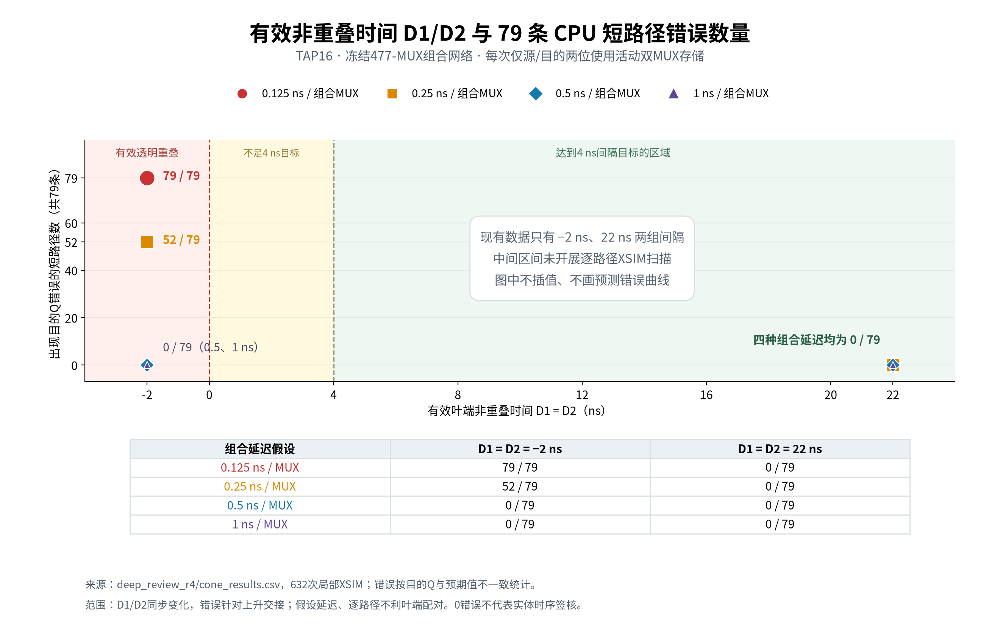

# V2.4-B：79组真实CPU短路径分析

2026-11-04。**VERIFIED：冻结网表/历史见证复核、632次局部时序实验；CONDITIONAL：数据污染延迟和放置；实体路径安全NOT_VERIFIED。** 没有执行完整CPU回归，没有修改CPU网表或机器码。

## 1. 原始79组到底证明了什么

输入是 `docs/m20/physical_resources/co_launch_risks.csv`、冻结 `m20v21_cpu_core.netlist.json` 及trace_manifest指向的V2.1游戏原始轨迹。实际核对9份轨迹/输入文件和网表SHA，重新构造对应退役前状态、微状态、ROM/RAM/keys并检查：

1. 所列每一个MUX的输入确实来自上一节点，最后到达目的D。
2. 历史微周期中源寄存器将翻转，列出的侧输入条件允许传播。
3. 在其余状态固定时仅翻转源Q，目的D布尔结果改变。

全部79组成立。这个见证证明该周期存在逻辑影响条件，**不等于完整动态路径只有一条或原器件一定在该周期穿透**。原报告的UNPROVEN敏化边界保留，不修改历史文件。

|MUX层数|路径数量|SELECT/DATA如何处理|
|---:|---:|---|
|4|4|按每条实际route的pin逐项解析|
|5|17|同上|
|6|14|同上|
|7|17|同上|
|8|27|同上|
|合计|79|无0.1ns人工总组合路径|

[79条紧凑报告](ff16_review_resources/cpu79_summary.csv)包含源/目的、层数、逐MUX route、微状态、机器码/历史事件、侧输入条件、时钟时间和实际局部实验结果。原始 `cpu_route_pins.csv` 有逐节点输入、group与pin； `cpu_witness_vectors.json` 保存完整输入向量和见证。未伪造未知的物理污染最小值。

## 2. 两种安全口径分别报告

**A，全局非重叠：**任何Slave有效开放前全部Master已经有效关闭。它不依赖组合污染延迟；本轮仍优先要求A。

**B，逐路径最小污染约束：**某条源Slave在tS更新Q，沿实际CPU组合到目的Master，在其最晚关闭tM之前是否可能到达。上升交接条件分析为：

```
earliest_data_arrival = tS + CQ_min + Σ DATA/SELECT污染min + PCB_data_min
path_hold_slack = earliest_data_arrival − tM − destination_guard
```

负slack是条件风险，等于0标BOUNDARY_NOT_QUALIFIED，不列安全。缺保证min时，层数乘典型值不能证明安全。新扫描把CQ_min、数据PCB_min、guard先保守设为0，分别显式列出；组合DATA/SELECT先采用相同每级min扫描，这只是二维独立弧空间的等值切片，不是器件建模完成。

寄存器位置比较含“网表顺序示例”和“每次源最快leaf0/目的最慢leaf32”两种。**没有实际CPU PCB放置，后者是逐路径不利配对，不声称79组在同一块板上同时占据同一对物理叶端。**

本短路径分析针对源Q到目的D的上升交接；D2仍按全局叶端约束保留。未将这79组扩展成所有下降交接动态路径的证明。

## 3. 重点路径

|源→目的|真实route|层数|历史见证|
|---|---|---:|---|
|PC0→PC1|n0427:i0 → n0471:i0 → n0472:i1 → n0473:i0|4|pong_boot，事件0，PC0，word0008|
|AR0→AR1|n0505:i0 → n0538:i1 → n0539:i0 → n0540:i0|4|snake_boot，事件4，PC4，wordA600|
|A0→C|n0395:i1 → n0396:i1 → n0569:i1 → n0570:i0|4|pong_continuous_64，事件580，PC34，word7100|
|A3→C|n0310:i0 → n0396:i0 → n0569:i1 → n0570:i0|4|pong_continuous_64，事件930，PC73，word3001|

其余含PC/AR增量高位、A移位及FSM→PC等，共79组。表中route是冻结网表原节点，不是另设计简化ALU；确切选择侧条件见CSV，不能凭功能模块名猜测。

## 4. 使用原477个组合MUX的局部XSIM实验

测试生成器逐节点复制冻结网表的全部477个MUX连接，使用原独立传播模型；源/目的两位使用真实反馈双MUX存储，其余31状态和ROM/RAM/keys保持为历史见证值。源预置为此周期应该获取的新位，目的Master接实际组合D锥，20颗TAP16发生器真实输出经过对应分配参数。初始化后检查源确实提交、目的D在上升前与冻结逻辑一致，再观察Q/QM。

两时钟配置均沿用原参数家族：

- 正对照：每级链2ns，ROOT=29ns，有效叶端间隔22ns。
- 压力：每级链0.5ns，ROOT=5ns，源Slave在12ns开、目的Master在14ns关，有效间隔−2ns。

每种配置79向量×4组合弧参数，共632次。实际结果：

|每个组合MUX弧假设|4～8级累计污染示例|正对照错误/79|压力实验错误/79|
|---:|---:|---:|---:|
|0.125ns|0.5～1ns|0|**79**|
|0.25ns|1～2ns|0|**52**|
|0.5ns|2～4ns|0|0|
|1ns|4～8ns|0|0|



[高清/矢量图与数据说明](ff16_review_resources/margin_error_relation/README.md)：仅绘制已有−2ns、22ns两组时序配置，不把中间未测区间插值为已验证曲线；两配置D1/D2同步变化，不代表独立D2因果扫描。

压力0.25ns的52条对应4～7层路径；27条8层到达数学边界未出现错误。0.5ns的四条4层同样是边界，不因为本次数字事件未错而签核。该反馈锁存模型还配置0.1ns DATA端延迟；理论分析将这项取0以保持保守，没有当成原厂tCD保证。

**本模型在DATA端预延迟后由有效SELECT选择，已稳定数据在开放时可以立即送Q，不能把设置的Slave DATA延迟再当成额外保证CQ_min。** 本实验CQ最小按0处理。全局叶端仍重叠时，B的未见错误不能替代A。

仿真标记 `FF16_CPU_CONES_COMPLETE cases=632 observed_mismatches=131 no_full_CPU=1`；[实际汇总](ff16_review_resources/cone_verification.json)，原始 `cone_results.csv`、生成SV、输入向量、日志和 `xsim/cone_paths.vcd` 全部有SHA。不是87场景、不是Pong/Snake重新执行，也没有声称冻结CPU在实体时钟下验收通过。

## 5. 风险结论

TAP16快速链不利配对下，若不承诺任何组合min（取0），79组全部有条件风险。若只假设每级0.25ns，则52组为负、27组为边界；每级0.5ns时75组有正的条件slack、4组在边界；每级1ns时79组为正。这是参数条件，不是原厂保证。

因此实际路径有可能缓解原0.1ns人工总路径的风险，但**目前没有资料足以证明所有实际路径都能消除该风险**。A优先；B作为补充，需要测得或有可信边界的源CQ、DATA/SELECT污染、数据布线及目的锁存有效关闭/hold，且需考虑多输入同时变化与冒险。不能以目前0.5ns扫描未错批准C/D。
