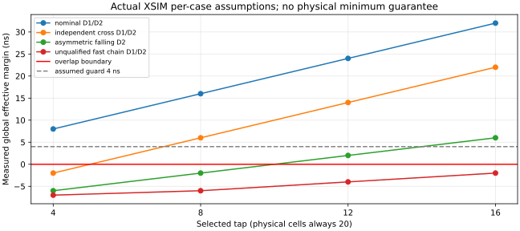

# M20 V2.4 A/B：20颗前馈发生器开发与验证报告

> **当前正式状态：用户批准 V2.4 有条件数字验收。** [正式阶段报告](../reports/m20_phaseV2.4_20261104.md)；本地标签 `m20-v2.4-digital-verified`。以下待审/停止字样是开发历史；24个问题配置及131局部错误保持原分类，物理/FPGA实现/硬件开放。

> **2026-11-04 最新状态：V2.4-C/D 数字联合已经完成。** [完整系统报告](M20_V24_FULL_SYSTEM_VERIFICATION.md)：A/B/C 的 logic/timed 六配置各 87 场景、57,331 事件全部通过；B/C 各 50,521 非法终态与恢复、全部 151 Python 通过。指定 TAP16 条件下有效 D1/D2=22/22ns。实体时序仍 NOT_VERIFIED，未创建 V2.4 commit/Tag。
>
> 以下 A/B 正文与失败结论保留其历史口径；其中“未开始 C/D”“停止在 A/B”描述当时阶段，已被用户本次授权的数字/实体分层验收替代，不代表当前任务停滞。原 24 个问题配置和 131 次局部错误均重放保留，未改成 PASS。

2026-11-04，供审核。**固定20颗结构正确，独立时序模型能够检出实际穿透；时序门禁未通过，已停止在A/B，没有开始C/D或完整CPU联合回归。** 这不是V2.4正式验收报告，也不改变V2.3模式A的原PASS。

## 本轮范围与交付

完成固定16级链、4/8/12/16静态抽头、20颗独立结构审计、逐芯片传播模型、33对双MUX锁存器测试和14类场景扫描。原543 CPU、ISA、Pong/Snake机器码和V2.3代码/数据/tag不修改。17颗及116颗Johnson方案保留为历史，未用于本轮前馈发生器的通过证据。

|交付|入口|
|---|---|
|架构/来源A、B、C映射|[架构](M20_V24_FEEDFORWARD_ARCHITECTURE.md)|
|16级/四抽头/0Ω/负载/测试点|[抽头设计](M20_V24_DELAY_TAP_DESIGN.md)|
|逐MUX/引脚/无环审计|[20颗审计](M20_V24_MUX_AUDIT.md)|
|独立DATA/SELECT、惯性及锁存有效边界|[时序模型](M20_V24_TIMING_MODEL.md)|
|56项结果、反例与图|[非重叠验证](M20_V24_NONOVERLAP_VERIFICATION.md)|
|钳位/初始化/停车/单步边界|[SAFE_HOLD契约](M20_V24_SAFE_HOLD_CONTROL.md)|
|待实现的新存储服务要求|[FPGA存储时序](M20_V24_FPGA_MEMORY_TIMING.md)|

源码为 `rtl/m20/v24_ff16/`；独立模型与Testbench为 `sim/m20_ff16/`、`sim/m20_ff16_static/`；结构/时序数据工具为 `host/python/m20/ff16_structure.py`、`ff16_timing.py`；回归入口为 `sim/scripts/run_m20_ff16_small.sh`；证据整理器为 `tools/m20/ff16_evidence.py`。两个新增Python测试文件包含9项结构和6项时序工具测试。

## 参数、资源与实际测试

|项目|实际配置/结果|来源与边界|
|---|---|---|
|目标器件/电源|NC7SZ157P6X / 3.3V|用户指定；未进行实体测量|
|发生器/核心合计|20 / 543＋20＝563颗|逐实例结构审计；不含Buffer树和FPGA服务|
|延迟链|固定16颗，抽头4/8/12/16|静态0Ω选一，无状态、计数器、反馈、动态选MUX|
|参考时钟|正常1MHz，500ns高/500ns低|仿真配置，不是CPU实测Fmax|
|占空/抖动|300/700ns，确定性±20ns|专项输入场景|
|基准链传播|每级DATA上/下降2ns|assumed；不作数据手册最小保证|
|每组检查|两个初始化完整周期后4个基础参考周期、33对锁存器；正常保持另加两次上升检查与park/resume|小型DFF/流水测试，不是87场景CPU|
|时间精度|1ps|XSIM数字模型|
|叶端判定|D1/D2至少4ns，Master窗至少100ns|assumed测试门槛，不是CPU路径或实体setup/hold签核|
|工具|Python3.12虚拟环境、已有XSIM2026.1.1|未迁移V2.3工程或生成bitstream|

|验证层|结果|实际证据|
|---|---|---|
|结构/非法配置与篡改检查|VERIFIED，9项测试|Python日志、structure_audit.json|
|RTL语法/elaboration|VERIFIED|small_r4/xsim/compile.log及各elaborate.log|
|零延迟实际SV真值/四抽头/后续级|VERIFIED，24项|structure.log标记vectors=24|
|DATA/SELECT弧、惯性与两方向真实穿透自测|VERIFIED|pin_model.log的实际穿透标记|
|4tap×14时序场景|32 CONDITIONAL / 24 FAILED|[56项CSV](ff16_resources/timing_results.csv)|
|全部Python单元测试|PASS，142项，12.608秒|build/m20_300/v24_ff16/python_all_20261104.log|
|完整STOP/STEP、同步ROM/RAM新适配|NOT_VERIFIED / NOT_RUN|按小型测试门禁停止|
|87场景/57,331事件/50,521非法CPU终态|NOT_VERIFIED / NOT_RUN|本前馈版本未运行，不能借用旧版PASS|
|综合、布局布线、STA、实物|NOT_VERIFIED / NOT_RUN|本次不做板级开发或实体签核|

## 四抽头的实际模拟死区

以下为所有33个Master/Slave叶端的全局有效裕量，单位ns，包含独立Buffer与锁存开启/关闭假设。正数只在所列参数集合内有意义。

|抽头|名义D1 / D2|11个normal_assumed中最坏方向|快速链敏感性D1 / D2|敏感性流水错误|
|---:|---:|---:|---:|---:|
|TAP4|8 / 8|−8.2|−7 / −7|4|
|TAP8|16 / 16|−2|−6 / −6|4|
|TAP12|24 / 24|2|−4 / −4|4|
|TAP16|32 / 32|6|−2 / −2|4|

TAP16在11个normal_assumed中最坏6ns，超过4ns测试guard；但快速链0.5ns/级场景仍重叠2ns。**本轮不推荐实体抽头。** 若限定在已列11组假设内，TAP16是数字候选；该结论不能扩大到未限定的器件最小延迟。

最重要的反例是TAP4根部两相间隔+5ns、同位锁存器无重叠，却因Slave0先打开、Master32晚关闭出现2ns跨位透明重叠，实际流水Q提前一周期。[波形与完整见证](M20_V24_NONOVERLAP_VERIFICATION.md)说明只检查两条时钟网或同一对锁存器不够。

## 尚未解决的条件与修正方向

原厂NC7SZ157 Rev.7给出指定条件下DATA/SELECT传播典型和最大值，没有足以证明本电路最低死区的保证最小值。所有本轮运行中的最低延迟、Buffer偏斜、探头负载换算和反馈锁存有效开/关时间均assumed，详见[参数来源](ff16_resources/parameter_sources.json)。不能声称真实器件一定失败，也不能排除快速链后宣布物理通过。

恢复开发前应先明确上/下降链最小延迟与最坏叶端开关差，或形成能减少该差值的20颗以内修正方案。当前快速链TAP16的−2ns距离4ns guard还差6ns；仅降低参考频率不会修正交接重叠。可计算的[参数充分条件示例](ff16_resources/parameter_envelope.json)用于下一轮评审，不是器件保证或PCB放行。

SAFE_HOLD正常手动保持/恢复在给定时序下通过，晚释放反例每tap漏1窗且错1次。完整FPGA单步、RESET序列和RAM事务尚未实现/验证。新服务必须适应 `f_micro=f_REF`，利用较长高/低稳定窗口与较快FPGA服务时钟，不把完整BRAM访问挤入短D1/D2；具体时序契约仍为设计稿，见存储文档。

## 证据保存与恢复

最终原始运行保留于 `build/m20_300/v24_ff16/small_r4/`；small_r1～r3不覆盖。小型汇总和少量图表保存在 `docs/m20/ff16_resources/`，全部延迟配置/原始逐事件CSV/VCD/WDB/日志另由[272项SHA索引](ff16_resources/evidence_sha256.csv)追踪，合计5,258,980字节。Git只纳管源码、配置摘要、CSV和少量图表，编译缓存及大波形仍保留原位并忽略。

|文件|SHA256|
|---|---|
|small_r4/small_verification.json|e9a12918974062d4e970a5f6e8075879724a622f383d92978fb4a83d82097aab|
|python_all_20261104.log|2ef700a3dd4905355ebe5d1cbe7f9106355b6ec3e9a7a6b57165f298fde2f801|
|small_r4_evidence.tar.gz|ec6ae1e549db0e3fc4f85373f9d1434878cd3fcf3f863d9af72a64f492dcd652|

数据包位于 `build/m20_300/v24_ff16/small_r4_evidence.tar.gz`，543,113字节，包含原始证据和打包时的数据摘要，不含随后完成的本报告正文；**只生成在本地，未上传**。原始路径与SHA见[origin](ff16_resources/origin.json)、[数据包索引](ff16_resources/upload_bundle.json)。生成器/模型10项源码和116项运行输入分别有独立SHA，不能用报告代替原始证据。

重跑用新输出目录执行 `sim/scripts/run_m20_ff16_small.sh`；分析时先检查JSON的project_gate，而不是将脚本退出0当作设计全部通过。任务恢复入口为[活动任务](../tasks/m20-v24-ff16-20261103.md)。

Git供审状态：旧38份暂存blob保持，新增52份FF16及原提案来源文件单独暂存，未commit/tag；[分组文件清单](ff16_resources/git_review.json)记录范围。TASK_PROGRESS、M20索引和版本历史的当前检查点保留为工作区修改，未覆盖其旧暂存版本，后续不能直接提交整个索引。所有操作限本地。

**审核结论：V2.4-A完成；V2.4-B模型和反例验证完成，但适用时序边界未获确认。C/D保持NOT_VERIFIED，不创建V2.4验收tag。**

## 2026-11-04追加：B深化评审

本节追加记录，不更改上述56组/原始SHA和失败结论。[深化架构评审](M20_V24_ARCHITECTURE_REVIEW.md)已完成既有证据复核、根/叶7ns分解、参数包络和79组真实短路径核对。新原始数据为 `build/m20_300/v24_ff16/deep_review_r4/`，少量摘要在 `ff16_review_resources/`，不与本页原 `ff16_resources/` 混写。

新增632次局部实验使用冻结477个组合MUX连接、两个活动的真实双MUX存储单元，其余状态固定在历史见证值。316次名义正对照无错误；快速链/不利叶端配对下131次错（0.125ns/级：79，0.25ns/级：52），并非完整CPU运行或实体失效证明。Python全量现为146项PASS（原142保留）。

原7ns损失是模型分配聚合差3ns＋有效锁存边界差4ns，不是实测PCB偏斜。平衡译码、L=7ns家族下TAP16需累计链min≥10ns/14ns，才能分别达到D1/D2≥0/4ns；全部最低值仍assumed。保持20颗主线，暂不准入C/D。详细条件见[灵敏度](M20_V24_TIMING_SENSITIVITY.md)、[时钟树/Buffer资料](M20_V24_CLOCK_TREE_BUDGET.md)、[真实路径](M20_V24_REAL_CPU_SHORT_PATH_ANALYSIS.md)。

## 2026-11-04：C/D 实际执行与审核入口

已实现单参考边沿驱动的 FPGA 存储服务、RUN/STOP/STEP 协调、新存储绑定及独立模式 A 对照。保持原 477 组合、66 反馈存储和 20 发生器，不用理想时钟替代 B/C 真实 H/S。完整结果、12 项结论、参数、波形、SHA 与一键命令见[完整系统验证](M20_V24_FULL_SYSTEM_VERIFICATION.md)。

证据：`build/m20_300/v24_ffcd/full_r1/`；[小型摘要目录](ffcd_resources/verification.json)。模式 B 参考 1MHz，C 为独立约 0.9916MHz，FPGA 服务 50MHz；原 2/5 微周期保持，停车/启动墙钟开销单列。只在规定数字延迟包络内通过，不是实体时序签核。原 90 暂存文件和历史 Tag 未改变，新交付尚未提交，等待用户审核。
