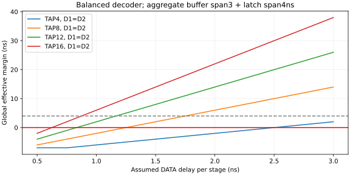
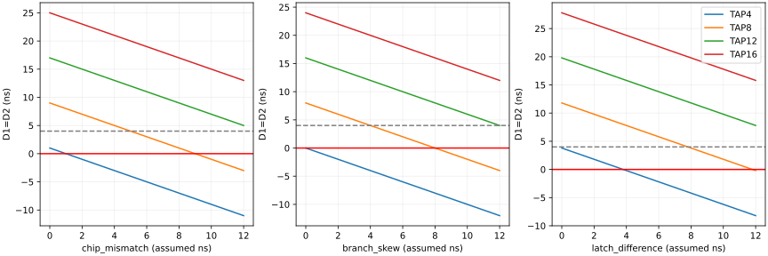
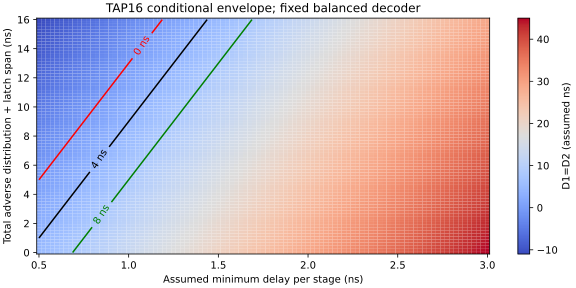
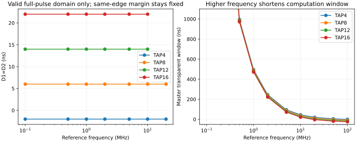

# V2.4-B：TAP16灵敏度与条件工作包络

2026-11-04。执行结果为VERIFIED，物理结论均为CONDITIONAL或NOT_VERIFIED。新运行 `build/m20_300/v24_ff16/deep_review_r4/`；原small_r4及其失败证据不覆盖。

## 1. 重现与扫描范围

```bash
M20_FF16_REVIEW_OUTPUT_DIR="$PWD/build/m20_300/v24_ff16/review_new" \
  bash sim/scripts/run_m20_ff16_review.sh
```

脚本要求新目录，先只读校验旧56组、哈希和日志，再产生分析/图，再执行632个局部双存储单元实验；**不会运行完整CPU或V2.4-C/D**。默认使用已有Python3.12环境与XSIM2026.1.1，可通过SWCELL_PYTHON/M20_VIVADO_BIN配置。

|扫描|实际规模/说明|参数来源|
|---|---|---|
|链延迟|4tap×51点×4分布＝816点；0.5～3ns、步进0.05ns|assumed探索范围|
|分布|全级相同、0.75/1.25交替、独立固定种子、下降为上升一半|全16级逐级值保存在原始CSV，不裁后级|
|叶端分解|芯片、分支、PCB、有效边界四轴，各49点×4tap＝784点|各自独立标名的assumed跨度|
|译码/钳位|60点；另192点原C到OR/AND输入相对到达和DATA快慢|完整稳定脉冲解析，不代表任意毛刺|
|频率|144点；0.1～100MHz、四种链延迟、4tap|超出完整脉冲适用域明确标记，不外推公式|
|包络|0/4/8/12ns guard；独立边界0/2/4ns等|assumed目标，无实体min保证|
|SAFE_HOLD释放|10个提前量的必要窗口分析；旧实际晚释放负测保留|解析约束，非完整控制器验证|

源码 `host/python/m20/ff16_review.py`；[扫描摘要](ff16_review_resources/delay_scan_summary.csv)、[叶端扫描](ff16_review_resources/leaf_scan.csv)、[完整证据索引](ff16_review_resources/evidence_sha256.csv)。seed固定为240411，不作统计工艺分布或良率推断。

## 2. 根部重汇合公式

令τr/τf为所选链累计延迟，译码DATA/SELECT延迟各自独立；钳位一直释放时：

```
H↑ROOT = min(H_select_r, τr + H_data_r) + HoldH_data_r
S↑ROOT = max(S_select_r, τr + S_data_r) + HoldS_data_r
S↓ROOT = min(S_select_f, τf + S_data_f) + HoldS_data_f
H↓ROOT = max(H_select_f, τf + H_data_f) + HoldH_data_f
```

一个输入已确定OR上升可先到达，AND上升则需两个条件均到达；下降相反。原TAP4快速链的根部0ns来自这种重汇合，不能简单写“累计2ns减3ns＝−1ns”。以上仅限完整隔离脉冲，不代替惯性事件仿真。

固定本轮平衡家族：关闭SELECT=4ns，等待链的DATA=1ns，另一SELECT=1ns，两钳位DATA均1ns。可化为：

```
R(τ) = max(τ−3, 0)
D1 = R(τr) − L1
D2 = R(τf) − L2
```

L1/L2分别为不利分配差与有效开关差之和。原敏感性家族两者均7ns，**这不是所有器件角落的通用常数**。原始译码不匹配、输入路由差或钳位竞争时，必须回到第一组公式/事件模型。

## 3. TAP16最小链延迟与允许偏差

当L+guard>0，满足要求的充分/必要边界（仅此参数家族）是：

```
τ_min >= 3 + L + guard
L_allowed <= 16 × stage_min − 3 − guard
```

若把锁存有效差K与分配总差B分开，`B_allowed = 16d−3−K−guard`；负的允许量意味着即使理想分配也不能满足所设K和guard。

|TAP16每级最小延迟假设|ROOT间隔|允许L：guard0|允许L：guard4|允许分配B：K=4、guard4|
|---:|---:|---:|---:|---:|
|0.5ns|5ns|5ns|1ns|−3ns，不可行|
|0.625ns|7ns|7ns|3ns|−1ns，不可行|
|0.75ns|9ns|9ns|5ns|1ns|
|0.875ns|11ns|11ns|7ns|3ns|
|1ns|13ns|13ns|9ns|5ns|
|1.25ns|17ns|17ns|13ns|9ns|

原L=7ns时，TAP16的guard0/4/8分别要求累计至少10/14/18ns，即每级至少0.625/0.875/1.125ns。等号只表示达到数学边界；0ns仍不是实体setup/hold保证，测量不确定度和负载变化要另留裕量。

|每级min假设，L=7ns|guard0最短tap|guard4最短tap|guard8最短tap|
|---:|---:|---:|---:|
|0.5ns|无|无|无|
|0.75ns|16|无|无|
|1ns|12|16|无|
|1.25ns|8|12|16|
|1.5ns|8|12|12|
|2ns|8|8|12|
|3ns|4|8|8|

此对照不使用不存在的原厂min；它说明无需增加级数也存在条件可行区，并不批准任何实体tap。







## 4. 频率、透明窗和组合建立预算

在上述独立快慢对称家族、占空50%时：

```
Master透明窗 = Slave透明窗 = T/2 − τ + 3
最保守Q启动至下一Master关闭预算 = T − τ − 4
```

后者从最晚Slave开放至下一最早Master关闭计算；组合逻辑在Master关闭的高半周期也能传播，**不能误称所有CPU计算都必须局限在Master透明低半周期**。ROM/RAM返回截止时间仍需另外满足。

若假设最低Master窗W、Q至下一次采样所需总传播P，则：

```
τ_max <= min(T/2 + 3 − W, T − 4 − P)
另需满足完整脉冲适用条件；本次保守要求 τ < T/2−4。
```

为展示建立/交接同时约束，取**纯假设**W=100ns、P=29×5.2＋5＋5=160.8ns（最大拓扑层数乘弧上界的保守示例，含CQ/setup假设，不含已签核PCB或新存储服务）：

|参考频率|τ_max条件上限|guard4/L7要求τ_min=14ns|结论|
|---:|---:|---:|---|
|0.1MHz|4903ns|14ns|有条件区间|
|0.5MHz|903ns|14ns|有条件区间|
|1MHz|403ns|14ns|有条件区间|
|2MHz|153ns|14ns|有条件区间|
|5MHz|3ns|14ns|此W假设下无共同区间|
|10MHz|−64.8ns|14ns|此P假设也不满足|

更改W/P会改变区间，不能将这张表当CPU Fmax。原脚本另列W=10ns，5MHz时上限35.2ns，仍有14～35.2ns条件区间；真实存储/CPU预算未确定，均不放行。

在完整脉冲有效域内改变频率，D1/D2曲线保持水平；频率升高只会缩短建立和透明时间，直至脉冲条件失效。**降低频率不能修复原−2ns同边沿交接重叠。**



## 5. 负载和资料边界

所选tap4/8/12还驱动下一实体级I0；tap16不含此直接输入，固定后级不会随仿真参数消失。原负载专项在所选级附加上升1ns/下降2ns，属于探头/负载敏感性，非RC提取结果。新独立分布保留全部16级延迟，但没有把未知电容映射伪装成校准传播。

所有本轮链最低值、有效锁存器开闭、PCB差与组合污染延迟均assumed。Buffer原厂指定点与系统假设分开见[时钟树预算](M20_V24_CLOCK_TREE_BUDGET.md)。对任意输入毛刺、模拟斜率和亚稳态仍NOT_VERIFIED；原3ns窄脉冲和晚释放失败不删除。
