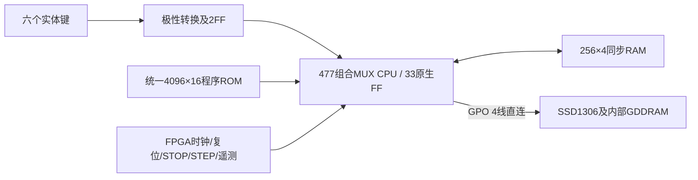

# M20 V3.1：CPU自主软件系统架构

2026-11-05。冻结ISA v0.1、477组合MUX、33位状态、原V3机器码/工程/Tag均保持。新工程`fpga/projects/m20/autonomous`；状态和实机结果以[测试报告](M20_V31_TEST_REPORT.md)为准。

## FPGA平台职责

`swc_m20_v31_service`保留已验证的50MHz系统时钟和50拍/微周期窗口：phase0进入Master阶段，4发起同步RAM请求、5返回，19捕获退役元数据，20关闭Master，21提交一次RAM写，25 CPU CE提交，28采样更新后的ROM地址、29返回同步ROM，40关闭Slave，49结束微周期。FUNCTIONAL_STORAGE只在25使用原生FF提交；两相H/S仅表示调度，不声称实体双MUX DFF或外部发生器上板。

CPU微周期1MHz，普通指令2微周期，RAM指令5微周期，V1-TIMING-0.1不变。CPU ISA没有新增指令。主线程连续运行；只有调试暂停、复位、HALT/TRAP可以停车。STOP在当前微周期结束停车，STEP执行一个微周期；可能在一条RAM指令中间停车，但待提交写已经在21唯一提交，不重复执行ST。重新复位清pending，不由硬件清RAM。

ROM只有一个bank，CPU自主跳转选程序。平台没有游戏ID、菜单ID、PONG_TICK_DONE/SNAKE_TICK_DONE、wait_tick、帧定时器、游戏RAM扫描、图形发生器或硬件SPI。held_pc/held_word只用于退役诊断，不用于帧控制。六键在GPIO中2FF同步后直接接CPU；held_keys在service中只是连线别名，无额外采样/事件缓存。

## GPIO与复位

|实体|CPU|含义|
|---|---|---|
|KEY2 / AE26|GPI0|上；Pong左拍上|
|KEY0 / AK28|GPI1|下；Pong左拍下|
|KEY3 / AG28|GPI2|左；Pong右拍上|
|KEY1 / AF26|GPI3|右；Pong右拍下|
|KEY5 / N19|GPI4|菜单确认/游戏重开|
|KEY6 / M19|GPI5|菜单取消/游戏返回|
|KEY4 / AF27|无CPU连接|禁用中键|
|KEY7 / M27|仅FPGA调试|暂停/继续，允许该调试键独立硬件消抖|
|RST_N / N27|系统控制|CPU复位，不是B键，不触发OLED硬件复位|

|GPO|OLED|引脚|
|---|---|---|
|3|CS_N|P22|
|2|D/C|M30|
|1|SCK|M29|
|0|MOSI|N24|
|不占GPO|OLED_RST_N|Y28|

配置后POR100ms，OLED硬件复位10ms、释放稳定10ms；CPU先完成两次复位及RESET→FETCH，再停在执行前等待OLED就绪，因此GPO8在OLED释放复位前建立。此等待属于上电外设安全启动，不理解软件。运行中的RST_N只重新初始化CPU，OLED_RST_N保持高，软件从PC0重新发送初始化和清屏。FPGA配置之前的引脚电平不受RTL保证，CS上拉/复位电源时序属于未来实体接口确认项。

## CPU软件职责与ABI

统一软件生成器在编译时将Pong/Snake所有标签/常量前缀隔离并重定位；现有汇编器处理绝对12位跳转，逐条检查目标属于已发射指令，不拼接二进制。所有显示/控制代码使用冻结ISA指令。CPU无CALL/RET、间接跳转、ROM常量读取或硬件栈；共享例程采用普通RAM返回ID和静态分派，禁止递归/重入同一例程。152个SPI调用点需要两个nibble返回ID；嵌套SPI/绘图/按键例程有独立槽。

菜单显示M20、PONG、SNAKE及选择标记。上下改变选择，A进入，B将选择回Pong。游戏中A在软件清屏后重开，B返回菜单；上＋下持续约3.35秒也返回菜单，由软件计数执行，不复位CPU。

Pong规则沿用原程序，3格高球拍、16×8逻辑坐标、8位比分；显示采用8像素逻辑格、局部擦除与重画，比分为紧凑两位十六进制。Snake沿用V3固定乱序128位置表、64槽蛇身环和占用位图，食物被占用时CPU选择下一项，既不是FPGA游戏规则也不是真随机。Snake初始画蛇身、每步只擦已真实移除的尾格，新增头与食物；死亡/增长不误擦活尾。

## RAM和ROM资源边界

|nibble地址|用途|
|---|---|
|00..23|互斥游戏工作区，含Snake乱序索引22/23|
|24..3E|软件消抖、菜单、按下/松开、方向暂存、长按、计时及旧绘图状态|
|3F|迁移后游戏RETURN_ID（原F0保留在旧V3）|
|40..BF|Snake64个坐标对，128nibble|
|C0..DF|16×8占用位图，32nibble|
|E0..EC|SPI和图形临时变量|
|ED..F5|分例程返回编号，普通RAM，无新增CPU寄存器|
|F6..FF|10nibble空余|

RAM不能容纳1024Byte framebuffer，本设计无此副本；GDDRAM只存在于SSD1306或独立外部仿真模型中。CPU软件开机显式清256nibble；Snake重开只清游戏区，不能清掉菜单/驱动返回槽。

当前修正版ROM4052/4096字，剩44（1.07%）。早期不含比分字形为3429字；直接展开字形曾超过4096，被汇编器拒绝，随后共享字形尾部/返回分派压缩至容量内，没有改CPU。未来第三游戏不改FPGA顶层，但这版ROM没有足够余量保证再装一款；需独立软件压缩或经批准扩展存储。详细静态布局见v31_resources/rom_layout.csv。

## 软件消抖与输入响应

轮询IN0/IN1，维护候选6bit电平、连续一致计数、稳定值及前值；连续3次一致才接受按下或松开，计算press/release，按下事件和最后非零方向由CPU普通RAM暂存。菜单导航采用单次触发，长按不自动多次翻转选择；短方向不靠FPGA队列。Whole-bank稳定判定意味着另一键抖动会延长接受时间，不是独立六路定时器。

软件延时期间周期轮询，绘图每完成8字节逻辑格/清屏块也轮询。采样间隔并非固定硬件定时器，3样本不等同于保证20ms滤波。正常当前样本中Pong最大18.935ms、Snake8.575ms，菜单重绘等全流程最大58.523ms；机械脉冲必须跨越足够连续样本，不能保证所有10ms短按都识别。长按组合计数只在软件等待环推进，实测模型3.357952s。固定参数假设CPU微周期1MHz，调试暂停使应用计时暂停。

## 固件0.2显示修复

用户报告Pong按A重开后球拍消失，已在旧r5复现：清屏后旧位置缓存仍有效，导致静止球拍被跳过。现在每次launch_pong都将OLDL/OLDR置15，使初始左右球拍必定重画；不改变CPU状态/游戏规则。PIX6原来重复8列0x66形成横条，现逐列输出00/00/18/7E/7E/18/00/00，Pong球和Snake食物都为加号。修复只增加29条软件指令，ROM4052字。新增真实A边沿的连续两次重开和逐像素断言，未放宽比较条件。旧r5源码/ROM/图片/日志保留在初始证据包及build快照，后续人工确认须针对新镜像。
