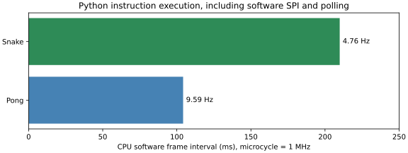
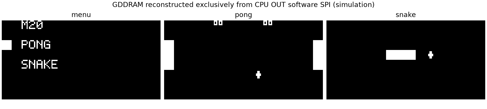

# M20 V3.1 软件周期与资源评估

2026-11-05。以下周期来自冻结Python ISA执行器的真实逐指令成本，并由新同步存储/真实CPU RTL全系统联合验证。不是板外逻辑分析仪实测频率。相关原始摘要与[布局CSV](v31_resources/rom_layout.csv)可离线再生成。

|项目|结果|统计口径|
|---|---|---|
|系统时钟 / CPU微周期|50MHz / 1MHz|50系统拍/微周期，不派生Fabric时钟|
|普通 / RAM指令|2 / 5微周期|M20-300-V1-TIMING-0.1|
|软件复位至首次完整菜单|1,505,807微周期，1.505807秒|不含FPGA POR和OLED复位等待|
|Pong帧|104,227..104,316微周期，约9.59Hz|6次正常样本，含绘图、轮询及软件延时|
|Snake帧|209,884..209,978微周期，约4.76Hz|4次正常样本，含乱序软件/绘图/轮询/延时|
|Pong常规绘图|29,589..29,593微周期，约9780..9782指令|球/比分，球拍不动时；首次绘图75,339微周期|
|Snake常规绘图|22,844..22,846微周期，约7516..7517指令|已移除尾/新头/食物；初始蛇身38,162微周期|
|游戏中轮询最大间隙|Pong18.935ms / Snake8.575ms|当前样本，不含菜单重建|
|全流程轮询最大间隙|58.523ms|菜单字形连续发送等开销|
|上下长按返回|3,357,952微周期，3.357952秒|软件组合键计数，不含调试暂停|
|软件SPI活动位周期|54..89微周期，11.2..18.5kbit/s|跨nibble有额外控制，字节之间另有分派开销|



这些是第一版可行性样本，不保证所有路径严格等周期。移动球拍需要额外擦除/重画，Snake食物查空、游戏死亡/重启和菜单整屏清除会增加开销；CPU没有硬件时间源，软件等待不补偿所有变化。减小刷新区及跳过不变球拍已明显减少常规绘图。若后续要求严格10/5Hz，应先对软件路径进一步计费或评审通用时间输入，不能暗中加FPGA游戏定时器。



图为独立SPI接收模型的GDDRAM，不是摄像头拍摄，也不是FPGA framebuffer。

## 静态ROM与RAM

统一ROM4052/4096words（8104/8192Byte）剩44字；Pong迁移例程167字，带128项固定乱序表的Snake1299字；字体/系统/SPI/软件返回分派占其余2586字。rom_layout.csv中menu_enter至spi区间含菜单、应用调度和游戏绘图，不能将1151字全算菜单。

完整显示缓冲需1024Byte，CPU RAM只有128Byte；本设计以SSD1306 GDDRAM存图，游戏和软件ABI使用246nibble、剩10nibble。新增菜单第三游戏不需要改FPGA，但当前44字资源余量不能容纳普通第三游戏；不能把“通用平台”理解为无限软件容量。

## 实际FPGA资源（restart_plus_r2）

|资源|结果|说明|
|---|---:|---|
|整个平台LUT|750|包括UART/调度/GPIO/存储，不对应157数量|
|整个平台FF|984|含调试64位计数和UART原子快照，非CPU功能状态|
|RAMB36 / RAMB18|2 / 1|4096×16 ROM和256×4 RAM，BRAM利用率并非100%|
|DSP / BUFG|0 / 1|一个50MHz系统时钟|
|CPU显式MUX / 原生FF|477 / 33|routed逐实例计数和源网表对应|
|CPU物理LUT位置|265|小LUT打包，不能当157计数|
|WNS / WHS / WPWS|+1.972 / +0.092 / +9.600ns|路由后STA，TNS/THS均0|
|DRC|0违规|没有反馈环或时序豁免|
|CDC|9条2FF，均Info|六GPI＋RST_N＋KEY7调试＋UART_RX|

## 再生成

```bash
build/venvs/python312/bin/python -B tools/m20/v31/verify_firmware.py --output build/m20_v31/software_new
build/venvs/python312/bin/python -B tools/m20/v31/report.py \
  --software build/m20_v31/software_new \
  --implementation build/fpga/m20/autonomous/restart_plus_r2 \
  --output build/m20_v31/report_new
```

脚本拒绝覆盖已有输出，验证ROM/CPU计数与STA，输出ROM布局CSV、周期CSV/JSON、图表和Bitstream SHA。implementation目录是本机证据；干净检出须先按独立工程README重新构建并执行route_audit。

本页已更新为固件0.2（修复Pong A重开和加号）。初始0.1的周期/图片保存在v31_initial_r5_resources，不回写原仿真和采集数据。新增两次A重开路径及像素比较的完整联合结果见当前测试报告。
