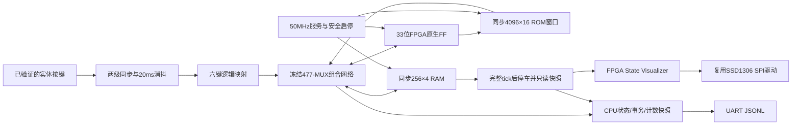

# M20 V3 FPGA 原型架构

2026-11-04。功能原型已下载，用户已确认Pong/Snake游戏画面及操作正常；随后要求减速及暂停键调整。实体NC7SZ157时序仍未验收。

CPU负责取指、译码、算术、分支、地址和所有游戏状态写入。FPGA服务层没有球/蛇状态推进函数：只有ROM/RAM、节奏、输入、只读像素呈现与调试。显示没有写入CPU RAM的端口。

独立工程为 `fpga/projects/m20/cpu_validation/`，共享逻辑在 `rtl/modules/m20/v3/`。不迁移或改写冻结的 `rtl/m20/v21`、V23/V24证据及原游戏ROM；477节点来源和33位对应关系由 `tools/m20/v3_generate.py` 生成并独立核对。

FPGA模式F使用同一个50MHz全局时钟；CPU用CE提交，不在Fabric中构建CPU时钟。模式S保留66颗反馈MUX，实际P&R后85项LUTLP-1，不能作为可下载实现。详见[结构报告](M20_V3_STRUCTURAL_IMPLEMENTATION.md)。

两个4096字程序银行映射为一个CPU可见4096×16窗口，切换只在完整周期结束后复位；不是新增CPU寻址位。普通/RAM指令仍2/5微周期。初始主动微周期1MHz，外部节奏当前Pong10tick/s、Snake5tick/s；节奏受实际执行时间限制，绝不跳过指令来追帧。

V3源码/文档未自动提交、未创建验收Tag。具体进度见[当前任务](../tasks/m20-v3-fpga-20261104.md)。
