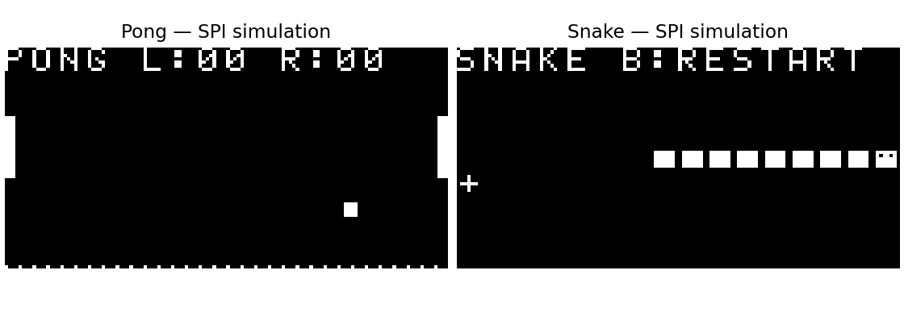

# M20 V3 游戏与状态来源验证

## 已执行的数字验证

|项目|结果|证据|
|---|---|---|
|原49指令、38游戏|PASS，57331事件，与V1/Python一致|build/sim/m20_v3/core_r2/|
|新同步存储连续运行|PASS，129帧/40398个F-S提交边界|build/sim/m20_v3/system_r11/|
|两游戏各64tick完整RAM|PASS，每帧256nibble对照独立Python ISA模型|同目录frame_snapshots.verification.json|
|STOP、STEP、运行/停止复位、改速|PASS|同目录simulation.log|
|真实SPI接收与6键映射/UART|PASS，两游戏各至少1显示帧、3918字节/6完整记录|build/sim/m20_v3/board_r9/|
|乱序食物独立软件变体|PASS，315场景/154611事件；独立变体板级仿真及实机对照|[专项报告](M20_V3_SNAKE_SHUFFLED.md)|

原38游戏场景继续覆盖反弹、得分进位、方向/反向拒绝、增长、密集身体/食物搜索、边界/自身碰撞、死亡及重启。新系统的64tick默认零键，不能把这组普通持续运行当作上述全部边界的实机触发。

## 实机初次证据

已JTAG下载functional_r2、UART收到M20V3F01，Pong连续计数前进且周期错误计数为0。首轮600s采集591条有效记录，末微周期3583459、退役1168551、持久写165683、tick17705、错误0。启动16条未识别记录原样保留。

其中无键前缀58份完整RAM快照（截至1715tick）已与独立Python执行原Pong ROM逐快照核对，全部256单元一致：`build/m20_v3_hardware_pong_prefix/verification.json`。这是有限只读快照校验，不是每条实际硬件指令的全轨迹证明。

|人工实机操作|状态|
|---|---|
|Pong球/球拍/分数显示，真实键控制，反弹/得分|用户确认正常；10tick/s速度合适|
|Snake四方向/反向拒绝/食物/死亡/B重启|用户确认正常；5tick/s速度合适；F04短按明显改善|
|两游戏切换、暂停/继续|F03/F04旧键位已用户确认；F05交换为KEY5切换、KEY7暂停，KEY4仍忽略|

用户已明确回复Pong“显示和操作正常”，Snake及切换/暂停“有效，都正常”。后续反馈速度偏快及KEY4中键易误触，已改Pong10/Snake5tick/s、KEY5暂停、KEY4无作用。原Pong/Snake文件与SHA保持不变。硬件指令家族诊断和TRAP使用独立ROM/结果目录，不混入游戏验收数据。

## 补充实机检查

原F02通过UART STOP、单步、停止复位、100k/500k/1MHz主动微周期配置，Snake零键累计131tick的12份完整256单元RAM与Python一致：[原始摘要](v3_resources/hardware_controls_f02.json)。新的F03速度/按键配置通过system_r8及board_r7（明确验证KEY4不暂停、KEY5暂停），已于19:15:44下载，UART收到F03且实际Pong相邻秒tick差为10、周期错误0。

用户报告的球回中场同时加分已核对为原ROM连续漏接/固定发球，详见[专项规则与4608tick见证](M20_V3_PONG_SERVE_REVIEW.md)，不擅自修改冻结ROM。

F04输入事件缓存已于19:46:30下载，用户确认“短按正常，明显改善”。600s原始记录`results/M20_V3/20261104_194621_buffered_keys/`含599条有效数据、1条未识别启动行、错误0，原始哈希`7238cf510f9e82412778b3ea54ca368eaff84061cc90b8ac6017605c3b2f937a`。20:14:18再下载独立乱序食物变体，66tick/12份全RAM与该变体Python ISA模型一致；新分布人工试玩尚待反馈，不能倒填为原版验收。

上图是独立XSIM SPI接收模型重建的显存图，不是实物照片。游戏规则由CPU执行，渲染只读状态。
