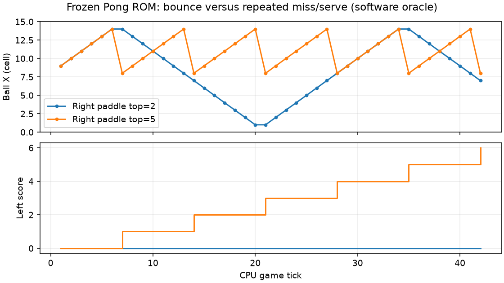

# Pong“中场到同侧反复闪回”的核对

2026-11-04。用户补充确认：球在中场与同一侧之间重复移动，同时分数增加。这与原冻结ROM的**漏接、得分、固定位置重新发球**规则相符，不能把每次回中场当作一次球拍反弹。

原 `pong.asm` 在左右得分分支都写入 `BALL_X=8、BALL_Y=4、VY=0`，VX朝向刚失分的一侧。每次发球坐标和方向固定；球拍不动且覆盖不到落点时，便重复同一段轨迹。只有命中时才翻转VX并保持碰撞内侧X=1或14。

## 可重复的软件见证

使用原ROM的Python ISA解释器，不改机器码。左球拍顶部2、右球拍顶部5（覆盖y=5、6、7），零键输入，初始球(8,4)向右下：

|tick|球坐标|右球拍覆盖|结果|
|---:|---|---|---|
|1|(9,5)|5～7|正常前进|
|2|(10,6)|5～7|正常前进|
|3|(11,7)|5～7|到下边界|
|4|(12,6)|5～7|向上反弹|
|5|(13,5)|5～7|正常前进|
|6|(14,4)|5～7|接近右侧|
|7|回到(8,4)|本次接触的新y=3，不在5～7|左侧加1分，重新向右发球|
|14/21/28|再次回中场|球拍仍不覆盖y=3|重复加分与发球|



图为**软件ISA模型执行原机器码的结果，不是实际OLED照片或示波器波形**。横轴为CPU游戏tick，纵轴分别为球X格数与左分数。右球拍top=2能接住，球会运动到对面；top=5漏接，球反复回中场。

脚本还遍历6×6种静止球拍位置，每种128tick，共4608tick，并与独立数学规则逐次比较通过。见[摘要](v3_resources/pong_serve_verification.json)、[接住轨迹](v3_resources/right_paddle_2.csv)、[漏接轨迹](v3_resources/right_paddle_5.csv)。复现：

```bash
build/venvs/python312/bin/python tools/m20/v3_pong_review.py --output build/pong_review_new
```

这是简化游戏的固定发球体验限制，原程序没有随机发球或失分停顿。本轮不修改冻结ROM。若以后希望改成随机/轮换发球、不同落点或得分动画，应新建独立软件版本并重新做CPU差分，保留原ROM。本轮已按用户要求将Pong从30降至10tick/s，便于操作和分辨得分回位；CPU主频与ISA不变。
