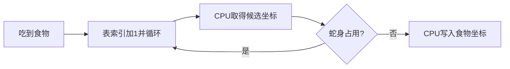

# M20 V3：固定乱序食物表

2026-11-04，Asia/Shanghai。用户提出固定乱序位置表，遇到蛇身跳过。已实现、通过数字及有限实机对照，并下载；新食物分布的人工试玩确认尚未收到，不将该变体加入原版正式验收口径。

本页的`snake_shuffled_r1`和实机数据属于F04键位；后续F05按用户要求仅交换为KEY5/A切游戏、KEY7暂停。当前镜像和新验证记录见[F05记录](M20_V3_KEY_SWAP_F05.md)，本页旧哈希及证据不改写。

## 实现与效果

原版Snake在旧食物位置之后顺序查找空格，因此食物容易沿一横排出现。本变体用覆盖全部128格的固定排列，跨行跳跃；每格只在表中出现一次。开始时仍为(10,3)，之后的候选为：

|表索引|0|1|2|3|4|5|6|7|8|9|10|11|
|---|---|---|---|---|---|---|---|---|---|---|---|---|
|坐标(x,y)|(10,3)|(2,6)|(13,1)|(5,5)|(1,0)|(14,7)|(7,2)|(11,6)|(3,4)|(15,1)|(0,7)|(8,0)|

坐标以16×8逻辑棋盘左上为(0,0)，不是OLED像素。表在程序生成时确定，重启时顺序相同；运行时由CPU查身体占用位图并跳过已占候选。不是伪随机序列。全部坐标见[food_table.json](../../software/m20_300/variants/snake_shuffled_v0_1/food_table.json)。



所有选择、查占用和写状态由真实CPU机器码执行。FPGA仍只提供ROM/RAM、输入和只读显示；没有新增食物计算硬件。

## 成本和兼容性

|项目|原版|乱序变体|
|---|---:|---:|
|程序ROM使用（16位字）|368/4096|1295/4096（31.62%）|
|食物表索引额外RAM|0|2个4位单元，0x22/0x23|
|CPU组合MUX / 状态位|477 / 33|477 / 33|
|tick_done程序地址|316|313|
|默认游戏节奏|5 tick/s|5 tick/s|

ISA没有从ROM读取数据表的指令，因此用条件分支选择立即数；增加927个ROM字，不增加CPU器件。原版ASM/ROM、ISA、V2.3/V2.4代码及Tag均保留。原[输入事件缓存](M20_V3_KEY_OLED_INTERFACE.md)继续使用。

## 验证结果

|层级|结果与范围|证据|
|---|---|---|
|Python|164项PASS；含生成文件逐字节复现、128格唯一性、原源码未改|build/m20_v3_python_shuffled_final.log|
|V1/V3/Python差分|315场景、154611事件PASS；464505微周期|build/sim/m20_v3/shuffled_r1/|
|覆盖|全部128索引及回绕、原定向/64键组合/100随机合法身体、占用前缀1/7/63/64、65阻塞负向、脏RAM启动|同上preparation.json、comparison.json|
|原版系统回归|40398个F/S提交边界、129帧；两游戏各64 tick全256 RAM一致|build/sim/m20_v3/system_r11/|
|变体板级集成|6键、SPI像素、3918 UART字节、控制PASS|build/sim/m20_v3/shuffled_board_r1/|
|综合 / 布局布线 / STA|PASS；WNS +0.735ns、WHS +0.060ns、WPWS +9.232ns、DRC 0|build/fpga/m20/cpu_validation/snake_shuffled_r1/|
|路由网表审计|477逻辑LUT3、33原生状态FF、1 BUFG|同目录route_audit/counts.json|
|实机UART|STOP/STEP/停止复位、100k/500k/1MHz通过；Snake66 tick、12份完整256单元RAM与该变体ISA模型一致；错误/输入溢出0|results/M20_V3/20261104_201445_snake_shuffled/verification.json|
|人工新食物体验|待确认|不以自动UART对照替代视觉确认|

65个候选全部占用是故意构造的异常位图单元输入，错误处理正确即该负向用例通过；不冒充合法身体。扫描最大样本17645微周期（含该负向），1MHz主动微周期下17.645ms；这是测试样本最大值，不是完整WCET证明。实机零键轨迹吃到首个食物后转为(2,6)，后续撞墙；全部128种增长位置主要由RTL夹具覆盖，未声称实机逐一吃到128个食物。

## 下载、复现和回退

当前乱序镜像（FUNCTIONAL_STORAGE）：

`build/fpga/m20/cpu_validation/snake_shuffled_r1/swcell_m20_v3_top.bit`

SHA256：`d58128b860ff512fd0bb36b6ae70afa35496844b098c39df6b27bf2e77eb3440`。

```bash
# 新构建必须选未存在的输出目录；两项变体参数必须一起给出
vivado -mode batch -source "$PWD/fpga/projects/m20/cpu_validation/scripts/build.tcl" \
  -tclargs --mode FUNCTIONAL_STORAGE --output build/fpga/m20/cpu_validation/shuffled_new \
  --snake-rom software/m20_300/variants/snake_shuffled_v0_1/snake_shuffled.memh --snake-done 313
vivado -mode batch -source fpga/common/tcl/program.tcl \
  -tclargs build/fpga/m20/cpu_validation/snake_shuffled_r1/swcell_m20_v3_top.bit xc7k325t_0
# 已有实机对照的复现入口，测试期间所有物理按键须释放
build/venvs/python312/bin/python host/python/swcell_m20_v3_control_test.py \
  --port /dev/ttyUSB1 --output results/M20_V3/shuffled_controls_new \
  --snake-source software/m20_300/variants/snake_shuffled_v0_1/snake_shuffled.asm \
  --snake-ticks 64 --leave-snake
```

上电仍默认Pong，KEY7切换Snake、KEY6(B)重启、KEY5(A)暂停；四方向与已确认键位不变。测试结束保留Snake画面。UART构建标识仍M20V3F04，必须结合bit SHA及`software_profile.txt`判断ROM配置，不能只凭F04辨别新旧软件。

回退原版F04：下载`build/fpga/m20/cpu_validation/functional_r6/swcell_m20_v3_top.bit`，SHA256 `a8807b476199a73ab8d52ff707f9211d55a960da2944592991aa7c0d8acae441`。不需要修改ISA或恢复源码。

变体ROM SHA256 `61edcb52673fd09abe265e43b27eeb073528665adfed5fcf534eaf267164738f`；本次实机原始JSONL SHA256 `55cbab6e1f415e82e45e4b9a977b5faae16f4f9dc88f22b5aebee694d2457d45`。小型汇总和逐文件哈希在[v3_resources](v3_resources/)，原始采集/仿真缓存仍分别在results/build，不自动提交或创建V3 Tag。
