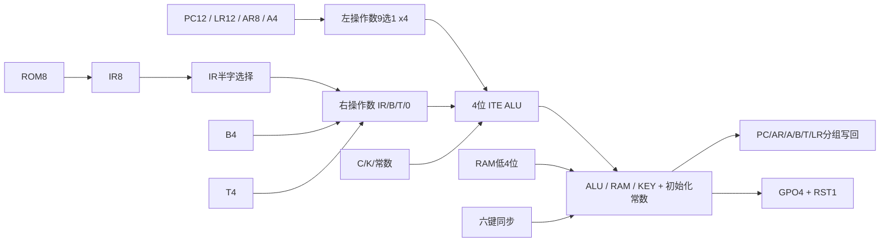

# M20微架构提案v0.1

## 1. 现有约束与复用审查

|来源|已核实内容|M20处理|
|---|---|---|
|板卡配置|XC7K325T-2FFG900C、50MHz系统输入|未来新工程沿用已确认器件信息；OLED/键引脚不据此推断|
|M11报告|基础17项/4742次；25/50MHz亿次；75/100MHz窗口及125MHz单点窗|仅说明小规模MUX存储可行，不外推82位状态、多级组合/扇出/PCB频率|
|rtl/common|UART、同步/复位、PRBS、日志、快照等|可评估复用验证辅助；多数计数用行为运算，不能直接当MUX门数已审计库|
|MUX/ALU库|未发现通用ITE原语、结构级加法器/ALU/CPU寄存器库|未来P1先建立并审计；`swc_ite2`等名称只是拟定名称|
|M20既有草案|当前目录未找到|无已冻结CPU结论可覆盖；本文全部为候选|

## 2. 4位与8位候选

|项目|4位推荐候选|8位比较候选|
|---|---|---|
|A/B/T|各4位|各8位|
|PC/AR|12/8位|保持12/8以便公平比较|
|指令|8位，4位opcode+4位字段；分支两字节|需另定义8位立即数编码，不能照搬4位ISA就宣称完整8位性能|
|PC递增|3次4位运算+3次写回|2次8位分段运算+2次写回（高段仅4位有效）|
|地址/游戏坐标|多nibble运算，RAM利用率低|字节操作/身体表更简洁，约减部分循环开销|
|输出SPI|软件逐位，常是瓶颈|仍需逐位；数据通路翻倍不等于显示吞吐翻倍|
|规划157范围|游戏配置627–747，预留至900|约743–903，预留约900–1090；控制/编码未冻结|
|主要风险|软件周期、4KiB代码容量、约300颗目标失配|更大资源/负载，新的ISA与面积闭合工作|

先选4位进入评审；若P3/P4证明软件/代码容量不达标，重新比较8位，而非偷偷把算法挪进FPGA。

## 3. 寄存器与状态

|寄存器|位数|用途|复位语义|
|---|---:|---|---|
|PC|12|程序**字节**地址，模4096|000|
|AR|8|256-nibble数据空间指针|00|
|A|4|累加器|0|
|B|4|软件可使用的ALU第二操作数|0；取指不能破坏|
|T|4|微架构临时结果/跳转高nibble|未定义，使用前由微操作覆盖|
|IR|8|当前opcode或分支扩展字节|未定义，首次ROM读取后有效|
|LR|12|单层调用返回字节地址|000；与PC三段并行清零，不增加初始化状态|
|Z/C|2|零/进位（减法时无借位）|Z=1，C=0|
|K|1|PC/AR/LR分段加法内部进位|未定义；每轮最低段强制cin=1，再写K|
|uSTATE|6|目标≤64个二进制微状态|RESET_WAIT|
|WCOUNT|2|一次总线访问附加0..3个等待周期|每次SETUP重载，不依赖上电值|
|GPO / DISP_RST|4+1|SPI控制和独立显示复位|GPO=8（CSn=1，其余0），RSTn=0|
|KEY_SYNC|12|六键×两级同步|上电短暂未定义；CPU初始化后软件消抖|
|RESET_SYNC|2|复位请求同步释放|真实板需复位/时钟电路，不能拿FPGA INIT免费替代|

合计**82个状态位**。原生FPGA FF不是157预算中的免费资源，折算与写使能另计。T不可当跨指令软件寄存器；取指会用它。B必须独立于T，否则PC递增会破坏下一条ADDB的操作数。

## 4. 数据通路

左端9个nibble源为A、PC三段、AR两段、LR三段；右端为IR选定半字、B、T、0。ALU功能为PASS_R、ADD/SUB、AND、XOR、SHR；PC/AR/LR递增共用加法器。RAM写数据直接来自A；GPIO写回也用公共总线（普通OUT时ALU执行A+0，初始化时用常数），不另加免费输入选择。IR可并行接8位ROM，是指令通路，并非暗藏8位ALU。

标志输入取实际提交的结果总线；加载/IN只改Z，保留C。PC/AR/LR运算只改内部K，不能破坏Z/C。CMP写标志不写A。所有寄存器写入都有明确enable；CE的反馈MUX计入实物预算。

## 5. 微状态与执行顺序

普通取指：ROM_SETUP→ROM_SAMPLE（WCOUNT可延长）→ROM_RELEASE→PC0_ADD/WRITE→PC1_ADD/WRITE→PC2_ADD/WRITE→DECODE。共10+W_R周期；然后执行。PC_INC最低段cin=1，其余用K，每段结果先写T、下一拍写目标。

下列状态族可展开为**63个编码**，目标6位uSTATE；本表是状态规划，不是已存在的控制RTL。P1必须补完整控制真值表、非法编码转移和门数审计。

|状态族|个数|说明|
|---|---:|---|
|复位等待+初始化|11|RESET_WAIT；PC/LR同拍清三段、AR两段、A/B、ZC、GPO、显示复位；不初始化T/IR|
|普通ROM取指|3|SETUP、SAMPLE/WAIT、RELEASE|
|取指后PC递增|6|三段ADD/WRITE，终点DECODE|
|译码/普通执行|2|DECODE、EXEC|
|RAM读|4|SETUP、SAMPLE_A或SAMPLE_B、RELEASE|
|RAM写|3|SETUP、WE脉冲、RELEASE|
|AR递增|4|两段ADD/WRITE|
|跳转扩展/写PC|10|保存高nibble；taken/not-taken各3个ROM扩展状态；taken写PC三段|
|未取条件分支跳过操作数|6|独立PC递增状态，终点取指，不误译码IR中的扩展字节|
|CALL复制PC到LR|3|此时PC指向扩展字节|
|CALL递增LR|6|使LR指向两字节指令之后，IR仍保留原opcode；再执行跳转状态族|
|RET写PC|3|LR三段经共享通路写PC|
|HALT/TRAP|2|保持状态、关闭总线写；全局时钟继续运行以便复位|

CALL顺序尤其重要：先LR←PC，LR←LR+1，再T←原IR低nibble，读取扩展字节并写目标PC。若先把目标高段放T，再用T做返回地址递增，会覆盖目标；该错误必须在P2注入检测。

## 6. 初始化和故障边界

RESET有效时令微状态回RESET_WAIT、RAM WE无效、三态写驱动关闭、显示保持复位；提供有效时钟使真实MUX主从状态初始化。释放复位后用常数总线依次清PC/LR/AR/A/B、设置ZC和安全GPIO，再从ROM000取指。T/IR在首次赋值前不得被程序读取。

RAM不承诺上电清零；游戏启动程序必须初始化身体表/位图/变量。软件执行显示器规定的复位保持与初始化序列，不能靠FPGA后台自动初始化屏幕。复位打断一次已经进行的SRAM写入时，仅允许该在途位置结果不确定；不承诺回滚。其它地址不得发生额外写入，物理写保护由P8根据器件时序审查。

## 7. 共享的收益与代价

|方案|规划面积影响|执行影响|
|---|---|---|
|共享4位ALU递增PC|相对独立12位递增器约省33–36颗（含额外写源、扣回PC读选择；T/K已被其它地址运算使用，不重复记收益）|每次取指递增6拍而非1拍，增加5周期|
|AR软件索引、无专用X寄存器|避免8位带使能X的24颗及额外读选择/加法|访问身体/位图需多条装载AR和nibble算术|
|单层LR而非硬件栈|LR自身36颗、加入读选择约12颗，合计增加约48|CALL26/RET13基础周期；比多处复制SPI例程省程序空间|
|省去LR|约省48，控制可简化|只能内联/手写控制流；游戏代码容量风险提高|
|微程序ROM控制|可减少门级译码但把控制逻辑转移进额外ROM|不作为默认方案；若采用必须列为额外控制存储器、改变BOM，不借FPGA BRAM免费实现|

以上面积差是方案内的结构估算，不是综合得到的测量。二进制微状态优于直接付出63位one-hot存储成本，但译码门数必须审计，不能把6位FSM只计12颗后忽略下一状态逻辑。
