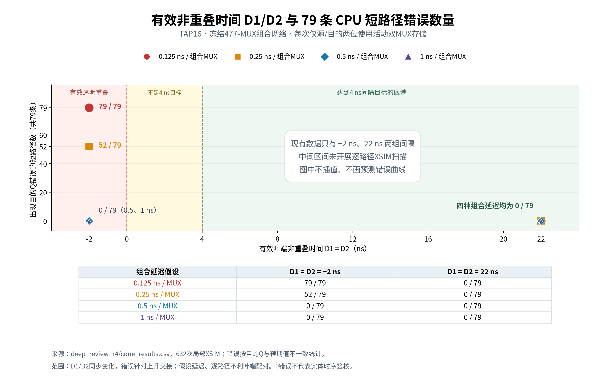

# 有效非重叠时间与79条CPU短路径错误数

2026-11-04。仅重新绘制已有632次局部XSIM观察，没有新增仿真或改动原始结果。

横坐标是实际时序配置对应的有效叶端D1=D2，不是根部H/S间隔。现有数据只有−2ns和22ns两组；中间区间未扫描，因此不插值。每个数据点检查79条路径，颜色/形状区分组合MUX的DATA/SELECT延迟假设。

两种时钟配置中D1/D2同步变化，目的Q错误针对上升交接；本图不证明单独改变D2的效果。0.5/1ns组合延迟假设下，负裕量点未见错误，也不能据此认定全局时钟安全或实体时序通过。

- [高清PNG](margin_error_relation.png)、[矢量SVG](margin_error_relation.svg)。
- [8个汇总数据点](margin_error_points.csv)、[来源/输出SHA与范围](plot_metadata.json)。
- 来源：`build/m20_300/v24_ff16/deep_review_r4/cone_results.csv`与原根/叶分解；均只读。
- 重现：在工程根目录执行 `build/venvs/python312/bin/python -B tools/m20/plot_ff16_margin_errors.py --output <新的输出目录>`。需保留/恢复原始证据；拒绝覆盖已有目录。

分类：图和数据一致性VERIFIED，延迟/放置参数CONDITIONAL，实体时序NOT_VERIFIED；V2.4-C/D门禁不变。
