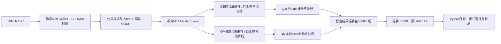

# M11 第二阶段：高速测试工程与操作

本文说明增量实现和测试方法，**不是第二阶段正式通过报告**。正式验收须以完整有效数据及用户确认作为依据，随后按`docs/reports/`规范出具报告。第一阶段源代码、顶层、约束与bitstream路径保留。

## 1. 架构与接入

采用静态配置、多bitstream扫频。每个频率、Q/QM采样相位、模式、位数的组合独立综合实现；Python只下载通过内部时序检查的镜像。不实施运行中的时钟MUX切换，不使用DRP或IDELAY，本阶段不做绝对延迟标定。



| 路径 | 职责 |
| --- | --- |
| `rtl/common/xilinx/swc_hs_clocks.sv` | 固定MMCM、BUFG、ODDR时钟输出；1MHz低频时隙 |
| `rtl/common/xilinx/swc_hs_pattern_driver.sv` | 初始化、公共模式/PRBS31推进和ODDR数据输出 |
| `rtl/common/swc_prbs31.sv` | 与第一阶段共用的PRBS31发生器 |
| `rtl/common/swc_capture_lane.sv` | 单路IOB采样、参考/标签流水线、64bit计数、首次错误、停止冻结 |
| `rtl/common/swc_snapshot_bridge.sv` | done同步后延迟捕获保持不变的多bit结果 |
| `rtl/common/swc_json_packet_tx.sv` | 请求快照和逐字节发送握手 |
| `rtl/modules/m11/phase2/` | M11主从时序参考和两路测试整合 |
| `fpga/xc7k325t/phase2/swcell_m11_hs_top.sv` | 板级集成、复位/失锁/超时控制、协议v2消息 |
| `fpga/xc7k325t/phase2/build_hs.tcl` | 精确器件、时钟、IOB、内部setup/hold及DRC检查 |
| `host/python/swcell_sweep.py` | 构建缓存、JTAG、并行串口接收、相位窗口选择及长测 |
| `host/python/swcell_hs.py` | 协议v2校验、CSV、摘要、离线分析和PNG图 |
| `sim/phase2/`、`sim/scripts/run_phase2.sh` | UNISIM时钟/ODDR与独立延迟DUT模型的自动回归 |

后续M12/M13可复用时钟、驱动、采样、快照、发送和分析机制；替换电路专用参考模型。高速DFF测试期间DL_D=0、DL_EN=1，D-Latch保留第一阶段回归，本阶段不宣称测得Latch高速上限。

## 2. 频率产生方案

器件为现有`xc7k325tffg900-2`，输入50MHz。MMCM采用整数倍频、整数输出分频及50%占空比；选用600–1200MHz VCO，位于本器件工作范围内。各输出来自同一MMCM，内部相位关系保留给STA分析。

MMCM在输出分频大于64时，静态相位编码无法覆盖完整360°。本实现将Q/QM的0–7索引配置到原生CLKOUT2/3，将8–15索引配置到专用互补CLKOUT2B/3B：计数器只编码`(索引%8)×22.5°`，后半周期由原语的互补输出增加180°。BUFG输入在展开时固定连接，没有Fabric时钟反相器或运行中MUX。这避免5MHz/分频120直接设置270°引发AVAL-139，同时保留全16个逻辑采样位置。实际边沿由实现报告及UNISIM回归核对。

| DUT目标频率 | 产生方式 | MMCM倍频M | 输出分频O | VCO | Q/QM逻辑相位网格 |
| --- | --- | ---: | ---: | --- | --- |
| 1MHz | 50MHz同步计数时隙；CLK寄存器输出 | — | 50系统周期 | — | 16个索引映射到最近20ns时隙 |
| 5MHz | MMCM+BUFG+ODDR | 12 | 120 | 600MHz | 22.5° |
| 10MHz | MMCM+BUFG+ODDR | 16 | 80 | 800MHz | 22.5° |
| 25MHz | MMCM+BUFG+ODDR | 16 | 32 | 800MHz | 22.5° |
| 50MHz | MMCM+BUFG+ODDR | 16 | 16 | 800MHz | 22.5° |
| 75MHz | MMCM+BUFG+ODDR | 24 | 16 | 1200MHz | 22.5° |
| 100MHz | MMCM+BUFG+ODDR | 16 | 8 | 800MHz | 22.5° |
| 125MHz | MMCM+BUFG+ODDR | 20 | 8 | 1000MHz | 22.5° |
| 150MHz | MMCM+BUFG+ODDR | 24 | 8 | 1200MHz | 22.5° |
| 200MHz | MMCM+BUFG+ODDR | 24 | 6 | 1200MHz | 22.5° |

1MHz不使用内部Fabric派生时钟：全部逻辑仍在50MHz，采用周期使能。D更新在第13个系统周期，即0.26T（260ns，逻辑配置93.6°）；Q/QM相位索引p映射到`round(p*50/16)`系统周期，实际配置角度保存为`*_phase_mdeg`。其他频率D更新为0.25T，MMCM输出相位索引对应`p/16`周期。本表表示可生成的时钟计划，**不保证每个相位配置均满足FPGA自身时序或DUT性能**。

构建结果分为SUPPORTED、UNSUPPORTED/FPGA_TIMING、BUILD_ERROR。UNSUPPORTED仅作用于具体频率/相位/位数/模式组合；例如某个200MHz早采样配置不支持，不代表其他200MHz采样相位也不支持，更不代表DUT在200MHz失效。

资料依据：[UG472时钟资源](https://docs.amd.com/v/u/en-US/ug472_7Series_Clocking)、[DS182 Kintex-7器件时序](https://docs.amd.com/v/u/en-US/ds182_Kintex_7_Data_Sheet)、[UG953 MMCME2_BASE](https://docs.amd.com/r/2022.1-English/ug953-vivado-7series-libraries/MMCME2_BASE)、[UG471 SelectIO](https://docs.amd.com/v/u/en-US/ug471_7Series_SelectIO)。

## 3. 周期对应与采样参考

设外部CLK逻辑上升沿为`nT`，在`nT+0.25T`由ODDR推出数据`b[n]`。低频1MHz将0.25T量化为0.26T。

| 时间 | 外部主从预期 |
| --- | --- |
| nT上升沿及其后稳定段 | Q获取此前已稳定的`b[n-1]`；QM保持`b[n-1]` |
| nT+0.25T | D更新为`b[n]`；高电平期间Master保持 |
| nT+0.5T下降沿及传播后 | Master透明，QM更新为`b[n]`；Slave保持Q=`b[n-1]` |
| (n+1)T上升沿及传播后 | Q更新为`b[n]` |

Q在本周期所有相位均比较`b[n-1]`。QM在前半周期比较`b[n-1]`，后半周期比较`b[n]`。参考由实际施加的数据事务及其PRBS状态标签建立；零相位使用边沿前已稳定的launched数据，避免误用上一周期的base保持寄存器。预期变化发生在逻辑边沿，故传播尚未完成的相位会正确出现CAPTURE_ERRORS。

IOB寄存器捕获实际输入，同时保存对应expected和PRBS标签；下一采样时钟用这组配对数据比较，补偿一拍寄存器延迟。没有用两级同步器采集高速Q/QM后直接比较当前PRBS。

每路独立发出N个有效采样，最后一拍比较完成后冻结本地计数和首次错误，计数为1起算的有效采样编号。Q/QM相位为0时，首次使能观测可能比非零相位晚一周期；因此两路`first_error_cycle`和`start_state`分别保存，不把不同相位的首个样本假装为同一绝对时间。

## 4. 初始化、PRBS与停止

PRBS31复用第一阶段多项式`x^31+x^28+1`，31bit种子`0x13579BDF`，左移，反馈`state[30] XOR state[27]`，输出旧状态bit30。非零种子避免锁死。支持模式0=全0、1=全1、2=0101、3=0011、5=PRBS31。

锁定并同步释放各域复位后，前32个D域周期强制D=0，连续CLK建立QM=Q=0。此后推进模式序列；base域预热满128周期才允许有效检查。预热已推进的PRBS前缀不计入N，实际开始状态分别保存为`q_start_state`和`qm_start_state`，可独立复现本次子序列。独立仿真黄金模型验证发生器序列及实际时序。

BITS为64bit参数，构建工具允许1到10^9；默认长测至少10^6，支持10^7、10^8和10^9。Q/QM每个有效DFF周期各完成一次检查，不把两路计为两倍`total_bits`。每路有独立的`qm_total_bits`/`total_bits`用于核验相等。

完成信号分别同步后，停止PRBS推进；系统取得两个稳定快照后复位时钟与驱动，CLK/D保持安全低电平，再发送结果。UART忙碌不参与运行期间的PRBS使能。没有运行中UART暂停/修改参数命令；配置由Python构建参数设置。再次运行通过重新JTAG配置完成确定性复位。失锁或超时输出ABORTED，不计为DUT频率失效。

## 5. 窗口选择与频率结论

默认每频率扫描16个逻辑相位索引，Q/QM分别使用该索引。两路错误分别记录，因此这一组扫描已能独立找各自窗口，不需要测试16×16种组合。

Python分别找两路最长连续零错误区间，支持跨15→0的环形窗口。缺失、不支持、传输异常或发生错误的相位会打断窗口；重复观测须全部满足要求。默认至少3个连续相位，选择窗口内的中间索引。随后另建镜像组合所选Q/QM相位，进行不少于10^6次长测；重要频率可执行10^8次。

摘要与CSV区分所选有效窗口、其他零错误点、不可用点，以及相对窗口的EARLY_SIDE_CANDIDATE/LATE_SIDE_CANDIDATE；无法归到一侧时标EDGE_AMBIGUOUS。早/晚是逻辑窗口两侧的候选解释，不能从单个错误点证明具体物理根因。另给`highest_window_validated_zero_error_frequency_hz`，只统计已有合格窗口且长测零错误的频率，区别于人工指定相位的联调结果。

没有合格窗口时记录NO_VALID_CAPTURE_WINDOW，并保留每点结果，不写成DUT失效。窗口摘要包含实际扫描的bin数量；使用`--phases`子集只能得到该子集内的窗口，不能宣称已遍历整个周期。长测出错也不自动推断根因是DUT，仍可能存在采样窗口/板外路径问题。

如果扫描配置全部UNSUPPORTED，窗口摘要也标UNSUPPORTED，区别于已经测量但没有找到窗口。未选定相位的频率会在frequency_sweep.csv保留主机SCAN_SUMMARY记录，执行位数为0、采样相位为空；不把缺少长测的一行伪装成零误码结果。

`highest_tested_zero_error_frequency_hz`仅取已完成至少10^6位PRBS、Q/QM均零错误且没有同配置后续异常的频率。短扫描、UNSUPPORTED、ABORTED、传输异常不参与；它表示**已测试配置中观察到零错误的最高频率**，不是理论Fmax或全条件稳定上限。`0 errors / N bits`不等于理论BER=0。摘要中的近似95%零错误上界需额外假设独立平稳Bernoulli误码，不能当作物理保证。

## 6. CDC、IO与时序约束

每个域使用异步置位、两级同步释放复位。Q/QM done和控制信号采用同步器。两路256bit结果保持不变，在done经过两级同步后再等待两个系统周期才锁存；不逐位同步正在递增的计数器。每条结果总线另加20ns datapath-only上界，小于握手等待时间。

输入寄存器强制IOB，并在布线后检查ILOGIC位置。MMCM生成时钟由工具推导，CLK输出使用`create_generated_clock`；1MHz采用divide_by 50的输出时钟定义。参考、标签和比较流水线之间仍由真实相位关系STA约束，负setup/hold slack的配置拒绝生成bitstream。

**当前外部PCB传播、157最小/最大延迟及电气负载尚未标定。** 因此只将两个DUT pad→各自IOB捕获D的路径作为测量接口豁免，不给它们编造input_delay；同样没有编造DUT输出端的setup/hold output_delay。其余内部路径未全局false-path。此状态明确写为`INTERNAL_TIMING_PASS_EXTERNAL_DELAYS_UNCALIBRATED`，不宣称完成板外源同步STA签核。

CDC报告中这两条原始测量输入会出现CDC-1；固定结果总线会出现CDC-15，需结合“结果冻结+done握手+等待+最大延迟”的结构审查，不能因统计数字存在就把所有路径全局忽略。先前同步前组合AND已改为分别同步done、在目的域合并。后续若要板外静态时序签核，需提供有来源的回环min/max、时钟/数据走线偏斜及DUT时序预算，再补input/output delay约束。

## 7. 构建、自动上板与离线分析

从工程根目录运行，现有板卡保持已验证连接。串口和JTAG设备按实际配置，不擦写Flash。

```bash
source ~/Software/Xilinx/Vivado/2022.1/settings64.sh
.venv/bin/python -m pip install -r host/python/requirements-analysis.txt

# 第一阶段回归仍独立可用；第二阶段回归会核对真实UNISIM时钟/ODDR。
sim/scripts/run_xsim.sh
sim/scripts/run_phase2.sh
sim/scripts/run_phase2_controls.sh

# 一个静态镜像：频率、Q相位、QM相位、位数、模式、是否短扫描、输出目录。
vivado -mode batch -source fpga/xc7k325t/phase2/build_hs.tcl \
  -tclargs 25000000 4 12 1000000 5 0 build/phase2/manual25

# 仅构建全频率/相位扫描镜像，不连接硬件。
.venv/bin/python host/python/swcell_sweep.py --build-only

# 默认10个目标频率×16相位，窗口合格后执行百万位PRBS。
.venv/bin/python host/python/swcell_sweep.py --port /dev/ttyUSB1 --device xc7k325t_0

# 举例：先只测25MHz；全16相位，随后1亿位；其余模式按需加入。
.venv/bin/python host/python/swcell_sweep.py --frequencies 25000000 \
  --important-frequencies 25000000 --important-bits 100000000 --patterns 0,1,2,3,5

# 已选相位的独立稳定性复验，分别可设置10^6、10^7、10^8、10^9。
.venv/bin/python host/python/swcell_sweep.py --frequencies 25000000 \
  --point 4 12 --long-bits 10000000

# 离线重新生成CSV、摘要、曲线，不访问硬件。
.venv/bin/python host/python/swcell_hs.py results/M11/本次目录/raw.jsonl \
  --output build/phase2/reanalysis

# 仍可使用第一阶段接收入口接收单个高速镜像：
.venv/bin/python host/python/swcell_capture.py --port /dev/ttyUSB1 --stop-on-complete
```

自动工具以源码指纹与完整参数构建缓存键，避免复用条件不符的旧镜像；构建输出在`build/phase2/images/`。缓存记录bitstream SHA256，复用前核对；旧版缓存首次复用时补录哈希。构建前清除旧成功标记，构建前后源码指纹不一致时拒绝下载。每点编程前打开串口，并在Vivado执行期间持续接收，避免阻塞下载命令造成TTY缓冲溢出。串口超时、校验异常、缺消息或JTAG失败记录为基础设施错误，保留原始字节。

默认160个相位镜像加长测镜像，编译可能持续数小时；每点固定配置换来较简单的时钟安全与可审查的时序结果。已完成的镜像可复用缓存，新运行创建新结果目录。当前不实现中断后跳过已完成硬件测量的断点续跑；再次运行会重测，保留历史目录。

退出码：0=自动流程完成（可包含UNSUPPORTED点，不等于正式阶段通过），1=没有合格采样窗口或长测观测到错误，2=构建/传输等基础设施错误，130=用户中断且文件已关闭。用`--point`跳过窗口选择仅用于已知相位复验或联调；其结果不证明全周期窗口已扫描。

Ctrl+C停止主机构建/采集并关闭文件，不通过UART命令立刻中止已经下载的FPGA测试；镜像继续运行到预设N并自动停止，需要提前中止时可重新JTAG配置。正常自动扫频始终等当前点完成并进入安全状态后才下载下一镜像。

## 8. 结果文件与协议v2

默认目录：`results/M11/YYYYMMDD_HHMMSS_微秒时区/`。

| 文件 | 内容 |
| --- | --- |
| `raw.jsonl` | UART接收到的全部原始字节，可能含异常/截断行，不做伪修复 |
| `host_events.jsonl` | 主机产生的UNSUPPORTED、BUILD_ERROR、传输异常；source=host，与UART原始字节分开 |
| `phase_sweep.csv` | 逐相位频率、配置相位、总位数、Q/QM错误和观测错误率 |
| `frequency_sweep.csv` | 所选窗口长测及未支持频率配置结果 |
| `summary.json` | Q/QM窗口、最高已测试零错误频率、异常统计及解释 |
| `frequency_ber.png` | PRBS长测的频率—观测误码比例曲线；零值按观测零绘制 |
| `phase_error.png` | Q/QM各自相位—错误比例热图；缺失/无效为灰色 |
| `metadata.json` | 主机配置、源码指纹、设备、时间；电压/温度实测为空 |
| `runner_manifest.json` | 每点构建目录、支持状态、实际bitstream哈希 |

协议v1原有四种消息和CSV保持可读。v2新增SWEEP_START、PHASE_RESULT、FREQ_RESULT、ERROR_SNAPSHOT、SWEEP_COMPLETE，带`protocol_version:2`。完整字段定义见[UART协议扩展](uart_protocol.md#协议v2m11高速测试)。FPGA采用十六进制字符串输出64bit值，Python转为整数，避免精度丢失。

离线分析默认同时读取原始目录旁的`host_events.jsonl`，以复现不支持点和异常。原始数据存在非法行时严格报错，不能静默删除错误后生成零错误结论；应保留异常原始数据，选择干净完整轮次进行验收。

## 9. 验证范围及后续工作

真实UNISIM回归检查10种时钟方案、各频率Q/QM全部16位置的采样边沿、PRBS独立黄金序列、D更新相位、正确/过早采样、Q/QM单独及共同注错、计数复位/停止、失锁中止、重启、真实UART解码和百万次迭代；另外通过边界预置验证64bit跨2^32进位，以及独立单元的CE暂停/停止恢复和256bit冻结结果握手。`run_all_regressions.sh`依次包含第一阶段、第二阶段整机、第二阶段控制/相位网格三组回归。外部模型使用独立透明锁存状态及可配置传播延迟，不从比较器状态直接生成实际输出。理想/延迟模型不证明实物高速性能。

第三阶段若开展绝对时序或setup/hold测量，需要补充板卡版本、电压/温度实测、PCB回环延迟、驱动/负载、IO建立保持预算与仪器标定。当前逻辑相位、MMCM相位、实际板外延迟不是同一物理量。本实现没有IDELAY抽头设置，也没有将逻辑相位当作绝对传播延迟。

本阶段开发与实测进展单独记录在[phase2_validation.md](phase2_validation.md)，不覆盖第一阶段正式报告。
