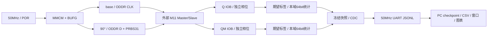

# M11 Phase 2B：独立采样窗口与分级可靠性测试

本阶段在原 Phase 2 工程增量实现。保留第一阶段全部测试、UART v1 和原 `swcell_sweep.py` 用法。正式结论以本轮 `summary.json`、原始 UART 和各镜像的 routed 报告为准，不能将之前固定 Q4/QM12 的约 50% 错误直接写成 DUT 的最高工作频率。

## 架构检查与增量修改

现有 `swc_hs_clocks` 使用 MMCME2_BASE、反馈 BUFG、四路时钟 BUFG：base、90° 数据、独立 Q 和独立 QM。Q 由 CLKOUT2/2B，QM 由 CLKOUT3/3B 在综合时选定；没有运行时组合时钟 MUX，也没有 IDELAY。CLK 通过 ODDR 输出；D 通过 90° 域 ODDR 输出。每次静态配置都重新生成 bitstream，经 JTAG 下载，POR、锁定等待、D=0 初始化、PRBS 预热和计数器清零后重新测试。

输入寄存器使用 IOB 属性，构建时强制检查实际 LOC 为 ILOGIC。采样输出与同一个采样边沿寄存的期望值、PRBS 标签在下一采样边沿比较；流水线有效标志避免 delta-cycle 和一拍错位。64bit 计数在各自采样域运行，完成后冻结。256bit 快照在 done 同步和额外稳定等待后送到 50MHz UART 域，未逐位同步递增计数器。

本轮 RTL 将启动使能经两级同步器送入 Q/QM 各自采样域，避免预热计数器译码直接驱动短相位路径。参考模型在 D 下一次发射前（相位 0..3）使用发射寄存器中的**同一笔** b[n−1]，其它相位保留 base-held 寄存器。没有任意延后期望数据一周期。协议新增两路各自的 `q_first_expected/actual`、`qm_first_expected/actual`；旧 v2 日志仍可解析。固件版本为 `m11_hs_v2_2`。

## 时钟与数据对应关系

系统输入 50MHz，UART 115200、8N1；IO 继续采用原有 LVCMOS33、DRIVE 12、SLEW SLOW 条件。名义供电 3.3V，电压实测和温度未知。

|DUT 配置频率|MMCM M / D / O|VCO|周期 T|16 点步进 T/16|D 更新 T/4|
|---:|---|---:|---:|---:|---:|
|75MHz|24 / 1 / 16|1200MHz|13333.333ps|833.333ps|3333.333ps|
|100MHz|16 / 1 / 8|800MHz|10000ps|625ps|2500ps|
|125MHz|20 / 1 / 8|1000MHz|8000ps|500ps|2000ps|

数值为逻辑配置推导，未用示波器测量实际频率、抖动或绝对传播延迟。上述相位间隔可由 MMCM VCO 1/8 周期相位量化实现：分别为 8、4、4 个量化单位。保持现有 16 点网格，未扩展 32 点。若仅有一个或两个零错误点，保守标为 MARGINAL_WINDOW；需要更细网格和外部时序测量后才能讨论更小裕量。

令 b[n] 在 nT+T/4 发射：

|采样位置（相对 nT）|Q 期望|QM 期望|
|---|---|---|
|0..7（CLK 高半周期）|b[n−1]|b[n−1]|
|8..15（CLK 低半周期）|b[n−1]|b[n]|

边界点仍按**理想更新后的目标状态**检查；传播延迟导致边界点错误是正常的扫描结果。相位 0 的 FPGA 采样在输出 ODDR/板外延迟前发生，期望取该上升沿将捕获的稳定 D，不能因实际返回仍旧而修改期望掩盖延迟。

Q 的 15→0 跨过目标比特更新，窗口算法不合并。QM 的 7→8 从旧比特切换为新比特，窗口算法在这里断开；QM 15→下一周期 0 属于同一笔数据，可以合并。保存**全部**连续零错误窗口，按宽度选择靠内部的中心。跨边界或网格端点的窗口带 `boundary_censored`，不伪称测到了两侧物理失效边界。



## 自动化步骤和恢复

```bash
source ~/Software/Xilinx/Vivado/2022.1/settings64.sh
.venv/bin/python -m pip install -r host/python/requirements-analysis.txt
sim/scripts/run_all_regressions.sh
# 仅运行新增的Phase 2B回归：sim/scripts/run_phase2b.sh

# 各频率 Q 固定 QM6 扫 0..15，再固定 Q12 扫 QM0..15，每点10000次。
# 两个并行 Vivado 构建；JTAG、串口由主线程唯一持有。
MPLCONFIGDIR=/tmp/swcell-mpl .venv/bin/python host/python/swcell_phase2b.py \
  --port /dev/ttyUSB1 --jobs 2 --output results/M11/phase2b_run

# 中断后继续；已完整采集且原始日志校验通过的测点不再下载。
MPLCONFIGDIR=/tmp/swcell-mpl .venv/bin/python host/python/swcell_phase2b.py \
  --output results/M11/phase2b_run --resume --jobs 2

# 仅继续某个频率，其他频率历史保持。
.venv/bin/python host/python/swcell_phase2b.py \
  --output results/M11/phase2b_run --resume --jobs 2 --frequencies 125000000

# 独立重测某频率：新结果目录，匹配源码及配置的合格镜像复用缓存。
.venv/bin/python host/python/swcell_phase2b.py \
  --frequencies 100000000 --jobs 2 --output results/M11/phase2b_100_retest

# 离线重新校验日志并生成 CSV/图表，无需 FPGA 或串口。
MPLCONFIGDIR=/tmp/swcell-mpl .venv/bin/python host/python/swcell_phase2b.py \
  --analyze results/M11/phase2b_run
```

只写 FPGA 易失配置，不操作 Flash。一次完整扫描有 96 个轴测点（每频率的固定锚点交集共用一个构建），另有候选模式与长测镜像，构建可能需要数小时。构建缓存按完整 FPGA 源码指纹和参数命名，每个 bitstream 都单独实现和检查时序；不能用一个相位的时序报告代替其它相位。

Ctrl+C 保存已收到原始字节和当前尝试状态；待启动构建取消，当前 Vivado 构建完成后退出。FPGA 上已启动的有限长度测试会自行结束并将 D/CLK 置低；串口忙碌不会推进或打乱 PRBS。恢复时先验证原始字节校验值、消息首尾、参数和计数，再跳过完整测点；传输失败和被中断测点重新运行。源码变更必须新建轮次，不能拼接成同一次测试。

每个频率先完整尝试两轴扫描，不因另一轴错误提前退出。各窗口中心组合分别做 0101、0011 短测与 PRBS 1e6；三者都零错误才自动执行同一组合 1e8。百万次失败不会触发亿次。窄窗口可以保留中心测试数据，但不能因此宣称有可靠裕量。所有预先识别出的候选窗口都保留，没有任意移动参考数据来寻找 PASS。

## 输出和判读

|文件|内容|
|---|---|
|`raw.jsonl`|各次采集的原始字节顺序拼接；中断可含半行，分析使用 checkpoint 指定的完整尝试|
|`attempts/*.jsonl`|每次尝试的独立原始字节，包括失败/中断，不覆盖|
|`checkpoint.json`|全部尝试、源码/bitstream/raw SHA256、阶段、原始位置、时序指标和恢复状态|
|`phase_scan.csv`|仅按当前扫描轴判定的检查/错误/首错；另一轴错误不影响有效窗口|
|`long_run.csv`|0101/0011、1e6/1e8、两路计数、相位、时序、时长|
|`summary.json`|全部候选窗口、中心、完整度、每频率结论、最高已验证亿次零错误频率|
|`q_phase_scan.png`、`qm_phase_scan.png`|实测数字错误比例，绿色候选窗口，虚线中心，红星实际通过的选相|
|`frequency_summary.png`、`report.md`|分类结论和可读图文记录|

`phase_ps` 为配置相位计算值，绝非外部精确传播延迟。`elapsed_seconds` 为主机从下载到收齐日志的墙钟时间，含 JTAG/UART；`effective_data_seconds=N/f` 为配置推导的有效数据时长。即使 1e8 零错误，在125MHz也仅约0.8s有效数据，不能等价为长时间温度/电压可靠性证明。

相邻比特转换数量作为诊断列 `adjacent_bit_transition_count` 保存。其与错误数一致仅标注 `one_cycle_signature_candidate`，不自动改变期望，也不单凭它判定 FPGA 错位或芯片失效。

最终 `PASS_1E8_ZERO_ERRORS` 必须具有两轴完整扫描、可靠窗口、0101/0011 和 1e6/1e8 同配置零错误及 FPGA 内部时序通过。仅有1e6通过且未完成1e8记 `PASS_1E6_ONLY`；亿次已发现错误则不能沿用该简化结论。无可靠窗口、窄窗口、FPGA 自身时序失败、基础设施/未完成分别保存相应状态。未排除外部采样和接口标定问题时不自动输出 `DUT_FUNCTIONAL_FAILURE`。

## 时序和仍需外部测量的项目

每个镜像保存 `timing_metrics.json` 和 timing/clock_interaction/cdc/io/drc 报告。Setup、Hold、Pulse Width、ILOGIC 放置不通过不得下载。`no_clock` 和 `unconstrained_internal_endpoints` 必须为0。只对外部 Q/QM pad→对应 IOB D 作有说明的例外：尚无 PCB/157 min/max 延迟可填写，这是相位扫描测量接口；内部输入寄存器→比较器、期望标签、计数器保持时序检查。快照总线只有冻结后的20ns datapath约束；启动/done 的首级同步器有局部 CDC 例外。没有新增全局 false path。

CDC 报告中的外部原始 Q/QM 两项 unknown CDC 和冻结快照 warning 必须结合结构审查，不能解释为外部时序已经关闭。输出延迟尚未标定的 UART/LED/D/CLK 不凭空设置数值。仍需要示波器测量板外 CLK/D 相位、占空比、上升下降沿、实际3.3V、负载、PCB 往返延迟、157输出稳定窗口和抖动；本轮不测绝对 tpd、setup/hold、温度/电压边界或器件保证 Fmax。

资源定义依据 [AMD UG472 时钟资源](https://docs.amd.com/v/u/en-US/ug472_7Series_Clocking)、[UG953 2022.1 MMCME2_BASE](https://docs.amd.com/r/2022.1-English/ug953-vivado-7series-libraries/MMCME2_BASE)、[UG471 SelectIO](https://docs.amd.com/v/u/en-US/ug471_7Series_SelectIO)。实际配置和时序仍以本机 Vivado 2022.1 的 routed 报告为准。

若仅补测50MHz完整相位、复用已有亿次结论而不重跑长测，可使用 `--frequencies 50000000 --scan-only` 并指定新的结果目录。单纯扫描不会在摘要中被升级为本轮亿次通过。

复位 CDC 的局部例外仅覆盖四个 `swc_reset_sync` 中标记 ASYNC_REG 的异步PRE输入（两级均可异步置位，输出同步释放）。其级间 Q→D、下游同步复位和所有数据路径保持 STA。这样不会把异步原始复位当成可满足固定相位 recovery 的同步输入，也不掩盖数据路径时序失败。具体诊断证据见 [验证记录](phase2b_validation.md)。

摘要同时给出两种上限：`highest_tested_1e8_zero_error_frequency_hz` 要求可靠候选窗口和分级验证全部通过；`highest_observed_1e8_zero_error_frequency_hz` 只记录经过模式/百万次门控的亿次零错误观测，可能来自 MARGINAL_WINDOW。两者不能解释为器件保证的 Fmax。

## 本次代码文件

|类别|新增/修改|
|---|---|
|RTL修改|`rtl/modules/m11/phase2/m11_hs_engine.sv`、`m11_hs_reference.sv`；`fpga/xc7k325t/phase2/swcell_m11_hs_top.sv`|
|构建修改|`fpga/xc7k325t/phase2/build_hs.tcl`：局部复位CDC约束、路由后metrics、pulse width门控|
|PC新增|`host/python/swcell_phase2b.py`、`host/python/tests/test_phase2b.py`|
|PC兼容扩展|`host/python/swcell_hs.py`：独立首错可选字段验证|
|仿真新增|`sim/phase2/tb_phase2b.sv`、`sim/scripts/run_phase2b.sh`|
|回归集成|`sim/scripts/run_all_regressions.sh`|
|文档|本文、`phase2b_validation.md`；扩展README、架构、UART协议及原Phase2验证入口|

本机出现过内核全局OOM记录。当前恢复轮次将构建并行数由4降为2；恢复入口优先读根目录TASK_PROGRESS.md，核对实际进程后再运行，避免与现有JTAG/串口控制器冲突。

2026-10-17本轮已完成：75/100MHz为`PASS_1E8_ZERO_ERRORS`，125MHz为`MARGINAL_WINDOW`，详见[图文验证总结](phase2b_validation.md)。不要对完成轮次重复运行硬件扫描。程序退出码0要求所有频率均为可靠窗口亿次PASS；完整采集后仍有MARGINAL等分类时返回1，这是结果分类，不表示日志采集不完整。离线`--analyze`核验成功返回0。

当前调度仅预构建本频率的未完成轴点；扫描结束后执行本频率门控长测，再开始下一频率预构建，防止主线程长测编译额外突破--jobs预算。恢复时已完整测点不重新预构建。
