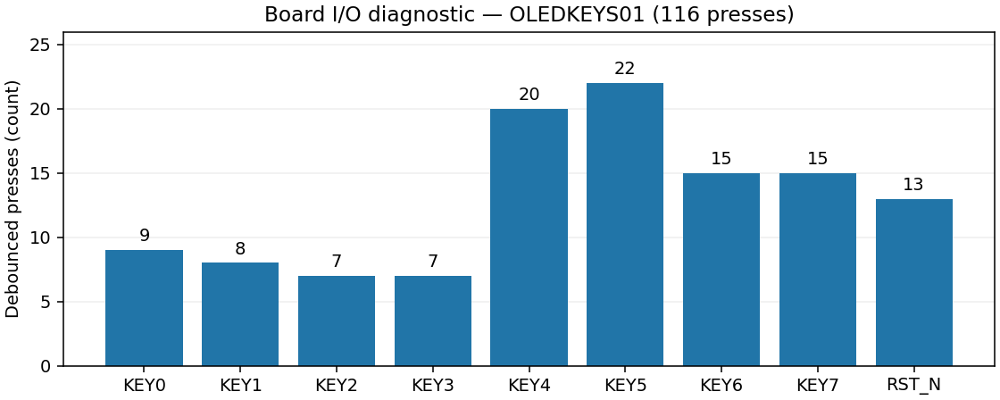

# swcell_k325t 第一阶段外设引脚验收：OLED、按键、LED 与 UART

> 基础引脚功能由用户确认通过；反显全白背景明暗闪动作为显示质量问题保留。此结论不代表 OLED 全条件电气或显示质量验收。

|项目|内容|
|---|---|
|日期 / 时区|2026-11-04，Asia/Shanghai|
|板卡|XC7K325T-2FFG900C，板卡 PCB 修订未记录；SSD1306 128×64、SPI OLED|
|目标|先独立验证外围引脚，避免 M20 上板时将接线问题误判为 CPU 故障|
|验收镜像|OLEDKEYS01，1MHz SPI；bit SHA见第7节|
|依据|用户确认“图案和文字均正常”“功能都正常”；串口完整按键电平覆盖|
|范围|9个低有效输入、8个低有效LED、5根OLED信号、UART TX/RX；不运行CPU|
|结果|859条有效状态，116次消抖后按下、232个按下/释放事件，9路按下/释放均被主机观察；白底闪烁仍开放|

## 1. 测试内容与方法

FPGA 输出 8 种 OLED 图案，随后显示每键状态、最后事件和计数。用户逐键操作、观察同名文字及 LED 对应，并测试多键。RST_N 在本镜像中作为第9个待测键，短按反显、长按2秒释放重播；系统使用内部上电复位。

KEY0～KEY7 与 LED0～LED7 一一对应，均低有效；RST_N没有第9颗对应LED。按键经过两级同步与逐位20ms消抖。串口只保存状态和计数，不能自动证明物理屏幕、灯光或丝印正确；用户观察单独记录，不回写采集程序的 `NOT_CONFIRMED` 字段。

## 2. 实际参数与频率

|参数|验收版本实际配置|依据及边界|
|---|---|---|
|FPGA系统时钟|50MHz，20ns|板卡配置，未外部标定|
|IO电平|LVCMOS33；用户说明3.3V|未记录电源波形/纹波、温度|
|SPI|Mode0、MSB，1MHz；高/低均500ns|RTL及XSIM默认参数周期计数；非板外仪器测量|
|整帧传输|450021系统周期，9.00042ms|1024数据字节、页地址及反显命令、握手开销均计入|
|连续内容更新周期|2450022系统周期，49.00044ms|含40ms帧间隔、握手|
|内容更新率|20.407980Hz|`50,000,000 / 2,450,022`，与SSD1306内部面板扫描频率不同|
|图案保持|20帧/图，约0.980s|8种图案；任意键可进入实时页|
|初始化|POR100ms；OLED复位10ms、释放10ms；AF后等待100ms|清零显存后开屏，约0.23s开始图案|
|按键|两级同步；每位20ms消抖|独立过滤，允许多键|
|UART|115200、8N1，W23/V20，`/dev/ttyUSB1`|296字节/状态包；握手发送，繁忙时合并快照|
|工具|Vivado/XSIM2026.1.1、Python3.12环境|独立诊断工程，无CPU逻辑|

内部扫描参数为D5=80、D9=F1、contrast=7F。SSD1306独立从显存扫描；SPI变快不等于面板扫描必然变快，实际扫描频率尚未测量。

## 3. 逐项结果

|ID|刺激 / 检查目标|规模与结果|结论|
|---|---|---|---|
|IO01|黑/白、两类棋盘、横/竖条、边框/对角线、移动十字|8种图案，发送掩码FF，用户确认显示正常|基础显示通过|
|IO02|文字、每键标签、最后事件|用户确认文字及功能正常|通过|
|IO03|9个输入逐键按下/释放|主机按下掩码1FF、释放掩码1FF；FPGA seen=1FF|通过|
|IO04|KEY0～7对应低有效LED0～7|8组，用户确认；串口本身不检测灯光|通过|
|IO05|多键、RST短按反显、长按释放重播|用户确认功能正常；独立仿真也覆盖|功能通过，反显白底有闪烁|
|IO06|UART与RX活动探测|859条有效IO_STATE，末状态RX=1|通信通过|
|IO07|自动仿真|45帧，含16图案帧、29实时帧；5328 UART字节；38个受控事件|PASS，属于仿真而非实测事件|
|IO08|Python回归|160项|PASS|
|IO09|综合/实现、引脚/内部STA|25个引脚核对，WNS2.807ns、WHS0.066ns、WPWS9.600ns，DRC无违规|PASS，不等同外部SPI时序签核|

实物按下次数分别为 KEY0～7：9、8、7、7、20、22、15、15，RST_N：13；合计116。末状态全部松开，按下/释放事件合计232。859是有效串口快照数量，不是按键次数或像素正确率，不能据此报告“显示错误率为零”。

## 4. 图表及解读

图中单位为次，数据来自原始串口计数。各键操作次数不同来自人工操作，不代表需要达到某个次数门限；重要的是9路均被操作且物理标签与显示/灯光一致。

## 5. 通过的意义及验证边界

本轮确认独立外设链路具备作为后续CPU验证终端的基础：OLED写通、按键能读、LED映射正确、串口可记录。CPU计算与存储、M20时钟、OLED长期可靠性、供电纹波和板外时序均未在本阶段验收。

用户报告反显白底整体明暗变化；原因尚未确定。不能将20.4Hz内容更新直接认定为原因，也不能因后来提高SPI便声称该问题已经解决。

## 6. 异常、版本及后续调整

- 首轮 `results/BOARD_IO/20261104_154609_oled_keys/` 未连接OLED，不作为实体显示验收。
- 有效硬件轮在下载前开始采集，原始文件包含38条未识别启动输入；全部保留，859条有效状态另行统计。
- r1仿真发现长按重播误计在途实时帧，造成图案掩码FE；已保存失败证据，修复后r2才下载。未将r1失败改写为通过。
- 本报告验收原OLEDKEYS01。随后用户要求180°旋转、10MHz SPI及至少50Hz内容更新，OLEDKEYS04默认A0/C0、SPI高40ns/低60ns、16ms帧间隔，仿真为58.874854Hz；其现场复验单独记录，不替换本报告原始配置和SHA。

## 7. 证据与复现

|证据|路径 / 标识|
|---|---|
|原始串口及CSV|`results/BOARD_IO/20261104_160402_oled_connected/`：raw.jsonl、states.csv、summary.json、metadata.json|
|原始数据SHA256|`e67359906a420786f2f2f09ab5b1cb9065bdaf5750ecaf54b33b966e47ed6198`|
|验收bit SHA256|`3cdbd63c491acdc2adf096d4bd1d3da249f788b6e0825850e20954952014224a`|
|旧bit/源码/实现快照|`build/oled_keys_20261104/r2_hardware_pass_before_rotation/`（现场保存，未纳入Git）|
|小型持久索引及源SHA|[accepted_oledkeys01.json](../diagnostics/oled_keys_resources/accepted_oledkeys01.json)|
|各版刷新周期|[refresh_measurements.json](../diagnostics/oled_keys_resources/refresh_measurements.json)|
|仿真及构建|`build/oled_keys_20261104/sim_r3.console.log`、`build_r2.vivado.log`、`program_oled_connected.console.log`|
|旧版精确周期补测|`build/oled_keys_20261104/legacy_refresh_measure/simulation.log`（从保存的旧源码补测，非改写原始日志）|
|当前代码、命令|[工程README](../../fpga/projects/diagnostics/oled_keys/README.md)、[诊断说明](../diagnostics/oled_keys.md)、[当前任务记录](../tasks/oled-keys-20261104.md)|

构建与仿真通过后先启动UART，再JTAG下载，完成观察和逐键操作。只写易失配置，不固化Flash。原始数据及旧成功/失败构建放在被忽略目录，交接时必须连同这些目录单独备份；本报告与SHA清单不能代替原始数据和旧源码快照。
