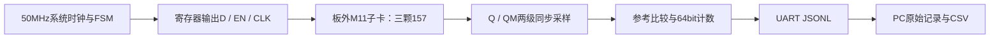
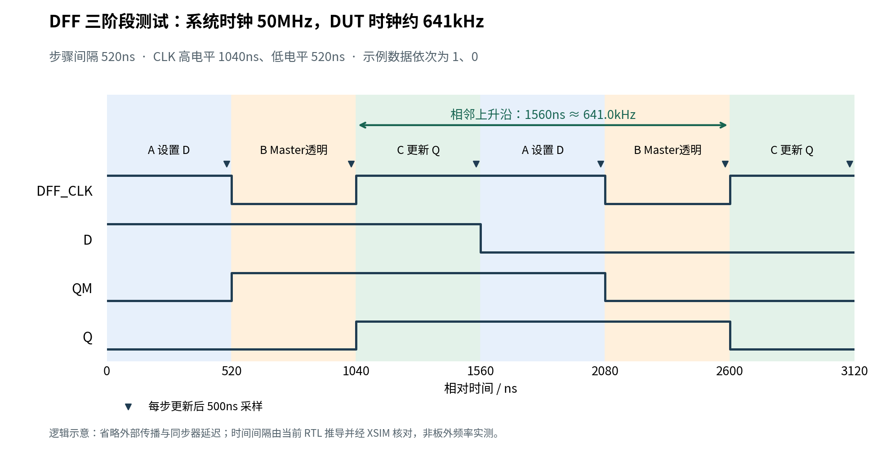
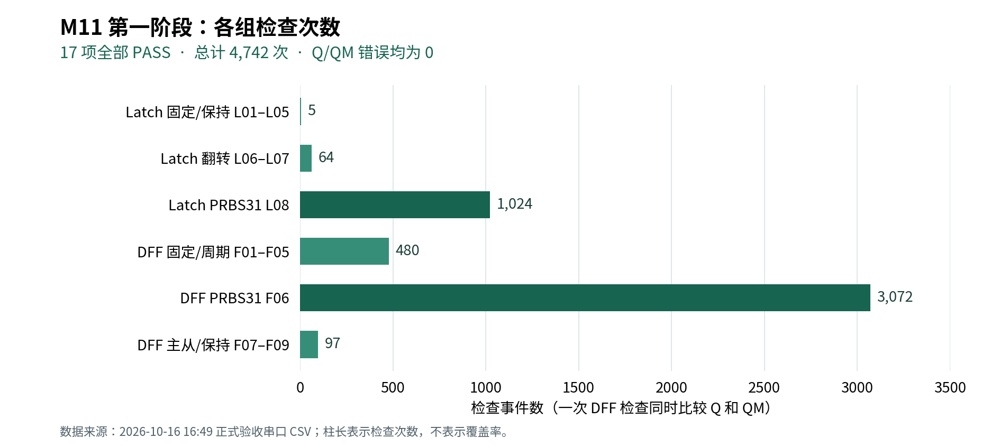

# M11 第一阶段验收报告：低速基础功能验证

> **验收结论：通过。** 用户已正式确认“M11 第一阶段基础功能验证：通过”。实际连接子卡后，L01–L08、F01–F09 共17项全部PASS，4742次检查，Q和QM错误均为0。本报告总结这次已经完成的测试。

| 项目         | 本次记录                                                              |
| ------------ | --------------------------------------------------------------------- |
| 测试日期     | 2026-10-16，Asia/Shanghai（UTC+8）                                    |
| 被测电路     | 三颗74LVC1G157构成的D-Latch和Master/Slave DFF                         |
| 工作电压     | 3.3V，用户提供的测试条件；未进行电压扫描                              |
| FPGA / 工具  | XC7K325T-2FFG900C；Vivado / XSIM 2022.1；Python 3.10.12、pyserial 3.5 |
| 下载方式     | JTAG；本次未擦写Flash                                                 |
| 正式数据目录 | `results/m11_20261016_164852_164402+0800/`                          |
| 串口与保存   | `/dev/ttyUSB1`，115200、8N1；完整JSONL及CSV                         |
| 数据完整性   | 35条有效JSONL、格式错误0、采集程序退出码0                             |
| 重复性       | 接回子卡后的两轮17项结果一致；正式轮原始记录完整                      |

## 1. 这次究竟测试了什么

M11不是FPGA内部的标准触发器，而是板外普通MUX加反馈形成的存储结构。本次检查它在慢速、输入充分稳定后的功能：

- **D-Latch：** EN=1时输出能否更新为D；EN=0时，D改变后Q能否保持。
- **DFF Master：** CLK=0时QM能否跟随D；CLK=1时QM能否保持。
- **DFF Slave：** CLK=0时Q能否保持；下一个上升沿后Q能否取得此前已稳定的Master数据。
- **多种数据形态：** 固定0/1、0101、0011、00001111，以及可重复的PRBS31伪随机序列。

FPGA输出D、EN和DFF_CLK，等待稳定后，经两级同步器读取板外DL_Q、DFF_Q、DFF_QM，再与独立状态参考值比较。DFF的Q和QM分别统计错误，有助于区分主级、从级行为异常。



初始化时先令Latch的EN=1、D=0；DFF先CLK=0、D=0，再产生上升沿建立QM=Q=0。初始化和准备动作也等待完整步骤，但不计入下表的检查次数。

## 2. 测试参数：50MHz与DUT测试频率的区别

**FPGA系统时钟是50MHz；本次DFF连续三阶段测试的激励时钟约为641.0kHz。** 50MHz用于运行控制、采样和UART逻辑，未直接作为板外DFF_CLK输出。

### 2.1 实际配置

| 参数              | 本次值                                  | 含义 / 依据                                                                               |
| ----------------- | --------------------------------------- | ----------------------------------------------------------------------------------------- |
| 系统时钟          | 50MHz，20ns/周期                        | 用户提供D27单端时钟；XDC周期20ns，未做板外时钟校准                                        |
| 单步采样等待      | 500ns＝25个系统周期                     | `STEP_NS=500`；从施加激励到比较采样                                                     |
| 连续步骤更新间隔  | 520ns＝26个系统周期                     | 上述25周期，加1周期FSM/握手开销；RTL推导并经XSIM核对                                      |
| 稳定时间配置      | 200ns＝10个系统周期                     | `SETTLE_NS=200`用于校验传播、同步与比较预算；没有另加一个200ns计时段，实际在500ns处采样 |
| 输入同步          | 两级寄存器                              | `SYNC_STAGES=2`，同步流水线按40ns预算；三个返回信号均同步                               |
| 固定/翻转序列长度 | N=32                                    | F01–F05各32个数据位；L06/L07及F07/F08各32次检查                                          |
| 伪随机序列长度    | R=1024                                  | L08为1024次检查；F06为1024数据位×3阶段                                                   |
| PRBS31            | 多项式x³¹+x²⁸+1，种子`0x13579BDF` | 每项重新启动，可重复；D取状态bit30，L08的EN取同一状态bit15                                |
| 上电复位          | 5,000,000周期约100ms，再两级释放        | FPGA配置INIT实现，无外部复位脚                                                            |
| UART              | 115200、8N1、非反相                     | 实际分频434，位宽8.68µs，推导波特率约115207.4，误差约+0.0064%                            |
| 计数与错误记录    | 64bit；每项汇总，首次错误快照           | 本轮错误0，因此没有FIRST_ERROR消息                                                        |

以上时间以标称50MHz为依据。500ns采样等待与520ns步骤更新间隔分别描述不同事件，不能直接把`1/500ns=2MHz`当成本轮DFF时钟。

### 2.2 各类刺激的运行速率

下表为当前RTL的稳态时序推导值；DFF连续相位间隔已由XSIM核对，未进行板外频率实测。

| 测试类型 | 实际激励安排                            | 速率 / 时间含义                                     |
| -------- | --------------------------------------- | --------------------------------------------------- |
| L01–L05 | 固定值及有限次EN/D改变                  | 不定义单一连续时钟；每一步均经过500ns采样等待       |
| L06、L07 | 稳态翻转段每520ns改变一次D              | D方波周期1040ns，约961.5kHz                         |
| L08      | 每520ns推进一个PRBS状态                 | 约1.923M步骤/秒；D/EN不是固定频率方波               |
| F01–F06 | 每个数据位依次执行高、低、高三个阶段    | 每数据位1560ns；相邻DFF_CLK上升沿1560ns，约641.0kHz |
| F07      | CLK保持0，D逐步翻转                     | CLK无连续边沿；D稳态翻转约961.5kHz                  |
| F08      | CLK保持1，D逐步翻转                     | CLK无连续边沿；D稳态翻转约961.5kHz                  |
| F09      | CLK保持0，多次改变D，最后产生一次上升沿 | 有限次操作，不作为周期时钟测试                      |

F03的0101数据方波约320.5kHz，F04的0011约160.3kHz，F05的00001111约80.13kHz；它们共享约641.0kHz的DFF激励时钟。F01/F02的数据为直流0/1，F06的数据为PRBS，不能都用一个“D信号频率”表示。

### 2.3 DFF三阶段时序

每个数据位的三个检查阶段为：

| 阶段 | 操作                  | 稳定后的检查                |
| ---- | --------------------- | --------------------------- |
| A    | CLK保持1，设置下一位D | QM与Q均保持原值             |
| B    | CLK降为0              | QM更新为D，Q仍保持          |
| C    | CLK升为1              | QM保持，Q更新为该Master数据 |



图中每阶段的采样点在更新后500ns，下阶段在520ns开始。稳态CLK高电平跨C和下一轮A，共1040ns；低电平为B的520ns。因此高电平占比约2/3，并非50%占空比。

这些间隔已在50MHz、STEP_NS=500的当前RTL仿真中核对：24个阶段、24次采样，以及7个相邻上升沿周期均满足预期。该补充仿真缩短了迭代次数并加速UART，未改变M11步骤定时。**图中QM/Q为功能示意，省略板外传播及同步器延迟；641.0kHz是RTL时序核对值，不是逻辑分析仪的板外频率测量。** 初始化、UART等待和测试切换阶段也不包含在上述稳态频率中。

## 3. 逐项结果

所有输出判断均发生在稳定采样点。一次DFF检查会同时比较Q和QM，仍只计一个检查事件；不能将两路比较重复算成两个检查。

| ID                     | 本次刺激与检查内容                        | 数量参数               |       检查次数 |       Q错误 |      QM错误 | 结果           |
| ---------------------- | ----------------------------------------- | ---------------------- | -------------: | ----------: | ----------: | -------------- |
| L01                    | EN=1、D=0，Q应为0                         | 单次                   |              1 |           0 |          — | PASS           |
| L02                    | EN=1、D=1，Q应为1                         | 单次                   |              1 |           0 |          — | PASS           |
| L03                    | 锁存1后关闭EN，D从1变0，Q保持1            | 单次                   |              1 |           0 |          — | PASS           |
| L04                    | EN=0时D再从0变1，最后Q保持1               | 单次                   |              1 |           0 |          — | PASS           |
| L05                    | 重新使能并令D=0，Q更新为0                 | 单次                   |              1 |           0 |          — | PASS           |
| L06                    | 锁存0后关闭EN，D反复翻转，Q保持0          | N=32                   |             32 |           0 |          — | PASS           |
| L07                    | EN=1，D连续翻转，稳定采样时Q跟随          | N=32                   |             32 |           0 |          — | PASS           |
| L08                    | PRBS改变D和EN，按使能状态更新/保持        | R=1024                 |           1024 |           0 |          — | PASS           |
| F01                    | 全0，分别检查三个阶段的Q和QM              | 32位×3阶段            |             96 |           0 |           0 | PASS           |
| F02                    | 全1，检查首次捕获及后续保持               | 32位×3阶段            |             96 |           0 |           0 | PASS           |
| F03                    | 0101，检查交替数据传递                    | 32位×3阶段            |             96 |           0 |           0 | PASS           |
| F04                    | 0011，检查两位连续相同的数据              | 32位×3阶段            |             96 |           0 |           0 | PASS           |
| F05                    | 00001111，检查四位连续相同的数据          | 32位×3阶段            |             96 |           0 |           0 | PASS           |
| F06m11_phase1_20261016 | PRBS31，逐位检查主从三阶段操作            | 1024位×3阶段          |           3072 |           0 |           0 | PASS           |
| F07                    | CLK=0时D变化，QM跟随而Q保持0              | N=32                   |             32 |           0 |           0 | PASS           |
| F08                    | CLK=1时D变化，QM和Q均保持0                | N=32                   |             32 |           0 |           0 | PASS           |
| F09                    | 低相位多次改D，最后稳定为1，再上升沿捕获1 | 32步+末次边沿          |             33 |           0 |           0 | PASS           |
| **合计**         | **17项**                            | **N=32，R=1024** | **4742** | **0** | **0** | **PASS** |

Latch行的QM标为“—”，表示该项不比较DFF Master；CSV中对应错误计数为0。L04中间的D=0是准备动作，独立保持判定由L03覆盖。

检查数核算：Latch为`5+2N+R=1093`次；DFF为`18N+3R+1=3649`次；总计`6+20N+4R=4742`次。初始化、准备及UART等待未计入检查数。



图中六组检查次数依次为5、64、1024、480、3072、97。PRBS相关检查合计4096次，占检查事件约86.4%；这表示本轮工作量分布，不能解释成电路状态或故障覆盖率86.4%。

## 4. 通过说明了什么

**M11在本次3.3V、低速稳定采样条件下，表现出了预期的锁存和主从传递行为。** EN关闭和开启两种状态均经过测试；Master的透明/保持与Slave的保持/更新也分别检查，并非仅看最终Q是否变化。固定序列和PRBS的全部采样点都符合参考值。

**FPGA到PC的自动测试链路已贯通。** JTAG配置、内部上电复位、寄存器激励、输入同步、参考比较、64bit计数、真实UART串行发送、Python解析和CSV保存，已在实际板卡上共同完成一次完整验收。35条消息的顺序、逐项计数和CSV转换均已核验。

**结果具有可重复性，也保留了错误检测证据。** 子卡接回后的两轮CSV完全一致。XSIM还单独注入Latch Q错误、DFF QM错误、Q/QM同时错误，验证了检测、分类计数、首次错误快照和FAIL汇总；故障注入发生在仿真中，本次正式实物验收未人为注错。

这为后续阶段提供了一个已验证的基础：可以继续复用公共激励、采样、记录和通信模块，也有一份能与未来测试比较的M11基准记录。

## 5. 本次结论的适用范围

本阶段的通过针对上述输入序列与采样条件。它没有给出M11的最高工作频率、传播延迟、setup/hold界限、毛刺宽度、主从竞争窗口或亚稳态裕量；也没有验证50%占空比及其他占空比范围。

本次没有开展温度/电压角落扫描、长时间BER测试或整个PRBS31周期遍历。1024位PRBS是有限的、可重复的功能刺激。板卡PCB版本号、环境温度和电源实测值未记录，不能从本报告推导全温全压可靠性。500ns后功能正确也不能排除采样前出现过短暂毛刺。

Vivado在50MHz约束下的布线后WNS为+14.538ns、WHS为+0.076ns，设计DRC为0；这些是FPGA内部实现检查，不能换算成板外MUX反馈电路的时序裕量。

## 6. 调试过程与验收数据选择

| 过程               | 观察与处理                                                                         | 与正式结论的关系                       |
| ------------------ | ---------------------------------------------------------------------------------- | -------------------------------------- |
| UART无数据         | 用户确认板卡版本差异使原接口未连到W23/V20；硬件修改后接通                          | UART约束仍为TX=W23、RX=V20             |
| 未接M11子卡        | 用户改UART时拆掉子卡；产生3 PASS/14 FAIL                                           | 不作为已连接M11的功能验收              |
| 无子卡仍有单项PASS | L02/L03/L04期望Q=1，与本轮高电平采样恰好匹配；初始化不独立计数，未实现子卡存在检测 | 单项PASS不证明子卡存在；整套结果仍FAIL |
| 断电接回子卡       | 两轮17项全PASS，逐项CSV一致                                                        | 确认子卡连接状态后才选用通过结果       |
| 通过首轮的文本前缀 | 下载前的W23诊断文本与第一条START拼行，采集程序返回2                                | 保留原始记录，另采完整一轮             |
| 正式完整轮         | 35条消息、格式错误0、采集退出码0                                                   | **采用本轮作为正式验收证据**     |

正式目录创建于16:48:52，采集关闭于16:49:19；这个时间窗包含等待JTAG下载，不能当作DUT持续测试时长。本次未单独测量整套FPGA测试执行时长。

## 7. 证据、版本与复现入口

以下链接相对于本报告，均指向实际工程文件或本机保留的记录。

| 证据               | 位置                                                                                                                                                                                                                                                                |
| ------------------ | ------------------------------------------------------------------------------------------------------------------------------------------------------------------------------------------------------------------------------------------------------------------- |
| 正式CSV            | [results.csv](../../results/m11_20261016_164852_164402+0800/results.csv)                                                                                                                                                                                             |
| 全部原始UART字节   | [raw.jsonl](../../results/m11_20261016_164852_164402+0800/raw.jsonl)                                                                                                                                                                                                 |
| 独立核验摘要       | [hardware_validation.json](../../results/m11_20261016_164852_164402+0800/hardware_validation.json)                                                                                                                                                                   |
| 采集信息与完整性   | [metadata.json](../../results/m11_20261016_164852_164402+0800/metadata.json)、[capture_summary.json](../../results/m11_20261016_164852_164402+0800/capture_summary.json)、[operator_context.json](../../results/m11_20261016_164852_164402+0800/operator_context.json) |
| 第二份通过CSV      | [首轮子卡已接结果](../../results/m11_20261016_164735_233687+0800/results.csv)；原始记录有诊断前缀，不用于完整协议验收                                                                                                                                                |
| 实际板级参数       | [board_50mhz.tcl](../../fpga/xc7k325t/config/board_50mhz.tcl)、[board_50mhz.xdc](../../fpga/xc7k325t/constraints/board_50mhz.xdc)                                                                                                                                     |
| 控制与计时RTL      | [M11编排](../../rtl/modules/m11/m11_test_top.sv)、[DFF控制器](../../rtl/modules/m11/m11_dff_tester.sv)、[步骤定时器](../../rtl/common/swc_step_timer.sv)                                                                                                               |
| 实际JTAG镜像与日志 | [主bitstream](../../build/vivado/swcell_m11.runs/impl_1/swcell_fpga_top.bit)、[本轮下载日志](../../build/hardware/program_m11_subcard_clean.log)                                                                                                                      |
| 构建与内部时序     | [timing.rpt](../../build/vivado/timing.rpt)、[drc.rpt](../../build/vivado/drc.rpt)                                                                                                                                                                                    |
| 补充时序核对       | [观测TB](../../build/report_timing/tb_report_timing.sv)、[运行脚本](../../build/report_timing/run.sh)、[XSIM日志](../../build/report_timing/simulation.log)                                                                                                            |
| 完整工程验证记录   | [verification.md](../verification.md)；包含XSIM故障注入及13项Python检查通过记录                                                                                                                                                                                      |

实际主镜像SHA-256：

```text
dd4e3d2e7cfc6367e7cd8823e733b50f18de5f60fe135c994e7a4c9a171e97b8
```

正式原始JSONL的SHA-256：

```text
0d88e8042368c6f90ce127621d76d4c941a31db804970393392cf61067a8b2b8
```

工程当时没有可用Git提交号，因此以上镜像和原始数据哈希用于标识本次证据，不能替代未来的完整源码版本管理。`results/`和`build/`不提交Git，交接时需另行归档所引用目录；报告表格及插图在`docs/reports/`保留。

复现顺序：断电连接子卡并上电；先打开串口采集，再通过JTAG下载M11主镜像；等TEST_COMPLETE后核对17项、4742次、错误0及采集退出码0。完整操作命令见[板级操作文档](../fpga_workflow.md)。本阶段不需要固化Flash。
