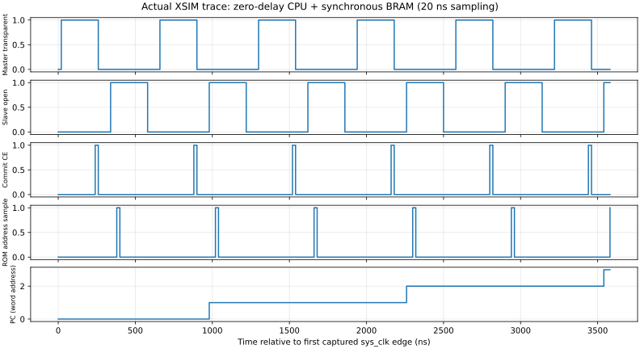
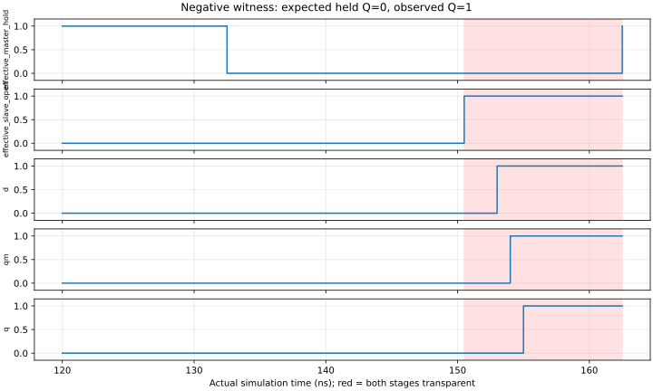

# M20 V2.3阶段验收报告：模式A两相CPU与FPGA存储联合仿真

> 状态：用户正式确认模式A数字仿真通过。不是实体NC7SZ157时序签核。

|项目|内容|
|---|---|
|日期/时区|2026-11-03，Asia/Shanghai|
|DUT|477组合MUX+33位双MUX主从状态，完整543等价；冻结ISA0.1|
|范围|FPGA直接非重叠两相、内部调度事件服务同步ROM/RAM|
|验收依据|用户明确限定模式A；regression_r6原始证据及本地定版检查|
|总结果|零/延迟各87场景57331事件相同；全非法50521及恢复、内存/单步/负测通过|

## 1. 内容与方法

真实透明/保持反馈MUX状态与V1、V2.1原生FF、V23原生FF及Python逐微周期/退役对照，各自独立ROM/RAM。初始化以两次完整复位主从序列和RESET入口进行，冷启动/连续64tick无非零夹具。S稳定观察点比较，禁止相位翻转瞬间判断。

## 2. 参数与频率

|参数|零延迟|有界延迟基准|来源|
|---|---|---|---|
|系统时基|50MHz|50MHz|仿真20ns周期|
|M/D1/S/D2|240/80/240/80ns|1280/160/1280/160ns|调度配置推导|
|CPU微周期|640ns/1.5625MHz|2880ns/约347.222kHz|四阶段总时长|
|普通/访存|2/5微周期|同左|V1 timing0.1不变|
|ROM/RAM|4096×16 /256×4；2系统边沿返回|同左|同步服务模型|
|电压/温度|数字模型无测量|无实测|不冒充3.3V板外验证|
|UART/下载|不适用|不适用|XSIM2026.1.1与CSV，不生成bitstream|

数据更新随CPU微状态和指令发生，不等于系统时钟。初始化、停钟、终态保持观察不混入有效指令周期。

## 3. 逐项结果

|检查|规模|错误/结果|
|---|---:|---|
|指令场景|49/22223事件，每种配置|0差异，PASS|
|游戏场景|38/35108事件，每种配置|0差异，PASS|
|连续64tick|Pong4252、Snake18778事件|含在游戏总计内，PASS|
|全部非法终态/复位恢复|50521/50521|无架构副作用，PASS|
|内存/复位|每配置7项|pending取消、已写不回滚、读写/终态/恢复PASS|
|单步/停车|CPU12步；四阶段停钟请求|状态保持/单写PASS|
|短路径|5场景×6配置|PASS|
|穿透、相位断言、ROM/RAM坏窗口|预期负测|均成功检测，不计为正向失败|
|Python|123项|PASS|

57331=57314退役+17异常；不因四RTL或两配置重复计成单轮次数。全非法另计。资源为477+66=543，纯功能542，非FPGA LUT数。

## 4. 图表

来源最终XSIM CSV，时间单位ns，20ns采样，是数字仿真，不是示波器测量。Master透明与Slave开放之间存在死区。

来源负测事件CSV；红区为两级有效透明，Q从应保持0变1。该例证明模型能检出穿透，不证明真实器件Hold。

## 5. 意义与边界

已证明原ISA/游戏码及2/5微周期可在66真实反馈MUX状态与内部同步服务窗口下执行。仅接受FPGA直接两相模式A；**不接受Johnson、外部时钟服务或实体时序**。未运行综合、布局布线、STA和硬件。V24外部同源服务另立证据，不反标本阶段失败。

## 6. 异常和排除

保留dev_r1漏接reset、dev_r2夹具释放Q为X的开发失败；修复后r6完整重跑。负测fatal按预期标记分类，未删除错误行或改期望。中间r4/r5不用于证明其后的新增修改。

## 7. 证据与复现

|证据|位置|
|---|---|
|原始最终证据|build/m20_300/v23/regression_r6/|
|结果SHA|38b3de525918fcbd0689150f349e5e71f6bc01d0997b8956696d83cc7630adaa（verification.json）|
|逐文件SHA|[2802项索引](../m20/v23_resources/evidence_sha256.csv)|
|详细结果/参数|[V23测试报告](../m20/M20_300_V2_3_TEST_REPORT.md)|
|本地定版|aecf570c2e33563179e95e1615fd005cc19817f5；m20-v2.3-two-phase-sim-verified|
|一致性检查|build/review/v23_freeze_20261103/consistency.json（48文件/原始SHA/临时重生成）|

复现用新的输出目录运行sim/scripts/run_m20_v23.sh；旧证据不覆盖。标签明确数字模式A范围，没有远程操作。
