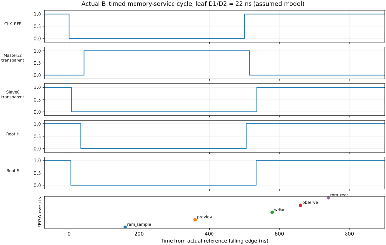

# M20 第 V2.4 阶段验收报告：20-MUX 前馈时钟完整数字联合

> 状态：**用户正式批准有条件数字验收**。本地版本标记 `m20-v2.4-digital-verified`；实体时序、FPGA 实现和硬件验证仍开放。

|项目|内容|
|---|---|
|测试与确认日期|2026-11-04，Asia/Shanghai|
|DUT|冻结 543-MUX CPU＋固定 20-MUX 前馈发生器，合计 563；不含 Buffer 或 FPGA 服务资源|
|目标实体条件|NC7SZ157P6X、3.3V 是设计目标；本轮没有实体供电/温度测量|
|阶段目标|由实际前馈 H/S 驱动真实反馈锁存 CPU，与同步 FPGA ROM/RAM、运行控制联合执行冻结 ISA 和原游戏码|
|验收依据|用户批准；`build/m20_300/v24_ffcd/full_r1/` 原始回归及独立 SHA 索引|
|总结果|A/B/C × logic/timed，各 87 场景 /57,331 事件通过；B/C 各 50,521 非法终态及恢复；全部 151 Python 通过|

## 1. 测试内容与方法

模式 A 保留 V2.3 的 FPGA 直接两相调度器作为独立基线。B 为 FPGA 单路参考时钟，C 为独立振荡源模型；两者共用固定 16 级链、TAP16 静态连接的 20 个逐芯片时钟模型，实际 H/S 输出驱动 CPU 的 33 对 Master/Slave 反馈 MUX，没有隐藏的理想调度器替代时钟。

477 个 CPU 组合 MUX、ISA、Pong/Snake 机器码及 2/5 微周期验收契约不改。同步 ROM 为 4096×16，RAM 为 256×4。FPGA 服务用实际 REF 同步边沿和稳定窗 age 产生读写/观察事件；RAM 写持久化一次。比较 Python、V1、V21 原生 FF、V23 IDEAL_FF，并独立比较模式 A/B/C 的完整微周期状态、退役、RAM 事务及最终内容。

复位需要真实 Master/Slave 相位初始化；Pong/Snake 冷启动与 64 tick 场景从完整 RESET 序列运行。其余定向场景保留原 fixture 的可控状态预置，不混称实体上电测试。检查所有 33×33 有效透明边界，保持原互斥、窗口与建立裕量断言。

## 2. 实际参数与频率

|参数|实际值|依据与边界|
|---|---|---|
|FPGA 服务系统时钟|50MHz，20ns|仿真时基；控制、同步边沿检测、BRAM 服务|
|A 的 CPU 微周期|logic 640ns，timed 2880ns|冻结 V23 两套调度配置|
|B 的 REF / 活动微周期|1MHz，500ns 高/低|寄存分频，每半周期 25 服务 tick|
|C 的 REF / 活动微周期|周期 1000～1017ns，平均 1008.5ns，约 0.9916MHz|独立仿真源；初相 17ns，高 500/505/510ns、低 500/507ns|
|CPU 周期模型|普通指令 2 微周期、RAM 指令 5 微周期|停钟/启动墙钟开销另计，不藏入 ISA 周期|
|链与译码|TAP16，每级 DATA 2ns；OR SELECT rise /AND SELECT fall 4ns，其余非链弧 1ns|全部为明确数字假设，不是原厂保证 min|
|最坏叶端损失|分配差 3ns＋有效开闭差 4ns|33 个独立叶端模型的假设，不是 PCB 实测|
|有效非重叠时间|ROOT 29/29ns，LEAF 最低 **22/22ns**|实际事件计时；两方向独立、全局最坏配对|
|带延迟 CPU 数据路径|DATA 0.2/0.8ns，SELECT 0.3/1ns；存储 DATA 0.1ns|节点独立配置的 assumed 参数|
|logic 配置|CPU 数据延迟为 0，时钟/有效开闭事件仍保留正延迟|不能用 delta-cycle 当实体非重叠证明|
|工具与通信|XSIM 2026.1.1，Python 3.12；UART 波特率不适用|本轮以仿真 CSV/JSON 交换，无实机 UART 采集|

连续活动 RUN 时 1 REF 周期对应 1 CPU 微周期；SAFE_HOLD 停车期间 REF 持续但 CPU 不推进。游戏状态更新由软件 tick 协议决定，不能把 REF 频率直接当游戏帧率或指令吞吐。

## 3. 逐项结果

|ID / 条件|检查数量|正常功能错误 / 分类|结果|
|---|---:|---|---|
|A_logic / A_timed|各 87 场景、57,331 事件|0 / 理想数据或条件延迟|通过|
|B_logic / B_timed|各 87 场景、57,331 事件|0 / 理想数据或条件延迟|通过|
|C_logic / C_timed|各 87 场景、57,331 事件|0 / 理想数据或条件延迟|通过|
|额外压力＋最小程序|每配置 7 场景、21 事件|0|通过|
|跨模式逐微周期|原套件每配置 166,991 行；含额外项 167,066 行|架构状态、FSM、终态一致|通过|
|全编码终态|B/C 各 65,536 编码，其中 50,521 非法实际 TRAP 及等量恢复|0|通过|
|内存 / RESET|7 项×6 配置|0|通过|
|RUN/STOP/STEP|7 项×B/C，每模式 26 个显式微周期单步|0|通过|
|同步服务单元|6 项|0|通过|
|Pong 连续运行|64 tick，4,252 动态事件、13,223 微周期，ROM 168 字|0|通过|
|Snake 连续运行|64 tick，18,778 动态事件、65,225 微周期，ROM 368 字|0|通过|
|Python 全部单元测试|151 项|0|通过|
|服务迟到注入|RAM 额外 500ns、ROM 额外 300ns|分别触发预期 Fatal|故障检出通过；配置 FAILED|
|原 56 时序配置重放|32 CONDITIONAL、24 FAILED|原分类保留|检测机制 VERIFIED|
|真实短路径局部重放|79 条×8 条件＝632 次|131 次错误；316 正向对照无错|反例保留，不代表实体故障数量|

六配置原定事件合计 343,986，是同一验收集合在六种配置下重复执行，不能当作 343,986 条独立指令覆盖。逻辑 RAM 读/写每配置在指令集套件为 1,275 /974，游戏套件为 8,433 /6,712；实际持久写次数和最终 RAM 均核对。原 CE/OE 可跨三微状态，BRAM 内部重采样不重复计成逻辑读事务。

## 4. 图表及解读



来源：原始 B_timed VCD 与服务 CSV；横轴相对真实 REF 下降沿，单位 ns。RAM_SAMPLE 在下降后 160ns、PREVIEW 在 360ns；WRITE/OBSERVE/ROM_READ 分别在上升后 80/160/240ns。C 的独立相位使相应偏移变化约 19ns，仍满足当前数字窗口。

BRAM 访问使用较长高/低半周期，不需要塞进 22ns 死区。PREVIEW 为验证快照，实际状态由 Slave 更新后再 OBSERVE；CPU 未被 FPGA 代算。降低主频可延长计算/服务窗口，但不能自动修复同边沿 Hold 重叠。

## 5. 通过的意义及验证边界

本阶段证明：**冻结 CPU 和游戏程序可以在声明的数字延迟包络内，由 20 颗前馈发生器驱动真实两级反馈存储，并与 FPGA 同步存储及运行控制正确协作。** RUN/STOP/STEP 控制位于 FPGA，STEP 采用 ready/ack；不把这些功能暗计入无状态的 20 颗发生器。

实体 min/max、Buffer 跨相与分支差、PCB/负载、真实锁存有效边界/污染/hold、默认安全、亚稳态及 FPGA 实现/STA 均未关闭。本地标签只表示本报告的数字验收，不表示实体签核、最高可靠频率或实机运行通过。不自动进入 V3。

## 6. 异常与排除记录

快速链四抽头有效 D1/D2 仍为 −7/−6/−4/−2ns，原 24 项问题配置与 131 次局部错误不改为 PASS。晚释放、窄脉冲及穿透证据原位保留；正常配置的通过不能消除这些边界。

开发期 `dev_r1` 测试驱动 STOP 未清，`dev_r2` 看门狗字面量溢出，均保留原日志/失败 TB；修正测试平台后先过 `dev_r3` 门禁再完整回归，没有改功能预期。版本审计另发现旧负测入口依赖 ignored 历史 build，新增版本化 79 见证的独立重放入口，使用相同网表/模型并逐项比较错误 path ID；原历史审计入口保留。

## 7. 证据与复现

|证据|路径 / 标识|
|---|---|
|完整报告、源码与参数入口|[完整联合验证](../m20/M20_V24_FULL_SYSTEM_VERIFICATION.md)、[存储契约](../m20/M20_V24_MEMORY_ADAPTER_DESIGN.md)、[开放事项](../m20/M20_V24_PHYSICAL_TIMING_OPEN_ISSUES.md)|
|正式核心 / 服务 / 平台|`rtl/m20/v24_ffcd/`、`sim/m20_ffcd/`；原发生器 `rtl/m20/v24_ff16/`|
|关键 CSV/JSON|[verification.json](../m20/ffcd_resources/verification.json)、[逐项结果](../m20/ffcd_resources/regression_summary.csv)、[事务](../m20/ffcd_resources/transactions.csv)、[最终原始检查](../m20/ffcd_resources/final_checks.json)|
|原始回归|`build/m20_300/v24_ffcd/full_r1/`；[8,089 文件 SHA 索引](../m20/ffcd_resources/evidence_sha256.csv)，211,505,057 字节|
|本地系统原始 tar|`build/m20_300/v24_ffcd/full_r1_evidence.tar.gz`，25,187,797 字节；SHA256 `c1ceb0f32f305aa1ee567620f4d014799c8e27638c4d4bc70618bed2aa21c0f3`|
|失败重放原始目录|`build/m20_300/v24_ff16/full_r1_ffcd_negative_small/` 和 `full_r1_ffcd_negative_cones/`；必须与系统 tar 分别备份|
|定版清单与恢复检查|[本地定版报告](../m20/M20_V24_LOCAL_GIT_REPORT.md)、[纳管清单](../m20/M20_V24_GIT_FILES.csv)|
|正式版本|本地 annotated tag `m20-v2.4-digital-verified`；目标由 `git rev-parse m20-v2.4-digital-verified^{}` 解析，避免文档自引用 SHA|

在干净检出或当前工程根目录，工具路径按实际环境指定：

```bash
SWCELL_PYTHON=/path/to/python3.12 \
M20_VIVADO_BIN=/path/to/Vivado/bin \
  bash sim/scripts/run_m20_v24_system.sh
```

默认创建新的 build 输出，不覆盖历史。固定 79 见证重放入口为 `bash sim/scripts/run_m20_ff16_cones_replay.sh`；旧 `run_m20_ff16_review.sh` 是历史 build 原始证据再审计，仍需原始数据，不与干净源码重放混用。Git 保留源码、生成器/正式生成件、关键汇总和哈希索引；大型原始波形、缓存及 tar 保留原位，另行离线备份，未上传。

定版恢复补充：原直接unittest命令的两个“拒绝覆盖”测试依赖历史目录先存在，首轮干净树因此出现2个夹具失败（日志保留）。公开套件入口 `python -B tools/test/run_python_tests.py`只创建缺少的受控空目录并在结束后清理，运行相同冻结测试，不修改V23逻辑或断言；完整恢复结果见本地定版报告。
