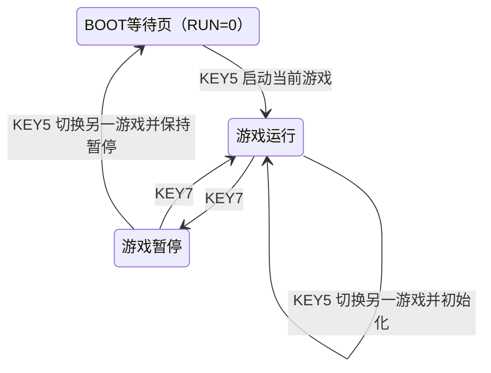

# M20 V3-F06阶段验收报告：FPGA启动页与游戏按键交互

> 状态：用户确认通过。本报告限定为FUNCTIONAL_STORAGE FPGA原型的启动与按键交互，不将该确认扩展为543颗实体157时序验收或V3全部项目最终冻结。

|项目|内容|
|---|---|
|测试日期 / 时区|2026-11-04，Asia/Shanghai|
|板卡 / 镜像|SwCell K325T，XC7K325T-2FFG900C；M20V3F06；PCB修订未记录|
|本阶段目标|KEY5统一承担启动页进入和游戏选择，KEY7用于游戏暂停/继续|
|验收依据|XSIM板级测试、实现/STA、JTAG及UART证据；用户答复“已经完全正常了”|
|结论|F06启动及按键交互通过；保留原版及中间版本证据，不创建新Tag|

## 1. 测试内容与方法

CPU使用冻结477个组合MUX网络及33个FPGA原生状态FF，执行Pong与独立乱序食物Snake软件。FPGA提供同步ROM/RAM、按键前端及只读OLED显示，游戏计算仍由CPU完成。

F05问题先通过只读UART复现：`frame_valid=0`、`run=0`、PC0/FETCH，此时显示“M20 CPU BOOT”，并非另一个菜单。用户补充确认所指为本次JTAG下载后或切换游戏后的页面，不是断电重启。

F06复用现有快照有效状态判断：无游戏快照时KEY5恢复当前ROM执行，不改变游戏选择；KEY7不作为启动入口。已有游戏快照时，KEY5切换另一ROM并复位，KEY7暂停/继续。按键经过同步、消抖和事件前端，测试平台从实体端口注入低电平，并用独立SPI接收模型检查显示RAM。实际板卡下载后，由用户操作确认。

## 2. 实际参数与频率

|参数|值|依据 / 口径|
|---|---|---|
|FPGA与用户IO|XC7K325T-2FFG900C，LVCMOS33|用户提供型号/3.3V配置；本次无外部电压/温度测量|
|FPGA系统时钟|50MHz，20ns，D27|板卡配置、XDC及STA；唯一内部时钟域|
|CPU主动微周期|默认1MHz，1µs|50系统周期调度；使用CE，不新建Fabric时钟|
|指令执行|普通指令2微周期，RAM指令5微周期|冻结执行契约；暂停、快照及游戏节奏等待另计|
|Pong / Snake节奏|10 / 5 tick/s|配置目标；每tick完整CPU执行后更新，不等同于指令速率|
|按键同步 / 消抖|两级 / 20ms|50MHz下1,000,000个稳定周期；不会保证任意短脉冲均有效|
|OLED|SSD1306，128×64，180°|沿用已验证引脚；内容更新约58Hz为RTL预算，不是面板扫描实测|
|SPI|10MHz，高40ns、低60ns|RTL及仿真推导；本阶段未增加逻辑分析仪测量|
|UART|115200、8N1，/dev/ttyUSB1|配置与实际解析；启动未识别行原样保留|
|软件|原Pong＋SNAKE-SHUFFLED-0.1|Snake占1295/4096个16位ROM字，完成断点313；本次不改软件|
|工具|Vivado/XSIM2026.1.1，Python3.12|已有构建及测试日志|

外接157 CPU的实体激励时钟不适用于本次FPGA原生FF交互测试；不能将1MHz主动微周期写成已经测得的实体157工作频率。

## 3. 逐项结果

|ID|测试项|规模 / 检查口径|结果|
|---|---|---|---|
|U01|完整Python回归|164项，含F06解析兼容；这是全工程测试数，不是164次启动|PASS|
|U02|BOOT与游戏板级仿真|暂停复位BOOT、KEY7不启动、KEY5进入当前ROM、切游戏、暂停/恢复、方向短按、UART单步等断言|PASS|
|U03|OLED实际SPI像素检查|2帧Pong＋1帧Snake＋1帧BOOT；检查KEY5: START提示|PASS|
|U04|UART仿真|5877字节，经原采集程序解析|PASS|
|U05|综合 / 布局布线 / STA|WNS+0.982ns、WHS+0.062ns、WPWS+9.232ns，DRC0|PASS|
|U06|结构 / 源文件 / 引脚|477逻辑LUT3、33CPU FF、1BUFG；22输入SHA及25引脚；除top/显示外20输入与F05一致|PASS|
|U07|JTAG / 实机UART|21:27:31下载成功；75条有效记录，错误/输入溢出0；1条未识别启动行保留|PASS|
|U08|人工实体交互|用户确认KEY5启动、切游戏及KEY7暂停/继续“已经完全正常了”；操作次数未记录|用户确认通过|

不同层级的检查数不能相加为单一覆盖率。75条UART主要保存启动后以及显式暂停/复位的等待页，没有记录到后续实体KEY5按下；人工确认作为独立验收证据记录，不回写原始采集文件。

本次总资源8774LUT（含4LUTRAM）、5986FF、4RAMB36＋1RAMB18、DSP0；这些包含FPGA显示/存储/调试外设，不是CPU的157器件数量。

## 4. 交互图及解读

图示为RTL/仿真验证并经用户确认的按键行为，不是传播延迟测量。默认配置后自动运行保持不变；若因暂停切换或暂停复位进入BOOT等待页，按KEY5进入，不再依赖KEY7。

## 5. 通过的意义及验证边界

启动入口与六键中的A键保持一致；游戏选择、暂停和B重启职责清楚，后续软件调试可以沿用当前板级输入链路。用户无需借助KEY7离开BOOT页。

本阶段不证明真实双MUX存储单元的电气时序。STRICT_MUX历史85项LUTLP-1及无下载结论保持；没有重新运行无修改CPU的87场景，也不以本次UI验收宣称所有V3验证范围正式冻结。乱序食物全部128位置的主要覆盖仍来自独立软件/RTL测试，不扩展成人工逐点验证。白底闪烁按用户要求延期，本阶段不处理。

## 6. 异常与排除记录

- 原F05现象的8条只读UART及哈希保留，不将其写成断电或Flash故障。
- `boot_entry_r1`保留FAIL：旧测试在Snake初始化尚无游戏快照时期待KEY7暂停，与新BOOT规则冲突；`r2`等待真实游戏快照后测试暂停，保留产品断言。
- 实机75条数据含显式UART空格＋r，以复现暂停/复位等待页；它不是75次成功启动，也不替代用户实体操作确认。
- F05互换、F04短按缓存及原版镜像保留；本次未写Flash、未commit/Tag或进行远程Git操作。

## 7. 证据与复现

|证据|路径 / 标识|
|---|---|
|正式用户确认|[独立确认记录](../m20/v3_resources/f06_user_acceptance.json)|
|实现/定位与下载命令|[F06技术报告](../m20/M20_V3_BOOT_ENTRY_F06.md)|
|板级顶层|[swcell_m20_v3_top.sv](../../fpga/projects/m20/cpu_validation/rtl/swcell_m20_v3_top.sv)|
|测试平台|[tb_m20_v3_board.sv](../../sim/m20_v3/tb_m20_v3_board.sv)|
|原始构建 / 仿真|build/fpga/m20/cpu_validation/snake_shuffled_boot_r1/；build/sim/m20_v3/boot_entry_r2/|
|实机原始记录|results/M20_V3/20261104_212750_boot_entry_f06/|
|小型摘要 / 哈希|[构建](../m20/v3_resources/f06_build.json)、[UART](../m20/v3_resources/f06_capture_summary.json)、[逐文件哈希](../m20/v3_resources/f06_evidence_sha256.csv)|
|实际镜像|build/fpga/m20/cpu_validation/snake_shuffled_boot_r1/swcell_m20_v3_top.bit|
|bit SHA256|972d8ebc5378c244ce5f530be9c8f0b0c9b04853c6c56576c82f96e995d79c49|
|raw SHA256|0b89238f60ea046d27febdc2baae0336523ec5c70f777a5b8f34b699a1801f63|

重新构建/采集须选新输出目录；下载使用上列镜像和现有JTAG脚本。原始results/build仍被Git忽略，交接或归档时须单独备份，不以报告替代原始证据。
