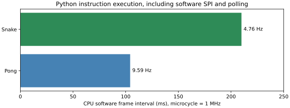
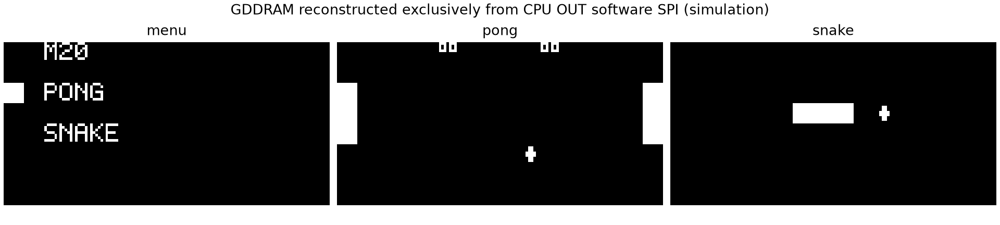

# M20 V3.1 阶段验收报告：CPU自主软件系统

> 状态：**用户正式确认通过，限 FUNCTIONAL_STORAGE FPGA 功能原型。** 2026-11-05，Asia/Shanghai。最终验收固件为 **M20-V31-0.2**，已修复Pong A重开球拍消失及球/食物图案问题。

|项目|内容|
|---|---|
|DUT / 板卡|XC7K325T-2FFG900C；SwCell PCB修订未记录；SSD1306 128×64 SPI OLED|
|CPU基线|冻结ISA v0.1；477组合MUX、33bit状态；FPGA中使用33原生FF，实体157等价预算仍543颗|
|目标|CPU自主启动、六键处理、菜单、Pong/Snake、帧节奏、绘图与SSD1306软件SPI|
|验收依据|自动仿真、路由后报告、JTAG/UART、初始基本功能确认及修正版两项实机确认|
|结果|181 Python通过；2589535条新系统指令对照一致；最终45条新固件UART错误0；用户确认重开球拍与两处加号正常|

## 1. 测试内容与方法

CPU使用一个统一ROM，自行处理六键、选择应用、计算游戏、生成图形，并通过OUT产生CS、D/C、SCK、MOSI。FPGA提供微周期调度、同步ROM/RAM、输入2FF、OLED上电复位及调试。正式路径中没有FPGA游戏选择、固定PC帧边界、游戏RAM渲染、按键事件FIFO或硬件SPI。

联合Testbench实例化真实板级top、同步存储、477-MUX CPU和独立OLED接收器；每个CPU提交边界与V1行为RTL比较，每条退役与Python比较，最后核对全部256个RAM nibble。SPI字节只能来自CPU OUT，路由审计确认四个OLED输出的唯一驱动都是CPU GPO寄存器。

用户最初确认菜单/两游戏、长按返回、KEY7暂停及RST_N复位正常，随后发现两处显示问题。旧r5失败已复现：清屏后球拍位置缓存未失效，导致静止球拍被跳过；PIX6重复8列0x66则产生横条。固件0.2每次启动Pong使球拍缓存无效，强制重画，并逐列生成加号。新增连续两次真实A按下/释放及像素比较，再仿真、实现、下载并请用户重验收。

修正版用户原话为“重开后两边球拍均正常”“两处均已显示为加号”。人工操作次数和持续时间未记录，不将回复扩展为穷举或长期可靠性验证。

## 2. 实际参数与频率

|参数|实际值|来源/口径|
|---|---|---|
|电压、环境|IO按3.3V配置；温度及供电实测未记录|板卡设定，不是本轮仪器测量|
|FPGA系统时钟|50MHz，20ns|板卡配置及XDC，唯一时钟域|
|CPU微周期|1MHz，1μs|50系统拍/CE，无Fabric派生时钟|
|指令成本|普通2、RAM5微周期|V1-TIMING-0.1保持，非每微周期一条指令|
|服务时序|phase4 RAM请求、21唯一写提交、25 CPU提交、28 ROM请求|19预捕获；同步存储后续系统拍返回，含握手开销|
|输入同步与消抖|六GPI仅极性转换及2FF；CPU软件3个连续一致样本|轮询间隔随路径变化，不等于固定20ms滤波|
|OLED软件SPI|同字节上升沿间隔54～89μs；高4μs；最小MOSI建立4μs|真实指令轨迹/仿真；活动速率约11.2～18.5kbit/s，字节间另有调用开销，非板外测量|
|Pong内容更新|104.227～104.316ms，约9.59Hz|6次正常样本，含计算、绘图、轮询与软件延时|
|Snake内容更新|209.884～209.978ms，约4.76Hz|4次正常样本，同上；不是OLED内部扫描率|
|软件启动|1505807微周期，约1.506秒到完整菜单|另加FPGA POR及OLED复位等待|
|组合长按返回|模型3.357952秒|用户确认功能正常，未仪器计时|
|ROM / RAM|4052/4096个16bit字，剩44字；RAM剩10nibble|总RAM256×4bit，不能存1024Byte framebuffer|
|图形、序列|180°方向；局部绘图；Snake固定128位置乱序表|由CPU执行，占用时跳下一项，不是真随机；球/食物加号列为00/00/18/7E/7E/18/00/00|
|通信与工具|UART115200/8N1；Vivado/XSIM2026.1.1、Python3.12|UART、CPU微周期和OLED SPI分别统计|

KEY2/KEY0/KEY3/KEY1对应上/下/左/右，KEY5=A、KEY6=B；Pong中的左右方向位控制右球拍上下。KEY4禁用，KEY7仅调试暂停，RST_N复位CPU。A在菜单进入游戏、游戏中重开，B返回菜单；上下长按也返回菜单。OLED硬件上电复位与CPU系统复位分离。软件SPI不是V3的10MHz硬件SPI。

## 3. 逐项结果

|ID|条件与检查|规模|错误/分类|结果|
|---|---|---|---|---|
|SW01|完整Python套件|181项|失败0|PASS|
|RTL01|原CPU基线，源码未变|49指令＋38游戏场景，57331事件|差分错误0；沿用本轮前段实际回归|PASS|
|RTL02|原非法/数学/访存专项|50521非法及恢复、27840数学向量、7访存专项|错误0；未重复计入新联合量|PASS|
|RTL03|新ROM/真实CPU/同步BRAM/V1/Python|2589535退役、373773次RAM写、最终256nibble|差分错误0|PASS|
|IO01|GPIO及存储/控制平台，RTL未变|6路单拍输入、16组GPO；单次写/cancel/STOP/STEP/HALT/TRAP/RESET|断言失败0|PASS|
|OLED01|软件SPI协议、图形来源与清屏|9566字节，独立接收模型及像素检查|协议断言失败0|PASS|
|FIX01|连续A按下/释放重开Pong|仿真2次；左右球拍与球像素|错误0|PASS|
|FIX02|加号图案|Pong球、Snake食物逐列检查|错误0|PASS|
|SW02|原/迁移程序与独立规则|177 Pong＋315 Snake|Python规则差分0，不冒充492场景都在新RTL上执行|PASS|
|FPGA01|综合/实现/STA/DRC/CDC|WNS+1.972/WHS+0.092/WPWS+9.600ns；DRC0，9条2FF Info|无时序负裕量或DRC违规|PASS|
|FPGA02|路由结构及无OLED旁路|477MUX、33CPU FF、4GPO直接驱动、1BUFG|数量/驱动不符0|PASS|
|HW01|最终镜像JTAG及UART|12:31:13 startup HIGH，45完整新固件记录|CPU错误0；起始残行1条另计|PASS|
|HW02|UART STOP/STEP/RESET/RUN|原r5平台7条状态，平台RTL本次未变|STEP+1微周期、复位GPO8、停止无新写；非重做一次实机测试|PASS|
|UI01|菜单/两游戏、长按、暂停及复位|初始2项用户回复，动作次数未记录|基本功能正常；两处后报缺陷单独修复|用户确认|
|UI02|最终修正版重开及加号|新2项用户回复，动作次数未记录|两边球拍、两处加号均正常|用户确认PASS|

检查量来自不同层次，不能相加为“总覆盖率”；多字段比较仍是一条退役。仿真UART另有351条完整JSON和1条结束截断末行，末行保留警告，未算完整消息。

整个平台750 LUT、984 FF、2 RAMB36、1 RAMB18、0 DSP。CPU265个物理LUT位置含小LUT打包，不等于265颗157；预算仍477组合＋66存储等价＝543。

## 4. 图表及解读

单位ms，数据来自固件0.2实际Python指令执行成本，假定微周期1MHz。是当前内容更新样本，不是器件最高频率或实测OLED扫描率。

图是外部SPI模型仅从OUT重建的GDDRAM，不是实机照片或FPGA framebuffer。Pong画面来自重复A重开后，左右球拍仍可见，球和食物为加号；实机结论另由用户确认。

## 5. 通过的意义及验证边界

在冻结4-bit ISA、4096字ROM和256nibble RAM内，CPU能自主运行应用和外设驱动，不再依赖FPGA游戏渲染及固定PC帧调度。新游戏原则上只修改软件，但当前ROM仅剩44字，不能承诺直接装入第三款游戏。

通过范围仅为FUNCTIONAL_STORAGE FPGA功能原型。33原生FF不证明真实双MUX DFF时序；STRICT_MUX、真实NC7SZ157最小延迟、外部发生器、PCB、电气、温压及长期可靠性均未因此验收。未增加或实测ILA core，采用UART辅助；未写Flash。

软件帧间隔随分支和绘图量变化，最长轮询空隙约58.523ms；3样本消抖不能保证所有短按都识别。比分采用紧凑十六进制字形并局部覆盖Pong顶行，未使用整屏framebuffer。用户确认不取消这些容量、性能和布局限制。

## 6. 异常与排除记录

- 初始r5的两处问题及反例保留在v31_initial_r5_resources和build/m20_v31/pre_fix_20261105，不将旧失败改写PASS。
- 首个加号实现比较方向错误，被新增像素断言和181测试中的2项失败拦截；修正后全部通过，错误版本未下载。
- 首个修复构建因ROM在运行时改变，被SOURCE_CHANGED_DURING_BUILD保护拒绝，没有生成可下载bit；输入锁定的新r2构建成功。
- 初始r5采集143条新协议及8条旧协议/前缀，属于旧版本记录，不充当最终0.2硬件证据。新采集45条有效记录，起始1条残行原样保留。
- TB超时常量、漏端口及同步器筛选等更早失败保留原位；未关闭产品断言或更换期望来通过。
- 人工回复单独存JSON，不回写原始日志中的按键轨迹、未测字段或历史SHA。

## 7. 证据与复现

|证据|路径/标识|
|---|---|
|最终人工确认|[user_acceptance_restart_plus_20261105.json](../m20/v31_resources/user_acceptance_restart_plus_20261105.json)|
|当前验证与验收摘要|[checks.json](../m20/v31_resources/checks.json)、[acceptance_summary.json](../m20/v31_resources/acceptance_summary.json)|
|旧失败反例|[restart_and_glyph_counterexample.json](../m20/v31_initial_r5_resources/restart_and_glyph_counterexample.json)|
|源清单、原基线保护|[source_manifest.json](../m20/v31_resources/source_manifest.json)、[baseline_sha256.json](../m20/v31_resources/baseline_sha256.json)|
|原始证据索引|[evidence_sha256.csv](../m20/v31_resources/evidence_sha256.csv)|
|实际bit|build/fpga/m20/autonomous/restart_plus_r2/swcell_m20_v31_top.bit|
|bit SHA256|181fb8844407a69f405594440245dc5ed1e50a24e81e103d194aa531835cfd0f|
|ROM SHA256|ae5be5055052c8ea9c8a5e4d00de5dcaf2dfe531e84a57fb9dec0b4feef71619|
|最终UART原始文件|results/M20_V31/20261105_restart_plus_r2/raw.jsonl|
|最终raw SHA256|031f17fb6676515a21744ba1c151570adf97a71c1dd2310d5b5abcfb15e99834|

构建、仿真、下载和采集命令见[独立工程](../../fpga/projects/m20/autonomous/README.md)、[验证方法](../m20/M20_V31_VERIFICATION.md)和[性能/图表](../m20/M20_V31_SOFTWARE_PERFORMANCE.md)。输出使用新目录；原始build/results需要独立备份。

功能任务COMPLETED。验收记录落盘时尚未创建V3.1 commit/Tag或推送；用户随后授权定版，实际Git与Release结果见[定版报告](../m20/M20_V31_LOCAL_GIT_REPORT.md)。冻结ISA/CPU和原V3 Tag不改。
