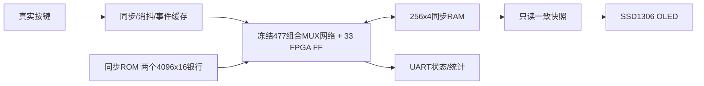

# M20 V3阶段验收报告：结构级CPU FPGA实机Pong/Snake

> 状态：用户在本次GitHub发布任务中明确确认V3 FPGA实机验证已完成。验收模式为 **FUNCTIONAL_STORAGE：477组合MUX＋33原生FF**；STRICT_MUX未放行，不代表实体66颗存储MUX时序验证。

|项目|内容|
|---|---|
|日期 / 时区|2026-11-04，Asia/Shanghai|
|平台|SwCell K325T，XC7K325T-2FFG900C；PCB修订未记录|
|目标|由冻结结构CPU实际执行Pong/Snake机器码，验证FPGA同步存储、真实按键与OLED链路|
|最终配置|M20V3F06；原Pong＋SNAKE-SHUFFLED-0.1，KEY5进入/切游戏、KEY7暂停、KEY6/B重启|
|人工确认|用户分别确认游戏/键位/减速/短按改善/F06入口，最新任务明确声明两游戏实机测试通过|
|结论|本阶段功能原型验收通过；无实体157时序、Flash启动或全条件可靠性签核|

## 1. 测试内容与方法

V3生成器从冻结V2.1网表逐连接保留477个组合MUX，CPU状态33位；FPGA将组合MUX映射至可追溯LUT3，以原生FF承载存储。FPGA仅承担ROM/RAM、输入事件缓存、服务调度和只读显示；移动、碰撞、得分、食物选点均由CPU机器码执行。

原49指令＋38游戏场景对照V1/Python；同步存储系统另比较F/严格反馈数字模型的提交状态、每tick完整256nibble RAM。板级测试从实际引脚输入低电平并解码SPI与UART。最后通过JTAG下载、只读UART及用户实际游戏操作确认硬件链路。

## 2. 实际参数与频率

|参数|最终值|来源 / 边界|
|---|---|---|
|FPGA / IO|xc7k325tffg900-2，LVCMOS33|用户提供、Tcl/XDC；电压/温度未新增仪器测量|
|系统时钟|50MHz，20ns，D27|板卡配置/STA，单时钟域|
|CPU主动微周期|默认1MHz，1µs|50系统周期CE调度；不是外接157时钟实测|
|指令成本|普通2、RAM5微周期|冻结V1执行契约；暂停/快照/节奏等待另计|
|游戏节奏|Pong10、Snake5 tick/s|最终配置；原F02 30/10是旧配置，未倒填|
|同步 / 消抖|2级 / 20ms|8项方向FIFO及动作sticky由真实IN退役消费，溢出上报|
|OLED / SPI|SSD1306，128×64，180°；SPI10MHz|高40ns/低60ns；内容约58Hz为RTL推导，不是面板内部扫描实测|
|UART|115200、8N1|/dev/ttyUSB1；64位运行/错误计数及完整RAM快照|
|软件ROM|Pong168字；原Snake368字，乱序版1295字|每银行4096×16；乱序表128格循环、跳过身体，非真随机|
|工具|Vivado/XSIM2026.1.1，Python3.12|当前实机实现版本；M11保留2022.1历史，未重跑其硬件|

## 3. 逐项结果

|ID|范围|规模 / 结果|证据|
|---|---|---|---|
|V3-01|原核心差分|49指令＋38游戏＝87场景、57331事件一致|simulation/core下比较JSON|
|V3-02|ISA/算术/边界/访存|65536编码分类、27840算术、50521非法TRAP及恢复、7访存专项通过|core实际XSIM日志|
|V3-03|新同步存储与控制|40398次F/S数字提交、129帧；两游戏各64tick×256单元RAM一致；STOP/STEP/RESET/改速通过|system_r11原日志/独立frame oracle|
|V3-04|独立乱序软件|315场景、154611事件；全部128表索引/回绕、占用跳过与异常位图处理通过|shuffled_r1比较JSON|
|V3-05|最终板级F06|2Pong＋1Snake＋1BOOT帧SPI像素；5877 UART字节；6键/启动/切换/暂停/短按通过|boot_entry_r2|
|V3-06|Python|164项全部通过|python_164.txt|
|V3-07|最终实现|WNS+0.982ns、WHS+0.062ns、WPWS+9.232ns，DRC0；477逻辑MUX/33CPU FF/1BUFG|fpga_f06报告|
|V3-08|原游戏实机只读对照|Pong58份完整RAM至1715tick一致；原Snake131tick/12份完整RAM一致|原始采集及hardware_*摘要|
|V3-09|ISA有限实机诊断|71向量，1081退役、3111含启动微周期、278写，完整RAM/寄存器一致；非法0010硬件TRAP通过|单独诊断目录，非游戏|
|V3-10|乱序版实机对照|66tick、12份完整RAM一致，错误0；不是板上遍历128食物|20261104_201445_snake_shuffled|
|V3-11|最终F06实机/操作|JTAG成功；75有效UART/1未识别启动行，错误/溢出0；KEY5入口及按键用户确认正常|最终UART＋独立人工确认|

不同层级、不同版本计数不求总和；有限快照不是每条实机指令全轨迹。原始错误/启动行保留；人工确认与自动采集状态分开存储。

最终总资源8774LUT（含4LUTRAM）、5986FF、4RAMB36＋1RAMB18、DSP0，包含显示/存储/通信外设。CPU物理LUT位置不是157数量；真实逻辑预算仍477＋66＝543，另加V2.4 20-MUX前馈发生器为563（不含Buffer）。该外部前馈链未作为FPGA时钟网实现。

## 4. 架构图及解读

这是功能数据流，不是实体157布线/延迟图。显示只读，不能反向更新游戏RAM。

## 5. 通过意义与边界

证明ISA软件、结构组合CPU、同步存储服务与真实外设可以连成可操作的FPGA游戏系统；生成器、ROM、构建及回归入口可纳管恢复。

STRICT_MUX实际布局布线保留543逻辑MUX，但85项LUTLP-1、WNS−22.002ns，未生成或下载bit；原强制初始化严格套件失败亦保留。原生FF功能通过不能关闭实体双MUX DFF、时钟分配/最小死区、电源/PCB及器件最小延迟开放项。没有Flash固化、温压/长期测试或全部合法编码硬件穷举。M0～M19未找到的模块不得推定已实现。

## 6. 异常与排除

- 初次F模式外设计时器运行时除法WNS−7.059ns，未下载；修正为编译期常量后通过，原失败路径实际为build/fpga/m20/cpu_validation/FUNCTIONAL_STORAGE。
- F05暂停后复位/切换无画面仍需KEY7恢复；F06统一KEY5入口，保留F05原始记录。boot_entry_r1旧测试调度失败保留，r2按真实游戏快照测试。
- Pong固定发球造成同侧连续失分的轨迹已通过4608软件tick独立核对，不擅改原程序。Snake顺序食物另建软件变体，原版保留。
- 白底闪烁用户要求暂不处理；本阶段正常黑底游戏与引脚功能通过不等于显示供电诊断完成。

## 7. 证据、版本与复现

[精选原样证据](../evidence/m20_v3/README.md)含74文件/2340847字节，逐份与本机来源SHA一致；原build/results不搬动。完整来源见[manifest](../evidence/m20_v3/manifest.json)，大波形/bit/DCP不上传。

|标识|值|
|---|---|
|最终bit|build/fpga/m20/cpu_validation/snake_shuffled_boot_r1/swcell_m20_v3_top.bit|
|bit SHA256|972d8ebc5378c244ce5f530be9c8f0b0c9b04853c6c56576c82f96e995d79c49|
|最终raw SHA256|0b89238f60ea046d27febdc2baae0336523ec5c70f777a5b8f34b699a1801f63|
|乱序ROM SHA256|61edcb52673fd09abe265e43b27eeb073528665adfed5fcf534eaf267164738f|
|人工F06确认|[独立记录](../m20/v3_resources/f06_user_acceptance.json)|
|构建/操作|[V3工程](../../fpga/projects/m20/cpu_validation/README.md)|
|版本边界|[阶段历史](../m20/M20_RELEASE_HISTORY.md)、[最终技术报告](../m20/M20_V3_TEST_REPORT.md)|

本报告来源于已有实际验证及用户本次整体确认，不新增实物测试。V3正式Tag只有在本次本地纳管及干净恢复检查完成后建立；Tag的真实commit由发布报告记录，不预填尚不存在的SHA。
